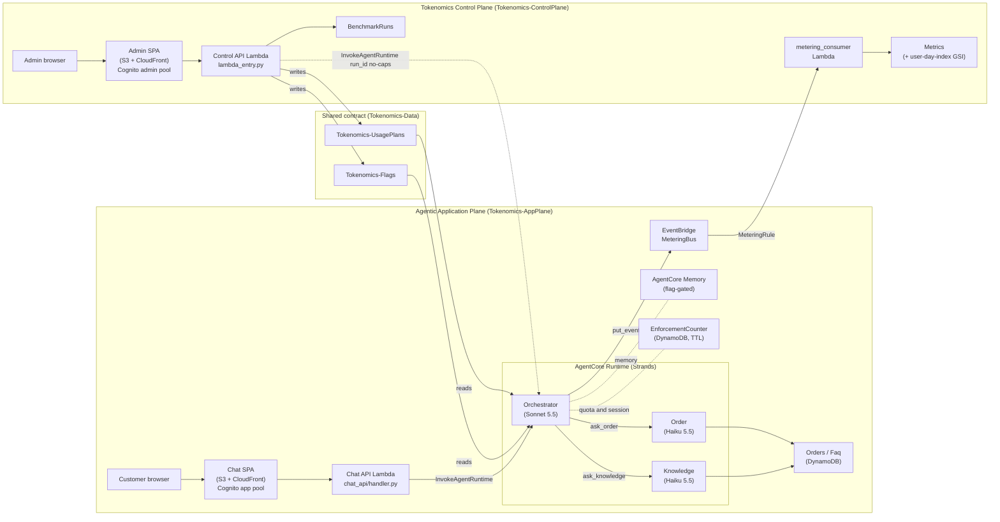
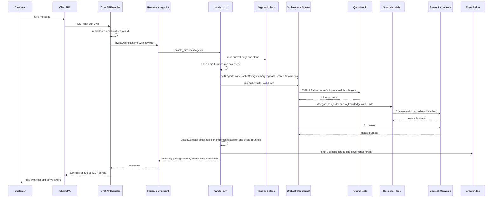
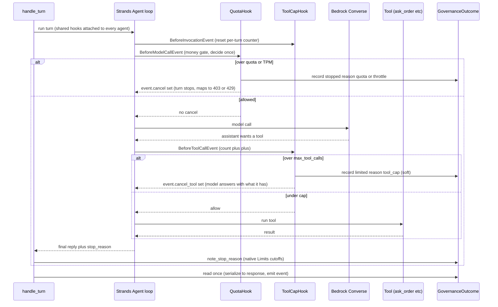
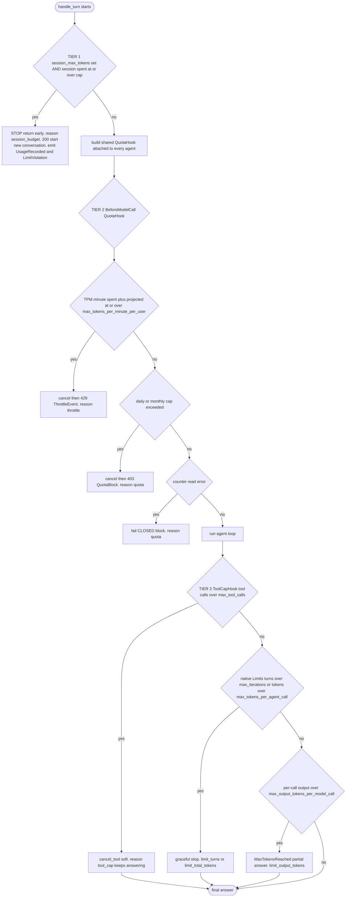
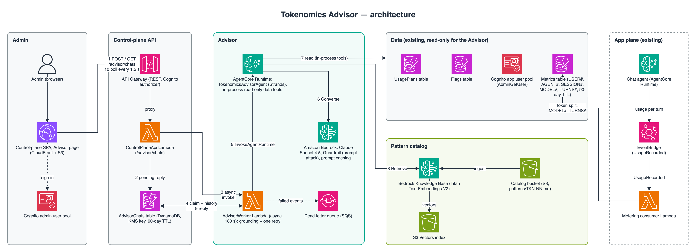
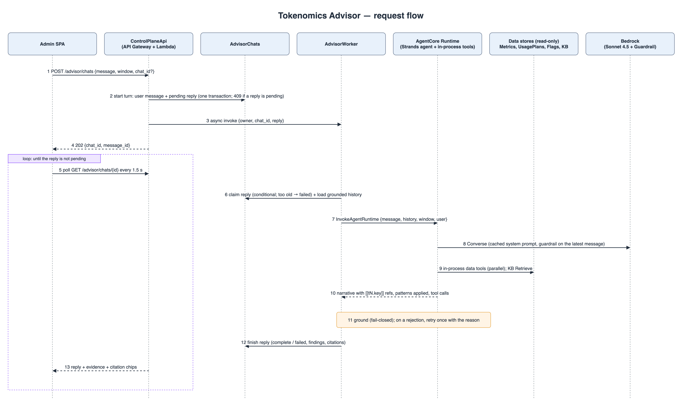
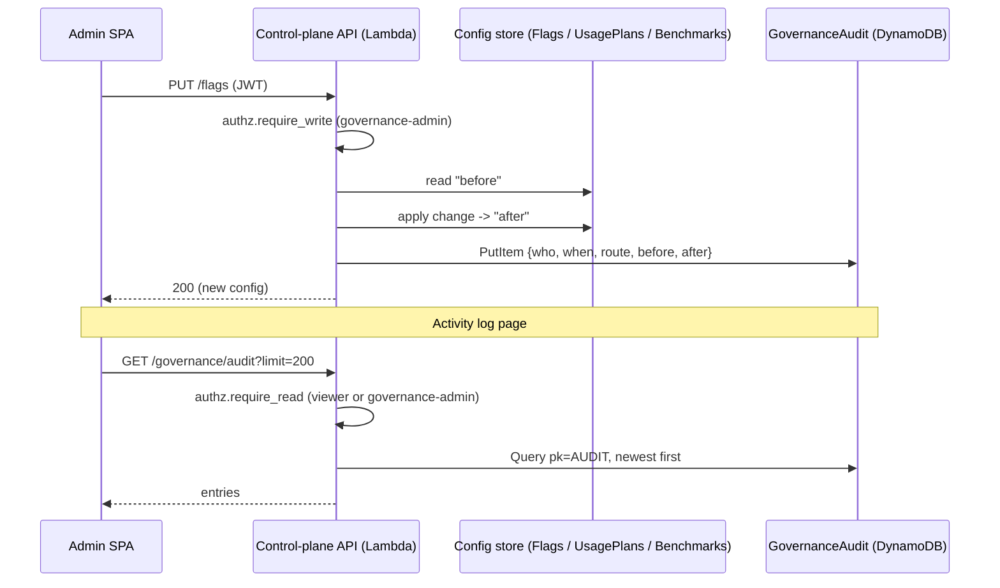
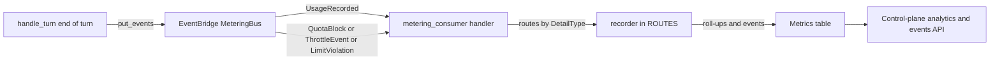

## Table of contents

1. [Overview](#1-overview)
2. [High-level architecture](#2-high-level-architecture)
3. [Application plane](#3-application-plane)
   - [3.1 Use-case overview](#31-use-case-overview)
   - [3.2 Agentic flow — one turn end to end](#32-agentic-flow--one-turn-end-to-end)
   - [3.3 Front-end (chat SPA)](#33-front-end-chat-spa)
   - [3.4 Strands hooks: the flag and governance seam](#34-strands-hooks-the-flag-and-governance-seam)
   - [3.5 Features: AgentCore, Memory, Strands Agents](#35-features-agentcore-memory-strands-agents)
   - [3.6 Tokenomics design patterns](#36-tokenomics-design-patterns)
   - [3.7 User management](#37-user-management)
4. [Tokenomics control plane](#4-tokenomics-control-plane)
   - [4.1 Metering pipeline](#41-metering-pipeline)
   - [4.2 Analytics](#42-analytics)
   - [4.3 Feature flags](#43-feature-flags)
   - [4.4 Benchmarking](#44-benchmarking)
   - [4.5 Token governance](#45-token-governance)
   - [4.6 Front-end (admin SPA)](#46-front-end-admin-spa)
   - [4.7 Control-plane API model](#47-control-plane-api-model)
   - [4.8 Advisor](#48-advisor)
   - [4.9 User management](#49-user-management)
   - [4.10 Activity log](#410-activity-log)
5. [Cross-plane integration](#5-cross-plane-integration)
   - [5.1 The shared config contract (sync)](#51-the-shared-config-contract-sync)
   - [5.2 The EventBridge contract (async)](#52-the-eventbridge-contract-async)
6. [Observability & troubleshooting](#6-observability--troubleshooting)
   - [6.1 Where the signals live](#61-where-the-signals-live)
   - [6.2 Troubleshooting guide](#62-troubleshooting-guide)
7. [Extending the framework](#7-extending-the-framework)
   - [7.1 Add a feature flag](#71-add-a-feature-flag)
   - [7.2 Add a governance hook](#72-add-a-governance-hook)
   - [7.3 Add a specialist agent](#73-add-a-specialist-agent)
8. [Testing](#8-testing)
   - [8.1 Unit tests (fast, offline — default)](#81-unit-tests-fast-offline--default)
   - [8.2 Live governance suite (opt-in — hits the deployed stack)](#82-live-governance-suite-opt-in--hits-the-deployed-stack)
9. [Local development](#9-local-development)

---

## 1. Overview

The **Agent Tokenomics Framework** is an AWS reference solution for a problem that shows up
the moment an agentic application leaves the prototype stage: **tokens cost money, and
multi-agent systems spend them fast.** A single customer turn can fan out across an
orchestrator and several specialists, each making multiple model calls, each call billing
input, output, and cache tokens at different per-model rates. Without instrumentation you
cannot answer three operational questions:

- **What should we optimize?** Where is the spend actually going — which agent, which user,
  which model?
- **How do we keep it in limits?** How do we stop a runaway conversation or an abusive user
  from blowing the budget, without redeploying the agent?
- **How do we know an optimization worked?** When we flip on prompt caching, how much did it
  actually save on an identical workload?

The framework answers all three with a **two-plane** design:

- An **Agentic Application Plane** — a working multi-agent customer-support app (a Strands
  orchestrator plus two specialists) running on Amazon Bedrock AgentCore Runtime. Every turn
  is metered, cost-attributed, and governed **in-loop**.
- A **Tokenomics Control Plane** — an admin app for analytics, feature flags, benchmarking,
  and token governance. Operators flip levers and set limits here; the agent picks them up on
  the next turn with **no redeploy**.

Two principles run through the codebase and are worth internalizing before you read on:

- **Reuse, never duplicate.** The solution leans on what the SDK already ships (Bedrock
  Converse prompt caching, Strands `Limits`, AgentCore Memory) rather than hand-rolling
  equivalents. See `tokenomics/factory.py` for the clearest statement of this.
- **Ship all code, gate on flags.** Every lever (prompt caching, memory) is baked into the
  agent and defaults OFF. The control plane flips a DynamoDB flag; the agent reads it. There
  is no feature branch and no stack change to turn a lever on.

Who it is for: teams building agentic applications on AWS who need a concrete, inspectable
pattern for cost attribution, governance, and before/after optimization — not a slide, a
running system you can deploy and extend.

---

## 2. High-level architecture

The system is **two independent planes joined by one small, explicit contract.** Each plane
owns its own data and deploys on its own; the only coupling is a pair of fixed-named,
shared DynamoDB config tables and a one-directional telemetry stream.

### The three CDK stacks

From `infra/app.py` — this is the whole stack graph and deploy order:

`infra/app.py`
```python
data = DataStack(app, "Tokenomics-Data", env=env)
app_plane = AppPlaneStack(app, "Tokenomics-AppPlane", data=data, env=env)
ControlPlaneStack(app, "Tokenomics-ControlPlane", data=data, app=app_plane, env=env)
```

- **`DataStack`** — only what *both* planes share: two config tables (below).
- **`AppPlaneStack`** — Cognito pool, the AgentCore Runtime (image built in-stack), Orders /
  Faq / EnforcementCounter tables, AgentCore Memory, the metering EventBridge bus, the Chat
  API Lambda, and the chat UI hosting.
- **`ControlPlaneStack`** — admin Cognito pool, the admin API Lambda, BenchmarkRuns +
  Metrics tables, the metering-consumer Lambda + EventBridge rule, and the admin UI hosting.

The deploy order is enforced by CDK, because the control plane takes a **cross-stack
reference** to the app-plane runtime ARN:

`infra/stacks/control_plane_stack.py`
```python
# The agent runtime ARN comes straight from the AppPlane stack (cross-
# stack reference), so no manual ARN hand-off is needed.
agent_runtime_arn = app.runtime.agent_runtime_arn
```

So you always deploy **app plane → control plane**.

### The shared contract

The only data coupling between planes is two fixed-named tables in `DataStack`. Fixed names
matter: both planes resolve them by name, and the seed script writes them by name.

`infra/stacks/data_stack.py`
```python
self.flags_table = dynamodb.Table(
    self, "Flags",
    table_name="Tokenomics-Flags",  # fixed: shared + cross-stack exported
    partition_key=dynamodb.Attribute(name="feature", type=dynamodb.AttributeType.STRING),
    billing_mode=dynamodb.BillingMode.PAY_PER_REQUEST,
    removal_policy=RemovalPolicy.DESTROY,
)
# ...
self.usage_plans_table = dynamodb.Table(
    self, "UsagePlans",
    table_name="Tokenomics-UsagePlans",  # fixed: shared + cross-stack + seeded by name
    partition_key=dynamodb.Attribute(name="plan_id", type=dynamodb.AttributeType.STRING),
    billing_mode=dynamodb.BillingMode.PAY_PER_REQUEST,
    removal_policy=RemovalPolicy.DESTROY,
)
```

- **`Tokenomics-Flags`** — control plane *writes*, agent *reads*. One item per feature. Drives
  the prompt-cache and memory levers.
- **`Tokenomics-UsagePlans`** — control plane *writes*, agent *reads*. One item per `plan_id`
  (`agent#<name>`, `user#default`). Drives all in-loop governance caps + the per-user quota.

> **Code vs. older docs:** some architecture notes describe Flags as "the only data
> coupling." As-built there are **two** shared config tables (Flags + UsagePlans). Trust the
> code.

Telemetry flows the *other* way and never couples the agent to the control plane: the agent
publishes `UsageRecorded` (and typed governance) events to an **EventBridge** bus and forgets
about them. An EventBridge rule in the control plane fans them into the metering consumer.

### Mermaid #1 — Two-plane architecture



---

## 3. Application plane

### 3.1 Use-case overview

The demo workload is an **e-commerce customer-support assistant**. It was chosen because it
naturally exercises a multi-agent shape — some requests are general policy ("what's your
return policy?"), some are account-specific ("where is my order?"), and some are both — so
cost attribution across agents is meaningful rather than contrived.

There are two audiences:

| Audience | App | Auth (separate Cognito pools, self-signup OFF) |
| --- | --- | --- |
| Customers | Chat SPA (app plane) | `Tokenomics-app-plane` |
| Operators / admins | Admin SPA (control plane) | `Tokenomics-control-plane` |

Identity is always the **verified Cognito `sub`** from the JWT — never client-supplied data.
Orders are keyed by `sub`. Benchmark traffic uses *synthetic* identities and is kept strictly
separate from live analytics (see §4.2 and §4.4), so load tests never pollute real cost data
or trip a real user's quota.

### 3.2 Agentic flow — one turn end to end

A turn starts at the chat SPA and ends with a reply plus a full tokenomics telemetry block.
The spine is `handle_turn()` in `agents/orchestrator/agent.py`; the HTTP edge is
`chat_api/handler.py`; the runtime edge is `entrypoint.py`.

**Edge 1 — the Chat API** reads identity from verified claims (not the body), builds a stable
AgentCore session id, and proxies to the runtime:

`src/app-plane/chat_api/handler.py`
```python
def _session_id(user_id: str, conversation_id: str) -> str:
    """Stable AgentCore runtimeSessionId for this user's conversation.

    Same user + same conversation -> same session (turns grouped, prompt-cache
    reuse). AgentCore requires 33-128 chars; we sanitize and pad.
    """
    raw = f"{user_id}-{conversation_id}"
    safe = re.sub(r"[^A-Za-z0-9_-]", "-", raw)
    if len(safe) < 33:
        safe = f"{safe}-{uuid.uuid4().hex}"
    return safe[:128]
```

A static SPA cannot safely hold AWS credentials to call `InvokeAgentRuntime`, so this
app-plane Lambda invokes the runtime on the SPA's behalf and maps governance outcomes to HTTP
status (403 quota / 429 throttle — see §4.5).

**Edge 2 — the runtime entrypoint** verifies the caller, builds the `RunContext` and
optionally pins a flag / usage-plans config. It trusts no caller-asserted identity (threat
model M8, `src/app-plane/tokenomics/caller_auth.py`): customer turns carry the user's Cognito
id token, which the runtime re-verifies and takes `user_id` + profile from; benchmark turns
carry a KMS HMAC (`src/shared/caller_mac.py`) that only the benchmark worker can produce, and
only those may pin flags / usage plans, as synthetic `bench-*` users:

`src/app-plane/entrypoint.py`
```python
@app.entrypoint
def invoke(payload: dict) -> dict:
    """Run one customer turn and return the reply plus tokenomics telemetry."""
    # ...
    caller = authenticate(payload)  # CallerAuthError -> "unauthorized"
    pinned = payload.get("flags") if caller.may_pin_config else None
    if pinned is not None:
        flags_mod.set_override(FlagConfig.from_dict(pinned))
    else:
        flags_mod.set_override(None)
    # ...
    ctx = RunContext(user_id=caller.user_id, profile=caller.profile,
                     run_id=payload.get("run_id"))
    if payload.get("session_id"):
        ctx.session_id = payload["session_id"]
    result = handle_turn(message, ctx)
```

**The spine — `handle_turn()`** reads the live flags + governance config, runs the three
enforcement tiers (detailed in §4.5), builds the agents through the flag-aware factory, runs
the orchestrator, collects cost, and emits metering. Delegation to specialists is **in-process
(agents-as-tools)**: the orchestrator simply calls `ask_knowledge` / `ask_order`, which are
closures over the specialist agents built for this turn.

`src/app-plane/delegation.py`
```python
@tool
def ask_order(task: str) -> str:
    """Ask the Order specialist about this customer's account or orders. ..."""
    result = order(task, **({"limits": order_limits} if order_limits else {}))
    collector.record_result(order_model_id, result, agent="order")
    _note(result, "order")
    return str(result)
```

Keeping the delegation seam narrow (only `ask_knowledge` / `ask_order`) is deliberate: it can
be promoted to A2A later — deploy each specialist as its own runtime and turn these closures
into remote calls — without touching the orchestrator prompt or logic.

The orchestrator's `system_prompt` is the largest, most stable string in the system
(`agents/orchestrator/prompts.py`), which is exactly what makes it the prompt-cache target
(§3.6). It never interpolates per-request data, so once cached it is reused across every
request in a session.

#### Mermaid #2 — Agentic-turn sequence



### 3.3 Front-end (chat SPA)

`web/app-plane/` is a React + Cloudscape SPA (Vite build). It logs in via Cognito (SRP), and
every request carries the Cognito id token. Build-time config is injected through `VITE_*`
variables by the deploy script (API base, user pool, client id, region).

The client knows how to render the tokenomics story the agent returns — the cost line and the
"active levers" indicator both come straight off the response:

`web/app-plane/src/api.ts`
```typescript
export interface ChatResult {
  reply: string;
  usage: Usage;
  /** Which tokenomics levers were active on this response, e.g.
   *  "prompt_cache=on+memory=on" | "baseline". From the agent's identity block. */
  flagConfig?: string;
  /** Enforcement outcome (in-loop caps). Present when governance is configured. */
  governance?: Governance;
}
```

It also translates the governance HTTP contract into typed errors the UI can present
gracefully (a friendly "limit reached" notice instead of a raw error):

`web/app-plane/src/api.ts`
```typescript
if (res.status === 403 && (data.error === "BUDGET_EXCEEDED" || data.limit_hit)) {
  throw new GovernanceBlockedError("quota", data.message || "You've reached your usage limit.");
}
if (res.status === 429) {
  const retryAfter = Number(data.retryAfter ?? res.headers.get("Retry-After") ?? 0) || undefined;
  throw new GovernanceBlockedError("throttle",
    data.message || "You're sending requests too fast. Please wait a moment.", { retryAfter });
}
```

### 3.4 Strands hooks: the flag and governance seam

This is the canonical reference for **how the framework uses Strands hooks**. Two distinct
mechanisms are at play, and it is worth keeping them separate in your head because they fire at
different times and are built differently:

1. **Feature flags are *not* hooks.** A flag like `prompt_cache` changes what the agent *is* —
   it is read once per turn and applied when the agent is **constructed** (the model gets a
   `CacheConfig`, or it doesn't). There is no runtime callback. Flags flip behavior in/out on
   the next turn, with no redeploy.
2. **Governance *is* hooks.** Per-user quota, the TPM throttle, and the per-turn tool-call cap
   are enforced by Strands `HookProvider`s that register callbacks on the agent event loop
   (`BeforeModelCallEvent`, `BeforeToolCallEvent`). They evaluate on **every** model/tool call,
   mid-loop, and can cancel the call.

Everything downstream (§3.5 Strands, §4.5 token governance) refers back to this section.

#### The flag seam — read once, apply at construction

The agent reads the shared Flags table through a short-TTL in-process cache, then the
**factory** decides what to build. Nothing about a flag is a callback — it is a plain branch at
build time. This is why a flag change "applies next turn": the next `handle_turn` rebuilds the
agents and re-reads the flag.

`src/app-plane/tokenomics/factory.py`
```python
def build_model(model_id: str, flags: FlagConfig, limits: AgentLimits | None = None) -> BedrockModel:
    kwargs: dict = {"model_id": model_id, "region_name": config.AWS_REGION}
    if flags.prompt_cache.enabled:                       # flag IN  -> cache the prefix
        params = flags.prompt_cache_params()
        kwargs["cache_config"] = CacheConfig(strategy="auto", ttl=params.ttl)
    # flag OUT -> no cache_config: byte-identical requests, just uncached (clean A/B baseline)
    if limits and limits.output_tokens_cap():            # governance: per-call output cap
        kwargs["max_tokens"] = limits.output_tokens_cap()
    return BedrockModel(**kwargs)
```

A benchmark pins an exact flag config for the whole run so the A/B is honest — the live table
is ignored while an override is set (`flags.set_override(...)`, cleared with `None`):

`src/app-plane/tokenomics/flags.py`
```python
def current() -> FlagConfig:
    """Return the active flag config (override wins, else short-TTL table read)."""
    if _override is not None:
        return _override
    # ... else read the Flags table, cached for config.FLAGS_CACHE_TTL_SECONDS (~2s)
```

> **Why not make caching a hook?** Prompt caching is a property of the request shape, which the
> SDK sets when it builds the model. A runtime hook would be the wrong tool — and it would
> fight the SDK's native `CacheConfig`. The guiding rule is *reuse, never duplicate*: let the
> SDK place the cache points. (An older spec called this a "prompt-cache hook"; the code uses
> construction-time `CacheConfig`. Code wins.)

#### The governance seam — a HookProvider that can cancel a call

A Strands hook is a class implementing `HookProvider.register_hooks`, which subscribes
callbacks to typed events. The framework ships two, both in `src/app-plane/tokenomics/hooks/`:

| Hook | Event(s) | What it does | Hard or soft |
| --- | --- | --- | --- |
| `QuotaHook` | `BeforeModelCallEvent` | Pre-call money gate: per-user daily/monthly quota + per-minute throttle. Sets `event.cancel` to stop the turn. | **Hard** (403 quota / 429 throttle) |
| `ToolCapHook` | `BeforeInvocationEvent`, `BeforeToolCallEvent` | Counts tool calls per turn; cancels calls past the cap via `event.cancel_tool`, feeding an error result back to the model. | **Soft** (model still answers) |

The diagram below shows where each callback sits in one turn's Strands event loop, and the two
ways a hook stops work: `event.cancel` (kills the model call, hard) and `event.cancel_tool`
(blocks one tool call, soft — the model keeps going).



**`QuotaHook` — the pre-call money gate.** It registers one callback on `BeforeModelCallEvent`,
decides once per turn (memoized), and fails **closed** if the counter store is unreachable —
a money limit must never be bypassed by a store hiccup. The decision compares *already-spent +
this turn's projected tokens* to each cap, so a single turn that would cross a cap is blocked
up front (critical for a per-minute cap smaller than one turn):

`src/app-plane/tokenomics/hooks/quota.py`
```python
class QuotaHook(HookProvider):
    def register_hooks(self, registry: HookRegistry, **_: object) -> None:
        registry.add_callback(BeforeModelCallEvent, self._check)

    def _check(self, event: BeforeModelCallEvent) -> None:
        if not self.user_id or not self._has_caps():     # no caps / benchmark => no-op
            return
        if self._decided is None:                        # decide once, reuse for later calls
            projected = int(getattr(event, "projected_input_tokens", 0) or 0)
            self._decided = self._evaluate(projected)
        cancel, message = self._decided
        if cancel:
            event.cancel = message                        # <-- stops the model call + the turn
```

```python
    def _evaluate(self, projected: int = 0) -> tuple[bool, str]:
        q = self.quota
        try:
            if q.max_tokens_per_minute_per_user:          # throttle first (shortest window)
                spent_min = quota_counter.read_minute(self.user_id)
                if spent_min + projected >= q.max_tokens_per_minute_per_user:
                    self.outcome.record(stopped=True, reason="throttle", scope="user", ...)
                    return True, "You're sending requests too quickly. ..."
            if q.daily_max_tokens_per_user:
                # ... daily -> reason="quota"
            if q.monthly_max_tokens_per_user:
                # ... monthly -> reason="quota"
        except quota_counter.CounterUnavailable as exc:
            # Fail-CLOSED: never let an unmetered turn through on a store error.
            self.outcome.record(stopped=True, reason="quota", scope="user", ...)
            return True, "Usage limits can't be verified right now. ..."
        return False, ""
```

**`ToolCapHook` — a deterministic soft cap.** Strands' native `Limits` caps turns and tokens
but has no tool-count field, so this thin hook adds one. It resets its counter each invocation
(`BeforeInvocationEvent`) so the cap is per-turn, and cancels the *n+1*th tool call via
`event.cancel_tool` — which hands an error-status tool result back to the model so it stops
retrying and answers with what it has. It is enforced on real events (not a model-asserted
label), which is what makes it a sound cap:

`src/app-plane/tokenomics/hooks/tool_cap.py`
```python
class ToolCapHook(HookProvider):
    def register_hooks(self, registry: HookRegistry, **_: object) -> None:
        registry.add_callback(BeforeInvocationEvent, self._reset)   # per-turn reset
        registry.add_callback(BeforeToolCallEvent, self._check)

    def _check(self, event: BeforeToolCallEvent) -> None:
        if self.max_calls <= 0:
            return
        self._count += 1
        if self._count > self.max_calls:
            event.cancel_tool = (f"Tool-call budget reached ({self.max_calls} per turn). ...")
            self.outcome.record(limited=True, reason="tool_cap", scope="agent"/"turn", ...)
```

#### The chokepoint — one shared hook on *every* agent

The governance integrity rule (ADR-001) is that **no model call, on any agent, can escape the
money gate**. The framework guarantees this structurally: the **factory is the single place
agents are built**, so attaching the one shared `QuotaHook` instance there means every agent —
orchestrator and both specialists — carries it. `handle_turn` constructs the hook once and
threads it through:

`src/app-plane/agents/orchestrator/agent.py`
```python
# ONE shared hook per turn, keyed on this user, attached to EVERY agent via the
# factory so no model call escapes it. Empty config (benchmark) => no-op.
quota_hook = QuotaHook(ctx.user_id, gov_config.quota_for(ctx.user_id), outcome)
built = build_specialists(flags, gov_config, hooks=[quota_hook])   # -> both specialists

hooks = [quota_hook]
if orch_limits_cfg.tool_calls_limit():                             # tool cap: orchestrator only
    hooks.append(ToolCapHook(orch_limits_cfg.tool_calls_limit(), outcome, agent_name="orchestrator"))
orchestrator = Agent(model=..., tools=specialist_tools, hooks=hooks, ...)
```

`src/app-plane/tokenomics/factory.py`
```python
# The factory attaches the shared hooks to BOTH specialists -> guaranteed coverage.
knowledge = Agent(model=build_model(...), tools=[search_kb], hooks=hooks, ...)
order     = Agent(model=build_model(...), tools=[lookup_customer, get_orders], hooks=hooks, ...)
```

#### How a hook decision becomes an outcome

All three enforcement surfaces — the two hooks **and** the native-`Limits` stop-reason — write
to one shared `GovernanceOutcome` per turn. The hooks never talk to the UI or the event bus
directly; they just `record(...)`. `handle_turn` reads the outcome once at the end, serializes
it onto the response (so the chat SPA shows the right banner), and emits a governance event
(so analytics counts it). This decoupling is why a cap can be *soft* (acted but still answered)
or *hard* (stopped) without the hook knowing anything about HTTP or EventBridge.

`src/app-plane/tokenomics/governance_outcome.py`
```python
@dataclass
class GovernanceOutcome:
    stopped: bool = False      # turn cut short (hard-ish cutoff)
    limited: bool = False      # a cap acted but the turn still produced a usable answer
    reason: str | None = None  # quota | throttle | tool_cap | limit_turns | limit_total_tokens
                               # | limit_output_tokens | session_budget
    scope: str | None = None   # turn | agent | session | user
    config: str | None = None  # which of the 8 settings fired (for the event)

    def note_stop_reason(self, stop_reason: str | None) -> None:
        """Map a Strands AgentResult.stop_reason (native Limits) onto the outcome."""
        # limit_turns -> max_iterations ; limit_total_tokens -> max_tokens_per_agent_call ; ...
```

So the full picture of **what evaluates governance**:

- **Hooks** (`QuotaHook`, `ToolCapHook`) — evaluate *before* a model/tool call and can cancel it.
- **Native `Limits`** — the SDK stops the loop and reports a `limit_*` stop reason, which
  `note_stop_reason` folds into the same outcome (§3.5 Strands, §4.5).
- **Pre-turn session check** — a plain guard in `handle_turn` before any agent is built, also
  recorded on the outcome.

The ordering of these — session check, then the `QuotaHook` money gate, then the in-loop caps —
is the enforcement contract covered in **§4.5**.

### 3.5 Features: AgentCore, Memory, Strands Agents

#### Bedrock AgentCore Runtime (hosting)

The agent runs as an ARM64 container on **Amazon Bedrock AgentCore Runtime**. The container is
built from `src/app-plane/Dockerfile` and launched by the CDK `aws_bedrockagentcore.Runtime`
L2 construct (it builds the image, pushes to ECR, and creates the runtime).

`src/app-plane/Dockerfile`
```dockerfile
FROM --platform=linux/arm64 public.ecr.aws/docker/library/python:3.12-slim
ENV PYTHONUNBUFFERED=1 \
    PYTHONDONTWRITEBYTECODE=1 \
    PIP_NO_CACHE_DIR=1 \
    PYTHONPATH=/app:/app/app-plane
# ...
# opentelemetry-instrument wires ADOT auto-instrumentation for AgentCore
# observability; the entrypoint boots BedrockAgentCoreApp (/invocations + /ping).
CMD ["opentelemetry-instrument", "python", "-m", "entrypoint"]
```

The `BedrockAgentCoreApp` SDK provides the mandatory `/invocations` (POST) and `/ping` (GET)
endpoints on port 8080; the app supplies only the `@app.entrypoint` function (see §3.2).

`infra/stacks/app_plane_stack.py`
```python
self.runtime = agentcore.Runtime(
    self, "SupportAgentRuntime",
    runtime_name="TokenomicsSupportAgent",
    agent_runtime_artifact=agentcore.AgentRuntimeArtifact.from_asset(
        str(_SRC_DIR), file="app-plane/Dockerfile"
    ),
    environment_variables={
        "ORDERS_TABLE": self.orders_table.table_name,
        "FAQ_TABLE": self.faq_table.table_name,
        "FLAGS_TABLE": data.flags_table.table_name,
        "AGENTCORE_MEMORY_ID": self.memory.attr_memory_id,
        "USAGE_PLANS_TABLE": data.usage_plans_table.table_name,
        "METERING_BUS": self.metering_bus.event_bus_name,
        "ENFORCEMENT_COUNTER_TABLE": self.enforcement_counter_table.table_name,
        **model_env,
    },
    # X-Ray trace delivery requires CloudWatch Transaction Search to be enabled
    # at the account level first; leave tracing off until that one-time setup is done.
    tracing_enabled=False,
)
```

Note `tracing_enabled=False`: X-Ray trace delivery needs CloudWatch Transaction Search enabled
account-wide first; application logs still emit. Everything the agent needs is injected as env
vars, so the container runs unmodified.

#### AgentCore Memory (short-term, flag-gated)

Memory is **short-term only** (raw conversation events; no long-term strategies). It is
provisioned as a `CfnMemory` resource and gated behind the `memory` flag:

`infra/stacks/app_plane_stack.py`
```python
memory_expiry_days = int(self.node.try_get_context("memoryEventExpiryDays") or 30)
self.memory = agentcore.CfnMemory(
    self, "SupportAgentMemory",
    name="TokenomicsSupportAgentMemory",
    event_expiry_duration=memory_expiry_days,
    description="Short-term conversation memory for the support agent (flag-gated lever).",
)
```

Data-plane access is scoped to exactly this memory resource (no wildcard):

`infra/stacks/app_plane_stack.py`
```python
self.runtime.add_to_role_policy(
    iam.PolicyStatement(
        actions=[
            "bedrock-agentcore:CreateEvent",
            "bedrock-agentcore:ListEvents",
            "bedrock-agentcore:GetEvent",
            "bedrock-agentcore:ListSessions",
            "bedrock-agentcore:RetrieveMemoryRecords",
        ],
        resources=[self.memory.attr_memory_arn],
    )
)
```

On the agent side, memory is wired through Strands' `AgentCoreMemorySessionManager`, scoped by
`(actor_id=user_id, session_id)` with a stable `agent_id="orchestrator"`. The stable id is the
subtle part: AgentCore rebuilds the agent each turn, and restored history is keyed by
`(session_id, agent_id)`; a random id would look like a brand-new agent every turn and skip
the restore.

`src/app-plane/agents/orchestrator/agent.py`
```python
def _memory_session_manager(ctx: RunContext, flags):
    if not flags.memory.enabled or not config.AGENTCORE_MEMORY_ID:
        return None
    try:
        from bedrock_agentcore.memory.integrations.strands.config import AgentCoreMemoryConfig
        from bedrock_agentcore.memory.integrations.strands.session_manager import (
            AgentCoreMemorySessionManager,
        )
        params = flags.memory_params()
        cfg = AgentCoreMemoryConfig(
            memory_id=config.AGENTCORE_MEMORY_ID,
            actor_id=ctx.user_id,
            session_id=ctx.session_id,
            batch_size=params.batch_size,
        )
        return AgentCoreMemorySessionManager(cfg, region_name=config.AWS_REGION)
    except Exception as exc:  # noqa: BLE001 -- never let memory break a turn
        print(f"[memory] disabled for this turn ({type(exc).__name__}: {exc})")
        return None
```

Graceful degradation is the theme: if the flag is OFF, the resource is unconfigured, or the
integration can't be constructed, the orchestrator runs **stateless** — a turn never fails
because of memory.

#### Strands Agents

Strands is the agent framework. The solution uses:

- **`Agent` + `BedrockModel`** — one `Agent` per role, each with its own model (see
  `factory.py`, §3.4).
- **Native `Limits`** — iteration (`turns`) and token (`total_tokens`) caps passed on the agent
  call. Mapped from the governance config in `delegation.py` and `agent.py`.
- **Hooks (`HookProvider`)** — `QuotaHook` (`BeforeModelCallEvent`) and `ToolCapHook`
  (`BeforeToolCallEvent` / `BeforeInvocationEvent`) implement in-loop governance. These are the
  governance seam — see **§3.4** for the mechanism and **§4.5** for the enforcement order.
- **`MaxTokensReachedException`** — raised when the per-call output cap trips; `handle_turn`
  catches it, salvages the partial text, and recovers the spent tokens for accurate cost.

### 3.6 Tokenomics design patterns

#### Prompt caching (the headline cost lever)

Prompt caching is implemented by **constructing the `BedrockModel` with a `CacheConfig`** when
the `prompt_cache` flag is on — not by a runtime hook. Strands then places the Bedrock
`cachePoint` blocks after the stable prefix for us.

`src/app-plane/tokenomics/factory.py`
```python
def build_model(model_id: str, flags: FlagConfig, limits: AgentLimits | None = None) -> BedrockModel:
    kwargs: dict = {"model_id": model_id, "region_name": config.AWS_REGION}
    if flags.prompt_cache.enabled:
        params = flags.prompt_cache_params()
        kwargs["cache_config"] = CacheConfig(strategy="auto", ttl=params.ttl)
    if limits and limits.output_tokens_cap():
        kwargs["max_tokens"] = limits.output_tokens_cap()
    return BedrockModel(**kwargs)
```

The *why* is spelled out in the module docstring, and it is the clearest expression of the
"reuse, never duplicate" principle:

`src/app-plane/tokenomics/factory.py`
```python
"""
Design note (verified against Strands 1.54.0):
  Strands applies Bedrock prompt caching natively via BedrockModel's
  `cache_config` (modern, non-deprecated) -- it places the cachePoint blocks
  after the stable prefix (tools -> system) for us. So "prompt-cache placement"
  is implemented by BUILDING the model with `CacheConfig(strategy="auto")`
  when the flag is ON, and WITHOUT it when OFF.
  ...
  Baseline (flag OFF): no cache_config -> byte-identical requests, just uncached
  -> cacheRead/Write tokens are 0. Optimized (flag ON): cache_config -> the stable
  prefix is cached -> cacheReadInputTokens climbs on repeat calls.
"""
```

Because caching is set at **model construction**, the flag applies when the factory next
builds agents (next session/turn), not mid-flight in an in-flight model call. For benchmarks
this is exactly right — each conversation is built fresh under one pinned flag config.

> **Code vs. design-intent spec:** an earlier design doc depicted prompt caching as a runtime
> `PromptCacheHook` / `BeforeModelInvocation` hook. The as-built uses construction-time
> `CacheConfig`. The hook form is design intent, superseded. Trust the code.

The lever's tunables live in the flag schema:

`src/shared/flags_schema.py`
```python
@dataclass
class PromptCacheParams:
    cache_system: bool = True
    cache_tools: bool = True
    ttl: str = "5m"   # "5m" (default) or "1h"
```

Note: `build_model` consumes only `ttl` (with `strategy="auto"`, the SDK decides placement);
`cache_system` / `cache_tools` exist in the schema for forward flexibility.

#### Context management (keeps memory-restored history bounded)

With `memory` on, the orchestrator re-sends every prior turn on every model call, so each turn
costs more than the last. The `context_management` flag keeps that history lean using
**Strands' native conversation managers** (configure, don't rebuild), plus one small,
count-preserving masking step. It is orchestrator-only (specialists are single-shot per
delegation), defaults **OFF**, and has an effect only with `memory` on.

**Three layers, applied in order on every turn:**

| Layer | When | What it does |
|---|---|---|
| 1. Observation masking (primary) | Always, when the lever is ON | After memory restores history, each prior `toolUse` becomes `[earlier call: ask_order(...)]` and each `toolResult` (the specialist answer — most of the tokens) becomes a fixed placeholder. Your questions and the agent's final replies are kept |
| 2a. Sliding window | `prompt_cache` OFF | `SlidingWindowConversationManager(window_size, per_turn=True)` — keep the last N messages, trimmed before every model call |
| 2b. Summarize (safety net) | `prompt_cache` ON | `SummarizingConversationManager` with proactive compression — once the **whole prompt** reaches `compress_at_tokens`, a Haiku summarizer folds the oldest messages into one summary |

**Why the mode depends on prompt caching.** `CacheConfig(strategy="auto")` caches the
conversation history up to the latest user message, and caching matches from the start of the
prompt. Removing old messages changes the start, so the next call re-writes the cache (~125% of
input price) instead of reading it (~10%). With caching OFF every removed token saves full
price, so trim often (sliding window). With caching ON, trimming every turn would break the
cache every turn and can cost *more* than doing nothing, so summarize rarely, in one large step.
The `strategy: "auto"` default picks between them from the `prompt_cache` flag.

`src/app-plane/tokenomics/factory.py`
```python
def build_conversation_manager(flags, orchestrator_model, hooks=None) -> BuiltContextManager:
    if not flags.context_management.enabled:
        return BuiltContextManager(SessionSlidingWindowConversationManager())  # Strands defaults
    p = flags.context_management_params()
    strategy = p.resolved_strategy(flags.prompt_cache.enabled)
    if strategy == CTX_SUMMARIZING:
        summarizer = Agent(model=build_model(p.summarizer_model or config.KNOWLEDGE_MODEL,
                                             FlagConfig.all_off()),          # no prompt cache
                           callback_handler=None, hooks=list(hooks or []))   # shared QuotaHook
        window = orchestrator_model.context_window_limit or 200_000
        manager = SessionSummarizingConversationManager(
            summary_ratio=p.summary_ratio, preserve_recent_messages=p.preserve_recent,
            summarization_agent=summarizer,
            proactive_compression={"compression_threshold": min(1.0, p.compress_at_tokens / window)})
        return BuiltContextManager(manager, True, strategy, p.mask_tool_history, summarizer, ...)
    manager = SessionSlidingWindowConversationManager(window_size=p.window_size, per_turn=True)
    return BuiltContextManager(manager, True, strategy, p.mask_tool_history)
```

The summarizer is deliberately **cheap and governed**: Haiku by default (overridable via
`summarizer_model`), built **without** prompt caching (its input differs every call, so a cache
write would never be read back), and carrying the same shared `QuotaHook` as every other agent
(ADR-001). Strands' proactive threshold is a ratio of the model's context window, which Strands
auto-resolves from the model id (1M for Sonnet 5.5), so the factory converts the token count.

The tunables live in the flag schema; the admin Flags page exposes the one that matters for the
active mode (window size with caching off, "max tokens before summarizing" with caching on) and
saves it into the flag's `params` in the Flags table:

`src/shared/flags_schema.py`
```python
@dataclass
class ContextManagementParams:
    mask_tool_history: bool = True   # observation masking (primary compaction)
    strategy: str = "auto"           # auto | sliding_window | summarizing
    window_size: int = 12            # sliding window: messages kept (min 2)
    compress_at_tokens: int = 20000  # summarize at this WHOLE-prompt size (min 500)
    summary_ratio: float = 0.6       # share of oldest messages folded (0.1-0.8)
    preserve_recent: int = 4         # most-recent messages never summarized
    summarizer_model: str = ""       # "" => the knowledge (Haiku) model
```

> **Keep `compress_at_tokens` well above the fixed prompt.** The orchestrator's system prompt +
> tool specs are ~1.5k tokens and the threshold counts the whole prompt. If the post-summary
> prompt (fixed prefix + summary + preserved messages) is still above the threshold, Strands
> re-summarizes on every model call, each pass summarizing the previous summary — early facts
> fade and the cache breaks every call. At 2,000 this happened on nearly every turn in testing.

**Wiring in the orchestrator runner.** Three details make the lever correct across turns:

`src/app-plane/agents/orchestrator/agent.py`
```python
orch_model = build_model(config.ORCHESTRATOR_MODEL, flags, orch_limits_cfg)
ctx_mgr = build_conversation_manager(flags, orch_model, hooks=[quota_hook])
orchestrator = Agent(..., session_manager=session_manager,
                     conversation_manager=ctx_mgr.manager)        # attached on EVERY turn
blocks_masked = (mask_restored_tool_history(orchestrator.messages)
                 if session_manager and ctx_mgr.mask_tool_history else 0)
```

1. **A manager is attached on every turn — even when the lever is OFF.** AgentCore Memory
   persists the conversation manager's state with its class name, and Strands'
   `restore_from_session` raises `ValueError("Invalid conversation manager state.")` if the next
   turn attaches a different class. Passing nothing would make Strands fall back to its own
   default `SlidingWindowConversationManager`, so a flag flip, `auto` changing mode when
   `prompt_cache` is toggled, or a session started before the lever was on broke every later
   turn. The factory now always returns one of two subclasses
   (`SessionSlidingWindowConversationManager` / `SessionSummarizingConversationManager`) whose
   `restore_from_session` **reconciles** a state written by another class: it keeps
   `removed_message_count` (the restore offset into stored history) and keeps a prior summary
   when the new manager is a summarizing one. Lever OFF gets a sliding window with Strands' own
   defaults (40 messages, trim at end of turn), i.e. the same behavior as passing nothing.
2. **Masking is count-preserving, and AgentCore's native filter is not used.** On restore,
   Strands skips the first `removed_message_count` stored messages. AgentCore's
   `filter_restored_tool_context=True` drops tool-only messages, which shifts that offset (the
   wrong messages get restored once anything has been trimmed or summarized) and can leave two
   assistant messages in a row (text-before-tool-call + final reply), which Bedrock Converse
   rejects. `mask_restored_tool_history` replaces blocks in place instead, so the message count
   and the user/assistant alternation are unchanged, and the output is deterministic, so the
   masked prefix is byte-stable across turns (cache-friendly). Stored history is untouched.
3. **The summarizer's cost is recorded by the runner.** Strands discards the summarizer's
   `AgentResult`, so its spend never appears in the orchestrator's usage. `_record_context_mgmt`
   reads `summarizer.event_loop_metrics.accumulated_usage` after the turn (on both the normal and
   the `MaxTokensReachedException` path) and records it with
   `collector.record_usage(..., agent="orchestrator", component="summarizer")`. The summarizer
   is an internal component of the orchestrator, **not an agent**: its cost goes into the
   orchestrator's `by_agent` bucket (so per-agent figures still sum to the turn total and
   Analytics/Advisor only ever list real agents) and is broken out under
   `usage.by_component.summarizer` (benchmark "Summarizer cost", chat footer "incl.
   summarizer"). Folding it in does not change the orchestrator bucket's `model_id`
   (`UsageTotals.add(..., set_model=False)`), which cache-cost roll-ups price against. Rows
   written before this change (`AGENT#summarizer#USER#…`) are folded into the orchestrator when
   Analytics reads them (`_OWNING_AGENT` in `handlers/governance.py`). It also adds a
   `context_mgmt` block to the turn's usage:

```json
"context_mgmt": {"strategy": "summarizing", "messages_restored": 13, "tool_blocks_masked": 6,
                 "messages_after": 9, "messages_removed": 4, "summarized": true}
```

**Benchmark signals.** `lib/metrics.py` rolls these up per run (tool blocks masked, messages
trimmed, summarizations, summarizer cost), splits cache **read** vs cache **write** cost so a
cache break is visible, and builds a per-turn series (average input tokens and cost at each turn
index) that the Benchmarks page charts for Run A vs Run B. Masking shrinks tokens, not the message
count, so the window still fills at ~4 messages per tool-using turn: trimming starts around
turn 4 with the default window of 12, so benchmark with 5 turns.

> **Not built:** an LLM-judge quality score, and `pin_first` (unsafe with memory restore).

#### Model routing (per-step model tiering)

With the `model_routing` flag on, each agent runs behind a **Strands `ModelRouter`** (configure,
don't rebuild) that picks the model by step complexity instead of a fixed model per agent. Two
strategies, matched to where each pays off (`src/app-plane/tokenomics/routing.py`):

| Agent | Default (candidate 0) | Classifier | Routes |
|---|---|---|---|
| Orchestrator | Sonnet (capable) | **LLM-as-judge** (Nova Lite) | *down* to Haiku when the judge says the step is simple; decline/error → stays Sonnet (**fail safe**) |
| Knowledge / Order | Haiku (cheap) | **heuristic** (length / keywords / tool signals — no model call) | *up* to Sonnet on clear complexity; decline/error → stays Haiku (**fail cheap**) |

Candidate 0 is each agent's current static model, so OFF and the ON-default run the same model —
routing only ever moves *off* the baseline. The routers are built in `tokenomics/factory.py`
(`build_router`); the judge is a small Nova agent carrying the shared `QuotaHook` (governed,
ADR-001) and metered as its own `router_judge` bucket, exactly like the context-mgmt summarizer.

**Cost attribution.** Routing applies at `InvokeModelStage`, so `agent.model` stays candidate 0
even when another model runs. A `RoutingUsageTracker` (`AfterModelCallEvent`) reads the actually-
selected model id from `invocation_state` and the agent's usage is priced at that model at turn
end (not per-call: on strands 1.61.0 the event carries no token usage). Routing selects once per
invocation and our strategies don't switch models on a failed call, so an invocation stays
single-model and the pricing is exact. See the design doc for the SDK details and the failure
analysis.

> **Deeper reference:** [`docs/optimisation-patterns/model-routing.md`](docs/optimisation-patterns/model-routing.md).

#### Cost attribution (per agent, per model)

Different models bill differently, so the collector **must not sum tokens across models before
pricing.** `UsageCollector` keeps a flat turn total *and* a per-agent breakdown, pricing each
agent's buckets with its own model price. The source of truth is the Strands `AgentResult`'s
`metrics.accumulated_usage`:

`src/app-plane/tokenomics/cost.py`
```python
def record_usage(self, model_id: str, usage: dict[str, Any], agent: str = "") -> None:
    it = int(usage.get("inputTokens", 0) or 0)
    ot = int(usage.get("outputTokens", 0) or 0)
    cr = int(usage.get("cacheReadInputTokens", 0) or 0)
    cw = int(usage.get("cacheWriteInputTokens", 0) or 0)
    self.totals.add(model_id, it, ot, cr, cw)
    if agent:
        bucket = self.by_agent.setdefault(agent, UsageTotals())
        bucket.add(model_id, it, ot, cr, cw)
```

The key subtlety is that when caching is on, Bedrock's `inputTokens` counts **only
non-cached** input, so total input must be reassembled:

`src/app-plane/tokenomics/cost.py`
```python
@property
def total_input_tokens(self) -> int:
    """Total input incl. cache (Bedrock's inputTokens excludes cached when caching is on)."""
    return self.input_tokens + self.cache_read_tokens + self.cache_write_tokens

@property
def cache_hit_ratio(self) -> float:
    """Fraction of input tokens served from cache. 0.0 when caching is off."""
    denom = self.total_input_tokens
    return (self.cache_read_tokens / denom) if denom else 0.0
```

#### The price map (single source of truth)

Dollars come from one shared module used by *both* the agent (pricing) and infra (IAM
scoping), so a model change happens in exactly one place:

`src/shared/price_map.py`
```python
SONNET_5_5 = "global.anthropic.claude-sonnet-5-5"       # frontier (global CRIS)
HAIKU_5_5 = "us.anthropic.claude-haiku-5-5"             # mid / cheap
NOVA_LITE = "us.amazon.nova-lite-v1:0"                  # small (routing judge)

PRICE_PER_1K: dict[str, ModelPrice] = {
    # Sonnet 5.5, Global CRIS ($2.00 / $10.00 per 1M; ~10% below the regional rate).
    SONNET_5_5: ModelPrice(input=0.002, output=0.010, cache_write=0.0025, cache_read=0.0001),
    # Haiku 5.5, regional `us.` profile, <=100K-prompt tier ($0.11 / $0.55 per 1M).
    HAIKU_5_5: ModelPrice(input=0.00011, output=0.00055, cache_write=0.0001375, cache_read=0.000011),
    NOVA_LITE: ModelPrice(input=0.00006, output=0.00024, cache_write=0.0, cache_read=0.000015),
}
```

`cache_read` at 0.05–0.1× input is where the savings come from. Each billing bucket is priced
separately — never double-counted. `known_model_ids()` feeds the Bedrock IAM policy in
`app_plane_stack.py`, so the agent can only invoke the exact models it prices.

The models are assigned per agent in `config.py` — a frontier orchestrator and cheaper
specialists, all env-overridable:

`src/app-plane/config.py`
```python
ORCHESTRATOR_MODEL = os.environ.get("ORCHESTRATOR_MODEL", price_map.SONNET_5_5)
KNOWLEDGE_MODEL = os.environ.get("KNOWLEDGE_MODEL", price_map.HAIKU_5_5)
ORDER_MODEL = os.environ.get("ORDER_MODEL", price_map.HAIKU_5_5)
```

> Both specialists default to **Haiku 5.5**. Model ids come from `shared/price_map`
> (the single source), so a model swap happens in one place. The `model_routing`
> flag can additionally pick the model per step; off = these static per-agent defaults.

#### Identity stamping

Every invocation carries a `RunContext` so cost can be rolled up per user / session / run /
flag config. Identity comes from the verified JWT, never from the body:

`src/app-plane/tokenomics/identity.py`
```python
def as_metadata(self) -> dict[str, str]:
    md = {
        "user_id": self.user_id,
        "tier": str(self.profile.get("tier", "")),
        "session_id": self.session_id,
        "transaction_id": self.transaction_id,
        "flag_config": self.flag_signature,
    }
    if self.run_id:
        md["run_id"] = self.run_id
    return md
```

#### Flag-aware factory + live flag reader

The agent reads the shared flag table with a short (2s) in-process TTL cache, so flag reads are
near-zero cost on the hot path but control-plane changes land within a couple of seconds. A
benchmark can pin an exact config via `set_override`:

`src/app-plane/tokenomics/flags.py`
```python
def current() -> FlagConfig:
    """Return the active flag config (override wins, else short-TTL table read)."""
    global _cached, _cached_at
    if _override is not None:
        return _override
    now = time.monotonic()
    with _lock:
        if _cached is None or (now - _cached_at) > config.FLAGS_CACHE_TTL_SECONDS:
            _cached = FlagConfig.from_dict(_read_table())
            _cached_at = now
        return _cached
```

> **Four flags ship.** `ALL_FEATURES = (prompt_cache, memory, context_management, model_routing)`.
> Older design docs list a larger toggle model (checkpoints, etc.); those are not flags.
> Governance caps are a *separate* config contract (UsagePlans), not feature flags.

### 3.7 User management

Customers sign in to the chat SPA through the Cognito user pool `Tokenomics-app-plane`
(`infra/stacks/app_plane_stack.py`). The Chat API sits behind a Cognito authorizer, so an
unauthenticated request gets `401`.

| Setting | Value |
|---------|-------|
| Pool | `Tokenomics-app-plane`, one per audience (operators use a separate pool, §4.9) |
| Sign-in | email |
| Self sign-up | off; users are provisioned by the deploy script |
| Profile | `email`, `name`, `custom:tier` (`prime` / `basic`); no separate customers table |
| Identity | the Cognito `sub` is the canonical `user_id`; it keys the user's Orders and conversation session |
| Agent context | name, email and tier reach the agent via JWT claims |

**Demo users.** `scripts/deploy-app-plane.sh` creates every user in
[`seed/data/users.json`](seed/data/users.json) with `ensure_cognito_user`
(`scripts/common/common.sh`), before the seed runs. They share the Chat UI password that
`scripts/deploy-all.sh` prompts for. `seed/load_app_plane.py` then only loads data: it looks up
each user's `sub` and writes their orders.

| Email | Tier | Orders |
|-------|------|--------|
| `bob@example.com` | prime | 2 |
| `eva@example.com` | basic | 2 |

To add a demo customer, add an entry to `seed/data/users.json` (email, name, tier, orders) and
re-run the deploy.

**Passwords.** Nothing is committed, generated or printed. The prompt is hidden, typed twice and
checked against the pool policy before the deploy starts: 12+ characters with at least one
uppercase letter, one lowercase letter, one digit and one symbol
(`infra/stacks/auth_policy.py`, `password_ok` in `scripts/common/common.sh`). The password is
kept in memory for that run and reaches boto3 on stdin, never in argv or on disk. Re-running the
deploy with a new password resets it on existing users. For non-interactive runs (CI), preset
`TOKENOMICS_USER_PASSWORD`; the live test suites read the same variable (§8.2).

**Threat protection (optional).** Set `"cognitoThreatProtection": true` under `context` in
`infra/cdk.json` (or `-c cognitoThreatProtection=true` on a direct `cdk deploy`) to enable
compromised-credential detection and adaptive authentication on both pools. It uses the Cognito
PLUS feature plan, billed per monthly active user, so it is off by default. Recommended for any
non-throwaway deployment.

---

## 4. Tokenomics control plane

The control plane is a Lambda-backed admin API (`lambda_entry.handler`) plus an admin SPA. It
authors the two shared config tables, runs benchmarks, and reads the Metrics table for
analytics. Because the agent reads the same config stores, a `PUT` here changes agent behavior
on the next turn — no redeploy.

### 4.1 Metering pipeline

The app plane emits **one `UsageRecorded` event per turn** and does **no aggregation**; the
control-plane consumer (`metering_consumer.handler`) owns all of it.

> The bus, rule, event source, detail-types, and the fire-and-forget transport are the shared
> EventBridge contract — documented once in §5.2. This subsection covers only what the
> consumer does once an event arrives: the rows it writes and the Metrics key schema.

#### The consumer: live vs. benchmark split

The crucial design decision is the **live-vs-benchmark split**: a turn carrying a `run_id` is
benchmark traffic and must never pollute the live per-session / per-user / per-agent roll-ups
that governance analytics read (§4.2). Benchmark turns go into separate `BENCH#RUN#...` rows;
live traffic writes three roll-ups:

`src/control-plane/metering_consumer.py`
```python
run_id = (detail.get("run_id") or "").strip()
is_benchmark = bool(run_id)
# ...
if is_benchmark:
    store.add_metric_usage(
        f"BENCH#RUN#{run_id}", total_tokens, cost,
        {"ts": ts, "source": "benchmark", "run_id": run_id},
    )
    # ... per-agent BENCH#RUN#<run_id>#AGENT#<name> rows ...
    return

# ---- live user traffic (feeds the Governance analytics, live-only) ----
store.add_metric_usage(
    f"SESSION#{session_id}", total_tokens, cost,
    {"ts": ts, "user_id": user_id, "source": "live"}, turns=1,
)
store.add_metric_usage(
    f"USER#{user_id}#DAY#{day}", total_tokens, cost,
    {"ts": ts, "user_id": user_id, "day": day, "source": "live"}, turns=1,
)
for name, a in by_agent.items():
    # ... a_tokens / a_cost ...
    store.add_metric_usage(
        f"AGENT#{name}#USER#{user_id}#DAY#{day}", a_tokens, a_cost,
        {"ts": ts, "user_id": user_id, "day": day, "agent": name, "source": "live"},
    )
```

#### The Metrics table key schema

`Metrics` is the control-plane-owned analytics ledger: written ONLY by this consumer and read
by the analytics, governance, and benchmark handlers. It is a single-table design keyed on
`pk`; the shape of `pk` encodes what the row is:

| `pk` shape | Row | Written by |
| --- | --- | --- |
| `SESSION#<session_id>` | live per-session roll-up (tokens, $, turns) | `_record_usage` |
| `USER#<user_id>#DAY#<yyyy-mm-dd>` | live per-user-per-day roll-up | `_record_usage` |
| `AGENT#<name>#USER#<user_id>#DAY#<yyyy-mm-dd>` | live per-agent-per-user-per-day roll-up | `_record_usage` |
| `BENCH#RUN#<run_id>` | benchmark per-run roll-up | `_record_usage` (benchmark branch) |
| `BENCH#RUN#<run_id>#AGENT#<name>` | benchmark per-run-per-agent roll-up | `_record_usage` (benchmark branch) |
| `VIOLATION#<config>#DAY#<date>` | per-config in-loop violation count | `_record_violation` / `_record_quota_block` |
| `QUOTABLOCK#<user_id>#DAY#<date>` | per-user daily 403 count | `_record_quota_block` |
| `THROTTLE#<user_id>#DAY#<date>` | per-user daily 429 count | `_record_throttle` |
| `EVENT#<ts>#<uuid>` | enforcement event-log row | `append_event` |
| `MODEL#<model_id>#USER#<user_id>#DAY#<yyyy-mm-dd>` | live per-model-per-user-per-day roll-up (Advisor) | `_record_models` |
| `TURNS#<session_id>` | live per-session turn ledger (`turn_log` list, max 200 entries, `ttl` 90 days; skipped by `list_metrics`) | `_record_turn` → `store.append_turn` |

For the Advisor (§4.8), live `SESSION#`/`USER#`/`AGENT#`/`MODEL#` rows also carry the token
split (`input_tokens`, `output_tokens`, `cache_read_tokens`, `cache_write_tokens`) and `AGENT#`
rows carry `model_id`; `tokens` is written as before. The table's TTL attribute is `ttl` (only
`TURNS#` rows set it). `list_metrics` follows `LastEvaluatedKey` past the 1 MB Scan page.

Two schema decisions are worth internalizing, both grounded in the comment in `_record_usage`:

- **Why the per-agent key embeds `#USER#`.** A plain `AGENT#<name>#DAY` row would mix every
  user's spend into one row whose `user_id` tag is only the last writer, so it could never be
  user-filtered. Keying per-agent-per-user-per-day lets the Cost-by-agent widget be filtered
  by user AND summed across users for a true grand total.
- **Why benchmark traffic is segregated.** A turn carrying a `run_id` is benchmark traffic. It
  is recorded (never dropped — the customer still pays) but routed to separate `BENCH#...`
  rows so it never pollutes the live per-user/session/agent roll-ups the Governance page reads.

> **Code wins over the stale comment.** The `Metrics` table's CDK comment
> (`AGENT#name#DAY#date`) and the `metering_consumer` module docstring
> (`AGENT#<name>#DAY#<yyyy-mm-dd>`) still describe the *old* per-agent key. The actual write is
> `AGENT#<name>#USER#<user_id>#DAY#<day>`. Trust the code; the docstrings are stale.

#### Reserved-word escaping

Several dimension attributes (`day`, `turns`, `count`, `config`, `agent`, `source`, `run_id`)
are DynamoDB reserved words, so every write routes them through `ExpressionAttributeNames`.
The escaping is centralized in `_apply_dimension_attrs`:

`src/control-plane/lib/store.py`
```python
def _apply_dimension_attrs(expr, vals, names, extra):
    """Append user_id/day/config/agent SET clauses using #name placeholders.
    All dimension attributes are written through ExpressionAttributeNames so
    reserved keywords like `day` never appear bare in the UpdateExpression."""
    sets = []
    for attr in ("user_id", "day", "config", "agent", "source", "run_id"):
        v = extra.get(attr)
        if v:
            names[f"#{attr}"] = attr
            vals[f":{attr}"] = v
            sets.append(f"#{attr} = :{attr}")
    # ...
    return expr
```

The two count/usage writers escape `turns` and `count` the same way:

`src/control-plane/lib/store.py`
```python
# add_metric_usage: `turns` is a DynamoDB reserved keyword -> escape via #turns.
expr += ", #turns :turns"
names["#turns"] = "turns"
# add_metric_count: `count` is a DynamoDB reserved keyword -> escape via #c.
expr = "ADD #c :n SET last_ts = :ts"
names: dict[str, Any] = {"#c": "count"}
```

A bare reserved word in an `UpdateExpression` makes the write fail, and because the consumer
swallows and logs per-event errors (§5.2), the row would be **silently dropped** — analytics
would look empty while `SESSION#` rows exist.

#### The `user-day-index` GSI

To read this table by user and window without a full-table scan, the Metrics table carries a
GSI tagged with the `user_id`/`day` attributes the consumer writes:

`infra/stacks/control_plane_stack.py`
```python
self.metrics_table.add_global_secondary_index(
    index_name="user-day-index",
    partition_key=dynamodb.Attribute(name="user_id", type=dynamodb.AttributeType.STRING),
    sort_key=dynamodb.Attribute(name="day", type=dynamodb.AttributeType.STRING),
)
```

The analytics handler (§4.2) queries this GSI so user+window reads don't full-scan.

### 4.2 Analytics

Analytics is the **read side** of the pipeline. The handler
(`governance.analytics(user, window)`) scans the Metrics table that §4.1 fills, applies three
filters, and computes every KPI/widget. It writes nothing.

#### KPI formulas

`src/control-plane/handlers/governance.py`
```python
total_tokens = sum(int(t["tokens"]) for t in usage_by_user.values())
total_cost = sum(float(t["cost"]) for t in usage_by_user.values())
kpis = {
    "total_tokens": int(total_tokens),
    "total_cost_usd": round(total_cost, 4),
    "avg_tokens_per_session": int(total_session_tokens / n_sessions) if n_sessions else 0,
    "avg_cost_per_session": round(total_session_cost / n_sessions, 4) if n_sessions else 0.0,
    "total_violations": total_violations,
    "quota_blocks": quota_blocks,
    "throttles": total_throttles,
    "users_near_quota": users_near_quota,
    "total_sessions": n_sessions,
    "total_turns": total_turns,
}
```

- `total_tokens` / `total_cost` are summed from the live `USER#...#DAY#` rows (via
  `usage_by_user`).
- `total_sessions` (`n_sessions`) is the count of live, in-window `SESSION#` rows.
- `total_session_tokens` / `total_session_cost` / `total_turns` are summed off those same
  `SESSION#` rows — the `turns` counter is the per-row turn count written with `turns=1` on
  each ingest (§4.1).
- `avg_tokens_per_session` and `avg_cost_per_session` divide those session totals by
  `n_sessions`.

#### The window→cap matching rule

`src/control-plane/handlers/governance.py`
```python
def _window_cap(window: str, daily: int, monthly: int) -> tuple[int, str]:
    """24h → the daily cap; 7d → daily×7 (the expected 7-day ceiling); 30d → the
    monthly cap. 0 if that cap isn't configured."""
    if window == "24h":
        return daily, "daily"
    if window == "30d":
        return monthly, "monthly"
    # default / 7d
    return (daily * 7 if daily else 0), "weekly"
```

The window picks BOTH the usage period AND the cap to compare against, so the two always use
the same period — no daily-sum-vs-weekly-ceiling confusion (the handler's inline comment:
"The window picks both the usage period AND the cap to compare against").

#### users_near_quota

`src/control-plane/handlers/governance.py`
```python
users_near_quota = sum(
    1 for u in usage_vs_cap if window_cap > 0 and (u["used"] / window_cap) >= 0.8
)
```

The count of users whose window usage is ≥ 80% of the window-matched cap.

#### CAP violations vs. per-user DENIALS

The handler draws a hard line between the five in-loop soft caps and request DENIALS:

`src/control-plane/handlers/governance.py`
```python
# "Total violations" = in-loop CAP violations only (the 5 soft caps). The
# per-user quota (daily/monthly) and TPM throttle are request DENIALS, not
# cap violations — they have their own KPIs/charts (quota_blocks, throttles,
# 403/429 trends) ...
_CAP_CONFIGS = {
    "max_output_tokens_per_model_call", "max_tool_calls",
    "max_iterations", "max_tokens_per_agent_call", "session_max_tokens",
}
total_violations = sum(v["count"] for v in violations_list if v["config"] in _CAP_CONFIGS)
```

The daily/monthly quota (403) is counted separately as `quota_blocks`:

`src/control-plane/handlers/governance.py`
```python
quota_blocks = sum(
    v["count"] for v in violations_list
    if v["config"] in ("daily_max_tokens_per_user", "monthly_max_tokens_per_user")
)
```

So the five soft caps feed `total_violations`; daily/monthly quota (403) and the TPM throttle
(429) are DENIALS counted separately as `quota_blocks` / `throttles`.

#### The three filtering rules that shape every number

(1) `SESSION#` rows have no `#DAY#` in the pk, so they are filtered by `last_ts` date, not the
pk, via `_session_in_window`:

`src/control-plane/handlers/governance.py`
```python
def _session_in_window(m: dict[str, Any]) -> bool:
    ts = str(m.get("last_ts") or m.get("ts") or "")
    return (ts[:10] in dayset) if ts else True
```

(2) the user filter resolves email→sub via `_sub_for_email` and is applied to every widget:

`src/control-plane/handlers/governance.py`
```python
def _sub_for_email(email: str) -> str | None:
    if not email or email == "all":
        return None
    try:
        sub, _ = _resolve_sub(email)
        return sub
    except ValueError:
        return None
```

(3) benchmark rows are excluded everywhere via `_is_benchmark_row`:

`src/control-plane/handlers/governance.py`
```python
def _is_benchmark_row(m: dict[str, Any]) -> bool:
    """A roll-up row is benchmark if explicitly tagged, or is a BENCH# row.
    Rows written before source-tagging have no `source` -> treated as live."""
    if str(m.get("pk", "")).startswith("BENCH#"):
        return True
    return m.get("source") == "benchmark"
```

#### The analytics correctness contract

Because every widget shares the same three filters (window, user, benchmark-exclusion) and the
per-agent key embeds `#USER#` (§4.1), two invariants hold and are guarded by the live suite
(§8): the KPI cost/token total equals Σ(`cost_by_agent`) equals Σ(`top_users`); and bob + eva
summed equals the all-users total. These are the analytics correctness contract.

> By default analytics is **empty on a fresh install** — it fills from real chat traffic. The
> seed only pre-populates demo rows behind `--demo-metrics`, which the deploy script does not
> pass.

### 4.3 Feature flags

The schema is deliberately tiny and additive: unknown flags read as OFF, a missing flag reads
as its default, so the two planes deploy independently.

`src/shared/flags_schema.py`
```python
PROMPT_CACHE = "prompt_cache"
MEMORY = "memory"
CONTEXT_MANAGEMENT = "context_management"
ALL_FEATURES = (PROMPT_CACHE, MEMORY, CONTEXT_MANAGEMENT)
# ...
def flag_signature(self) -> str:
    """Compact human-readable tag, e.g. 'prompt_cache=on' / 'baseline'."""
    on = [name for name in ALL_FEATURES if getattr(self, name).enabled]
    return "+".join(f"{n}=on" for n in on) if on else "baseline"
```

The `flag_signature` is stamped on every turn's identity so a benchmark run can be attributed
to an exact configuration. The control plane writes one item per feature:

`src/control-plane/lib/store.py`
```python
def write_flags(flags: dict[str, Any]) -> dict[str, Any]:
    """Normalize + persist each feature as its own item; return the config."""
    normalized = FlagConfig.from_dict(flags).to_dict()
    table = _flags_table()
    for feature, cfg in normalized.items():
        table.put_item(Item=_to_dynamo({
            "feature": feature,
            "enabled": bool(cfg.get("enabled", False)),
            "params": cfg.get("params", {}) or {},
        }))
    return normalized
```

The agent reads the same table (§3.4), so flipping a flag changes behavior on the next turn
within the ~2s TTL window.

### 4.4 Benchmarking

A benchmark replays a **fixed, pinned scenario set** so before/after comparisons are fair.
The set is five conversations across three synthetic users, with a seed, versioned:

`src/control-plane/scenarios/v1.json`
```json
{
  "scenario_set_version": "v1",
  "seed": 42,
  "conversations": [
    { "user_id": "bench-user-1", "message": "What is your return policy?" },
    { "user_id": "bench-user-1", "message": "How long do refunds take?" },
    { "user_id": "bench-user-2", "message": "How long does shipping usually take?" },
    { "user_id": "bench-user-2", "message": "How do I manage my subscription?" },
    { "user_id": "bench-user-3", "message": "Can I cancel an order that is still processing?" }
  ]
}
```

A run creates a `RUNNING` stub, pins its flags, replays scenarios in a background thread,
aggregates, and marks `COMPLETED`:

`src/control-plane/handlers/benchmarks.py`
```python
def start_benchmark(body: dict[str, Any]) -> dict[str, Any]:
    scenarios = load_generator.load_scenarios()
    flag_body = body.get("flags") or {}
    normalized = FlagConfig.from_dict(flag_body).to_dict()
    run_id = f"run-{uuid.uuid4().hex[:10]}"
    run = {
        "run_id": run_id,
        "label": body.get("label") or FlagConfig.from_dict(flag_body).flag_signature(),
        "status": "RUNNING",
        "flag_config": FlagConfig.from_dict(flag_body).flag_signature(),
        "requested_flags": normalized,
        "scenario_set_version": scenarios.get("scenario_set_version"),
        "seed": scenarios.get("seed"),
        # ...
    }
    store.upsert_run(run)
    thread = threading.Thread(target=_execute_run, args=(run_id, flag_body), daemon=True)
    thread.start()
    return run
```

The load generator is the key to isolation. It pins the run's flags **and a no-caps
usage-plans config per request**, so the operator's live quotas never fire during a run and
the live UsagePlans table is never touched. Each conversation gets a unique session id and the
`run_id` tag:

`src/control-plane/handlers/load_generator.py`
```python
no_caps_plans = GovernanceConfig.empty().to_dict()
# ...
resp = agent_client.invoke(
    conv["message"], uid,
    profile={"name": uid, "email": f"{uid}@benchmark.local", "tier": "basic"},
    session_id=f"{run_id}-{index}",
    run_id=run_id,
    flags=flags,
    usage_plans=no_caps_plans,
)
```

The admin UI's A/B flow (`web/control-plane/src/pages/Benchmarks.tsx`) runs a baseline
(`prompt_cache` off), then an optimized run (`prompt_cache` on), polls for completion, and
compares the two.

#### Benchmark calculation logic

`aggregate()` rolls per-conversation usage into a run summary. `cache_hit_ratio` is cache-read
tokens over total input tokens; `cost_per_conversation` is cost over conversation count:

`src/control-plane/lib/metrics.py`
```python
def aggregate(conversations: list[dict[str, Any]]) -> dict[str, Any]:
    # ... accumulate input/output/cache_read/cache_write/total_input/model_calls/cost ...
    convs = max(totals["conversations"], 1)
    denom = max(totals["total_input_tokens"], 1)
    totals["cache_hit_ratio"] = round(totals["cache_read_tokens"] / denom, 4)
    totals["cost_per_conversation"] = round(totals["cost_usd"] / convs, 6)
    totals["cost_usd"] = round(totals["cost_usd"], 6)
    return totals
```

`compare()` computes `savings_abs = cost_a - cost_b` and `savings_pct = savings_abs / cost_a ×
100`, and ALWAYS reports savings next to the cache-hit ratio and conversation count — the
`delta` block carries both runs' `cache_hit_ratio` and `cost_per_conversation` so a bare
percentage is never shown:

`src/control-plane/lib/metrics.py`
```python
def compare(run_a: dict[str, Any], run_b: dict[str, Any]) -> dict[str, Any]:
    # a = baseline, b = optimized
    cost_a = float(a.get("cost_usd", 0.0))
    cost_b = float(b.get("cost_usd", 0.0))
    savings_abs = round(cost_a - cost_b, 6)
    savings_pct = round((savings_abs / cost_a) * 100, 2) if cost_a else 0.0
    # delta also carries cache_hit_ratio_a/b and cost_per_conversation_a/b
```

The per-conversation `total_input_tokens` (input incl. cache) and the cache-hit inputs
originate in the app plane's `UsageTotals` (`src/app-plane/tokenomics/cost.py`).

### 4.5 Token governance

Governance is the heart of the control plane. It is **in-loop**: enforcement happens inside the
Strands agent loop via hooks, keeping Bedrock Converse (and therefore the prompt-cache lever)
intact. The hook *mechanism* — how `QuotaHook` and `ToolCapHook` register and fire, and how
they feed a shared `GovernanceOutcome` — is covered once in **§3.4**; this section covers the
settings and the **order** they fire in.

> **ADR-001 — no AgentCore Gateway.** An earlier design put enforcement in an AgentCore
> Gateway. It was **removed**: the Gateway inference endpoint speaks only OpenAI/Anthropic
> APIs, not Bedrock **Converse**, and prompt caching depends on Converse `cachePoint`. The
> accepted option keeps Converse + prompt caching and enforces in-loop via Strands hooks.
> There is no `gateway/` directory and no Gateway construct in any stack. Do not treat a
> Gateway path as current.

#### The 8 governance settings

Governance is exactly **8 setting types**: 4 per-agent `AgentLimits` (applied across the 3
agents) + 4 global settings. There is no separate `enabled` flag; a cap applies exactly when
its value is `> 0` (`0` = no cap).

`src/shared/usage_plans_schema.py`
```python
@dataclass
class AgentLimits:
    # Output cap per model call (BedrockModel max_tokens -> inferenceConfig.maxTokens).
    max_output_tokens_per_model_call: int = 0
    # Tool-call cap per turn (ToolCapHook).
    max_tool_calls: int = 0
    # Iteration cutoff per agent call (native Strands Limits.turns).
    max_iterations: int = 0
    # Cumulative input+output tokens per agent invocation (native Limits.total_tokens).
    max_tokens_per_agent_call: int = 0
```

`src/shared/usage_plans_schema.py`
```python
@dataclass
class UserQuota:
    daily_max_tokens_per_user: int = 0
    monthly_max_tokens_per_user: int = 0
    max_tokens_per_minute_per_user: int = 0  # TPM (in-loop rolling-minute window)
    email: str = ""  # display label only; a dormant override is keyed by Cognito sub
```

So the 8 setting types are:

| Scope | Settings |
| --- | --- |
| **Per-agent** (`AgentLimits`, across orchestrator / knowledge / order) | `max_output_tokens_per_model_call`, `max_tool_calls`, `max_iterations`, `max_tokens_per_agent_call` |
| **Global** (`GovernanceConfig` + `UserQuota`) | `session_max_tokens`, `daily_max_tokens_per_user`, `monthly_max_tokens_per_user`, `max_tokens_per_minute_per_user` |

> This is **8 settings**, not "nine configs" (an older design doc has stale "nine-field"
> wording). The per-agent 4 apply across all 3 agents (12 editable per-agent numbers) + 4
> globals = 16 editable numbers total, but **8 distinct setting types**.

The seeded demo values:

`seed/data/usage_plans.json`
```json
{
  "agents": {
    "orchestrator": { "max_output_tokens_per_model_call": 4000, "max_tool_calls": 6,
                      "max_iterations": 8, "max_tokens_per_agent_call": 60000 },
    "knowledge":    { "max_output_tokens_per_model_call": 2000, "max_tool_calls": 4,
                      "max_iterations": 5, "max_tokens_per_agent_call": 40000 },
    "order":        { "max_output_tokens_per_model_call": 2000, "max_tool_calls": 5,
                      "max_iterations": 5, "max_tokens_per_agent_call": 50000 }
  },
  "session_max_tokens": 150000,
  "user_default": {
    "daily_max_tokens_per_user": 200000,
    "monthly_max_tokens_per_user": 4000000,
    "max_tokens_per_minute_per_user": 40000
  },
  "user_overrides": {}
}
```

`session_max_tokens` is co-located on the `user#default` row by the schema's `to_items()`
convention, so there is exactly one global row.

> **Per-user overrides are DORMANT.** `GovernanceConfig.user_overrides` exists and
> `put_user_override` is routed, but the UI never writes it and the seed never seeds it —
> there is **one global default quota for everyone**. `quota_for(user_id)` returns the default
> for all users. The schema keeps overrides for the future tier feature.

#### Enforcement order (the critical part)

`handle_turn` runs three tiers in a strict order, top to bottom:

**Tier 1 — pre-turn per-session cap (FIRST).** Read before the model ever runs. If the
conversation has already spent past `session_max_tokens`, the turn returns early — it never
runs the model.

`src/app-plane/agents/orchestrator/agent.py`
```python
session_cap = int(gov_config.session_max_tokens or 0)
if session_cap > 0:
    spent = session_counter.session_tokens(ctx.session_id)
    if spent >= session_cap:
        outcome.record(stopped=True, limited=False, reason="session_budget", scope="session",
                       detail=f"session reached {session_cap:,} tokens", config="session_max_tokens")
        metering.emit_usage(...)
        metering.emit_governance_event(...)
        return TurnResult(
            reply="This conversation has reached its token limit. Please start a new conversation.",
            usage=UsageCollector().to_dict(), identity=ctx.as_metadata(),
            model_ids={}, governance=outcome.to_dict(),
        )
```

**Tier 2 — per-user quota / TPM throttle (`QuotaHook`, `BeforeModelCallEvent`).** One shared
hook is constructed, then attached to *every* agent through the factory chokepoint so no model
call escapes it. It fires before the first model call — the money gate.

`src/app-plane/agents/orchestrator/agent.py`
```python
# ONE shared hook per turn, keyed on this user, attached to EVERY agent via the
# factory so no model call escapes it.
quota_hook = QuotaHook(ctx.user_id, gov_config.quota_for(ctx.user_id), outcome)
built = build_specialists(flags, gov_config, hooks=[quota_hook])
```

Inside the hook, throttle is checked first (shortest window), then daily, then monthly; a
counter read error **fails CLOSED** (a money limit must never be bypassed by a store hiccup):

`src/app-plane/tokenomics/hooks/quota.py`
```python
if q.max_tokens_per_minute_per_user:
    spent_min = quota_counter.read_minute(self.user_id)
    if spent_min + projected >= q.max_tokens_per_minute_per_user:
        self.outcome.record(stopped=True, limited=False, reason="throttle", scope="user",
            detail=f"per-minute token throttle reached ({q.max_tokens_per_minute_per_user:,}/min)",
            config="max_tokens_per_minute_per_user")
        return True, "You're sending requests too quickly. Please wait a moment and try again."
# ... daily, then monthly ...
except quota_counter.CounterUnavailable as exc:
    # Fail-CLOSED: a money limit must not be bypassed by a store hiccup.
    return True, "Usage limits can't be verified right now. Please try again shortly."
```

The enforcement calculation is a projection: `QuotaHook` compares `already-spent +
projected_input_tokens` to each cap, so the turn that WOULD cross a cap is blocked up front
(critical for a per-minute cap smaller than one turn, which would otherwise never fire on the
first turn of a minute):

`src/app-plane/tokenomics/hooks/quota.py`
```python
if self._decided is None:
    projected = int(getattr(event, "projected_input_tokens", 0) or 0)
    self._decided = self._evaluate(projected)
# ...
# in _evaluate: (already-spent + projected) compared to each cap
if spent_min + projected >= q.max_tokens_per_minute_per_user:  # throttle
# ... spent_day + projected >= daily ... spent_month + projected >= monthly ...
```

That spend is later surfaced in analytics (§4.2) once the consumer records the turn.

**Tier 3 — in-loop soft caps** (while the agent runs): the per-turn tool-call cap, native
Strands `Limits` (iterations / agent-call tokens), and the per-model-call output cap.

The tool-call cap cancels extra tool calls but lets the model keep answering:

`src/app-plane/tokenomics/hooks/tool_cap.py`
```python
def _check(self, event: BeforeToolCallEvent) -> None:
    if self.max_calls <= 0:
        return
    self._count += 1
    if self._count > self.max_calls:
        name = event.tool_use.get("name", "tool")
        event.cancel_tool = (
            f"Tool-call budget reached ({self.max_calls} per turn). "
            f"Do not call '{name}' again; answer with what you have."
        )
        self.outcome.record(stopped=False, limited=True, reason="tool_cap", ...)
```

The native `Limits` are mapped straight from the governance config and passed on the call:

`src/app-plane/agents/orchestrator/agent.py`
```python
def _orchestrator_limits(limits) -> dict | None:
    if limits is None:
        return None
    out: dict = {}
    if limits.turns_limit():
        out["turns"] = limits.turns_limit()
    if limits.total_tokens_limit():
        out["total_tokens"] = limits.total_tokens_limit()
    return out or None
# ...
result = orchestrator(message, **({"limits": orch_limits} if orch_limits else {}))
```

The per-model-call output cap is applied at model construction (`max_tokens` in `build_model`,
§3.4) and surfaces as `MaxTokensReachedException`, which `handle_turn` catches to salvage the
partial answer and recover spent tokens for cost accuracy.

After the turn, the actual tokens spent (including cache tokens) are added to the session and
per-user counters so the *next* turn's checks are accurate:

`src/app-plane/agents/orchestrator/agent.py`
```python
if session_cap > 0 and turn_total > 0:
    session_counter.add_session_tokens(ctx.session_id, turn_total)
# ...
user_quota = gov_config.quota_for(ctx.user_id)
if user_quota.daily_max_tokens_per_user:
    quota_counter.add_day(ctx.user_id, turn_total)
if user_quota.monthly_max_tokens_per_user:
    quota_counter.add_month(ctx.user_id, turn_total)
if user_quota.max_tokens_per_minute_per_user:
    quota_counter.add_minute(ctx.user_id, turn_total)
```

The counters live in the `EnforcementCounter` table with date/minute-keyed rows + TTL, so each
window resets implicitly — no rollover Lambda (`quota_counter.py`, `session_counter.py`).

#### The EnforcementCounter table

`EnforcementCounter` is the live working-state counter the governance caps act on, so it is
documented here with the governance narrative. Its ownership is worth stating plainly so the
reader is not misled:

- The table physically belongs to the **app plane** (defined in `AppPlaneStack`); the app
  plane's `quota_counter` / `session_counter` **read and write** it on every governed turn.
- The **control plane never touches** this table — it owns the governance *config* (the caps
  in `Tokenomics-UsagePlans`) that the app plane enforces against these counters.

Its `pk` shapes and the "date-keyed rows + TTL = implicit reset" design are documented inline
in config:

`src/app-plane/config.py`
```python
# Enforcement counter table (DynamoDB). The agent reads/writes:
#   SESSION#<id>            -> soft per-session cap (session_counter.py)
#   USER#<sub>#DAY#<date>   -> per-user daily quota  (quota_hook.py)
#   USER#<sub>#MONTH#<ym>   -> per-user monthly quota (quota_hook.py)
#   USER#<sub>#MIN#<ts>     -> per-user TPM throttle window (quota_hook.py)
# Date-keyed rows + TTL = implicit reset (no rollover Lambda). Optional: empty =>
# session cap + per-user quota/throttle are skipped (baseline). TTL self-expires
# session + daily/minute rows; monthly rows get a longer floor (see quota_hook).
ENFORCEMENT_COUNTER_TABLE = os.environ.get("ENFORCEMENT_COUNTER_TABLE", "")
ENFORCEMENT_COUNTER_TTL_DAYS = int(os.environ.get("ENFORCEMENT_COUNTER_TTL_DAYS", "3"))
```

The DynamoDB TTL does the reset work — the daily/minute rows self-expire, so there is no
rollover Lambda to run at midnight:

`infra/stacks/app_plane_stack.py`
```python
self.enforcement_counter_table = dynamodb.Table(
    self, "EnforcementCounter",
    partition_key=dynamodb.Attribute(name="pk", type=dynamodb.AttributeType.STRING),
    time_to_live_attribute="ttl",
    **common,
)
```

The table is optional: an empty `ENFORCEMENT_COUNTER_TABLE` means the session cap and per-user
quota/throttle are skipped and the agent degrades to baseline behavior.

> **Two tables, two owners, two purposes.** `EnforcementCounter` (app plane) is the
> authoritative live counter the agent consults *before* letting a turn proceed. `Metrics`
> (control plane) is the after-the-fact dollarized ledger the admin UI reads. They are never
> the same table and are never written by the same code. This table is what the `QuotaHook`
> (§3.4) and the pre-turn session check (§4.5) read and increment; a quota decision reads
> `EnforcementCounter`, a dashboard reads `Metrics`.

#### How outcomes become events and HTTP status

The per-turn `GovernanceOutcome` is serialized onto the response and routed to the right typed
event by `reason`:

`src/app-plane/tokenomics/metering.py`
```python
if reason == "quota":
    _emit("QuotaBlock", base)
elif reason == "throttle":
    _emit("ThrottleEvent", base)
else:
    _emit("LimitViolation", base)
```

The Chat API maps the outcome to HTTP status so the SPA shows the right notice (soft caps stay
200 with a note):

`src/app-plane/chat_api/handler.py`
```python
gov = (data or {}).get("governance") or {}
reason = gov.get("reason")
if reason == "quota":
    limit_hit = "monthly" if gov.get("config") == "monthly_max_tokens_per_user" else "daily"
    return _resp(403, {"error": "BUDGET_EXCEEDED", "limit_hit": limit_hit,
                       "message": gov.get("detail") or "You've reached your usage limit."})
if reason == "throttle":
    return _resp(429, {"retryAfter": 60,
                       "message": gov.get("detail") or "You're sending requests too fast. ..."})
```

#### Mermaid #3 — Governance enforcement-order flow



### 4.6 Front-end (admin SPA)

`web/control-plane/` is a React + Cloudscape SPA with six pages and hash routing (analytics is
the default/home page). It uses the Cloudscape `AppLayout` with a Help drawer.

`web/control-plane/src/App.tsx`
```typescript
type Page = "analytics" | "advisor" | "flags" | "benchmarks" | "governance" | "activity";
const PAGES: Page[] = ["analytics", "advisor", "flags", "benchmarks", "governance", "activity"];
const DEFAULT_PAGE: Page = "analytics";

function parseHash(): Page {
  const h = window.location.hash.replace("#", "").split("/")[0] as Page;
  return PAGES.includes(h) ? h : DEFAULT_PAGE;
}
```

The six pages map 1:1 to control-plane concerns: `TokenomicsAnalytics` (§4.2),
`Advisor` (§4.8; `#advisor/<chat_id>` opens one chat),
`Governance` (§4.5), `Flags` (§4.3), `Benchmarks` (§4.4), `ActivityLog` (§4.9, the audit
trail: one "old → new" line per change, raw before/after per row). All call the admin API through
`src/api.ts` with the admin Cognito JWT. The API Gateway CORS and the SPA's `VITE_API_BASE`
are both scoped to the admin CloudFront origin by the deploy script.

### 4.7 Control-plane API model

The admin REST surface is a proxy-integration Lambda (`lambda_entry.handler`)
behind an API Gateway, protected by a Cognito authorizer on the dedicated
control-plane user pool. It is **admin-only**: customer chat is NOT on this API
(the chat UI calls the agent runtime directly through the app-plane Chat API).

**Roles and audit (threat model M14/M16).** Every route needs the caller to be in
the `viewer` or `governance-admin` Cognito group (`src/control-plane/lib/authz.py`,
read from the `cognito:groups` claim). The PUT routes and `POST /benchmarks` need
`governance-admin`, and each one appends an audit record — actor sub + email, time,
route, config before and after — to the `GovernanceAudit` table
(`src/control-plane/lib/audit.py`; the API role can only `PutItem`/`Query` it).
Both APIs also write JSON access logs (caller sub + email per request) to
CloudWatch (`infra/stacks/api_access_logs.py`).

| Method | Path | Handler | Note |
| --- | --- | --- | --- |
| GET | `/health` | inline | liveness + whether the agent ARN is set |
| GET | `/flags` | `flags_handler.get_flags` | read feature levers |
| PUT | `/flags` | `flags_handler.put_flags` | write feature levers |
| GET | `/governance/config` | `governance_handler.get_config` | read the 8 governance settings |
| PUT | `/governance/config` | `governance_handler.put_config` | write the 8 governance settings |
| PUT | `/governance/user-override` | `governance_handler.put_user_override` | per-user caps (DORMANT) |
| GET | `/governance/analytics?user=&window=` | `governance_handler.analytics` | plan-vs-actual, top spenders |
| GET | `/governance/events?user=&window=&config=` | `governance_handler.events` | enforcement event log |
| GET | `/governance/audit?limit=` | `audit.list_entries` | Activity log entries, newest first |
| GET | `/me` | inline | the caller's groups + whether they may change config |
| GET | `/benchmarks` | `benchmarks_handler.list_benchmarks` | list runs |
| POST | `/benchmarks` | `benchmarks_handler.start_benchmark` | start a run (returns **202**) |
| GET | `/benchmarks/compare?a=&b=` | `benchmarks_handler.compare_benchmarks` | A/B two runs |
| GET | `/benchmarks/{run_id}` | `benchmarks_handler.get_benchmark` | one run doc (404 if missing) |
| POST | `/advisor/chats` | `advisor_handler.send` | ask the Advisor (returns **202** `{chat_id, message_id}`; 409 while a reply is pending) |
| GET | `/advisor/chats` | `advisor_handler.list_chats` | the caller's chats, newest first |
| GET | `/advisor/chats/{chat_id}` | `advisor_handler.get_chat` | one chat + messages (polled until the reply is not pending) |
| DELETE | `/advisor/chats/{chat_id}` | `advisor_handler.delete_chat` | delete one of the caller's chats |
| DELETE | `/advisor/chats` | `advisor_handler.delete_all` | delete all of the caller's chats |
| OPTIONS | `*` | inline | CORS preflight (204) |

The route dispatch itself:

`src/control-plane/lambda_entry.py`
```python
if method == "GET":
    if path == "/health":
        return _resp(200, {"status": "ok", "agent_arn_set": bool(_agent_arn())})
    if path == "/flags":
        return _resp(200, flags_handler.get_flags())
    if path == "/governance/config":
        return _resp(200, governance_handler.get_config())
    if path == "/governance/analytics":
        q = _query(event)
        return _resp(200, governance_handler.analytics(q.get("user", "all"), q.get("window", "7d")))
    # ... /governance/events, /benchmarks, /benchmarks/compare, /benchmarks/{run_id} ...

if method == "PUT":
    if path == "/flags":
        return _resp(200, flags_handler.put_flags(_body(event)))
    if path == "/governance/config":
        return _resp(200, governance_handler.put_config(_body(event)))
    if path == "/governance/user-override":
        return _resp(200, governance_handler.put_user_override(_body(event)))

if method == "POST":
    if path == "/benchmarks":
        return _resp(202, benchmarks_handler.start_benchmark(_body(event)))
```

> **Code wins over the stale docstring.** The `lambda_entry` module docstring
> lists only `/health`, `/flags`, `/benchmarks` and `/advisor/chats` — it omits every
> `/governance/*` route and the user-override route. The real surface is the
> `handler` body above. Note also that `PUT /governance/user-override` is routed
> but **DORMANT**: the admin UI never calls it (per §4.5's "overrides
> dormant" note).

`POST /benchmarks` returns **202** immediately and runs the replay on a daemon
background thread inside the Lambda (see `handlers/benchmarks.start_benchmark`,
quoted in §4.4). The module docstring is candid about the limitation:

`src/control-plane/lambda_entry.py`
```python
# Benchmark note: `POST /benchmarks` kicks off the run on a background thread and
# returns the run_id immediately (202). In Lambda a background thread is not
# guaranteed to finish after the response is returned, so for large scenario sets
# the production-correct evolution is a dedicated worker (Step Functions / a
# worker Lambda / SQS). For the current scenario set this handler runs the replay
# inline on the thread within the Lambda timeout; see benchmarks._execute_run.
```

### 4.8 Advisor

The Advisor is a read-only admin chat on the Advisor page that explains what drives token
cost and which tokenomics patterns apply, using only figures read from the Metrics and
config tables. All of it lives in `ControlPlaneStack`.



| Component | Code | Role |
| --- | --- | --- |
| `/advisor/chats` routes (§4.7) | `advisor/api.py` | owner = Cognito JWT `sub`; POST stores the message + a pending reply and async-invokes the worker |
| `AdvisorChats` table | `advisor/chats.py` | `pk USER#<sub>`, `sk CHAT#<id>` (header) / `MSG#<chat>#<ts>#<n>#<id>`; KMS customer-managed key; TTL `ttl` (90 days); 50 questions per chat |
| AdvisorWorker Lambda | `advisor/worker.py`, `advisor/client.py` | claims the pending reply, invokes the agent, grounds the answer, stores it (180 s timeout, no async retries, DLQ, reserved concurrency 3) |
| Advisor agent (own AgentCore Runtime) | `advisor/agent/` | Strands agent, Claude Sonnet 5.5 (CDK context `advisorModel`), prompt caching, Bedrock Guardrail prompt-attack filter on the latest message; structured output `{narrative, table, patterns_applied, title}` |
| Advisor data tools (in-process, read-only) | `advisor/data_tools.py`, `advisor/service/` | the data tools (`get_cost_summary`, `get_period_comparison`, `get_cache_health`, `get_outliers`, `get_user_profile`, `get_plan_vs_actual`, `get_governance_config`, `get_turn_curve`) return pre-formatted figures plus deterministic signals (`SIGNAL_RULES`); `search_patterns` searches the catalog |
| Grounding | `advisor/grounding.py` | answers reference figures as `[[tN.key]]`; fail-closed check on typed numbers; citations limited to retrieved/signalled patterns; on failure a fixed note + headline figures |
| Pattern catalog + KB | `advisor/catalog.py`, `advisor/kb.py` | `seed/data/advisor/tokenomics-patterns-kb.md` split into one document per pattern at synth; Bedrock KB on S3 Vectors; keyword fallback over the bundled catalog |

Flow: the SPA POSTs a question (202), then polls `GET /advisor/chats/{chat_id}` every 1.5 s.
The worker invokes the runtime (170 s read timeout, one attempt), grounds the reply and, if
grounding rejects it or the agent ran out of steps, retries once with the rejection reason
when the time left (minus a 60 s margin) still allows an agent deadline of at least 40 s. The worker writes one structured log line per turn without prompt
or reply text. The deploy script waits for the KB ingestion of the catalog.



**Tunables (environment variables).** The defaults live only in
`src/control-plane/advisor/agent/settings.py`. Each one can be overridden with its environment variable.
The ControlPlane stack does not set them; to override one, add the variable to the Advisor runtime's
`environment_variables` in `infra/stacks/control_plane_stack.py` and redeploy. Feature docs: requirements §R11.

| Variable | Default | What it bounds |
| --- | --- | --- |
| `ADVISOR_MAX_OUTPUT_TOKENS` | 1000 | output tokens per model call; an answer cut off here is never shown in part (one retry asks for a shorter one) |
| `ADVISOR_NARRATIVE_MAX_WORDS` | 120 | the answer's word budget, stated in the cached system prompt |
| `ADVISOR_HISTORY_WINDOW_TURNS` | 10 | question/answer pairs of the chat the agent sees (Strands sliding window) |
| `ADVISOR_MAX_TURNS` | 8 | agent turns per answer (Strands `Limits`) |
| `ADVISOR_DEADLINE_SECONDS` | 150 | wall-clock limit per answer (cancel signal) |
| `ADVISOR_MODEL_READ_TIMEOUT_SECONDS` | 60 | max wait between streamed chunks of one model call |

Tests and demo data:

```bash
src/app-plane/.venv/bin/python -m pytest -q tests/advisor             # unit (offline)
src/app-plane/.venv/bin/python -m pytest tests/advisor -m live -v       # live (deployed stack)
python seed/advisor_demo_metrics.py --region <region>                  # ~30 days of demo usage
python seed/advisor_demo_metrics.py --region <region> --clean          # remove it
```

The live suite reads credentials only from environment variables (`TOKENOMICS_ADMIN_EMAIL`,
`TOKENOMICS_ADMIN_PASSWORD`; `TOKENOMICS_USER_EMAIL`, `TOKENOMICS_USER_PASSWORD` for the
metering check; `TOKENOMICS_REGION`). The demo seed replays synthetic `UsageRecorded` events
through the real metering consumer (§4.1).

### 4.9 User management

Operators sign in to the admin SPA through the Cognito user pool `Tokenomics-control-plane`,
separate from the customer pool (§3.7). The admin API sits behind a Cognito authorizer, so an
unauthenticated request gets `401`. Self sign-up is off and the pool uses the same password
policy and optional threat protection as the app plane (`infra/stacks/auth_policy.py`).

**Roles.** Access is role-based on Cognito groups in the admin pool
(`src/control-plane/lib/authz.py`):

| Group | Access |
|-------|--------|
| `governance-admin` | read and change everything: flags, usage plans, overrides, benchmarks |
| `viewer` | read-only |
| neither | `403` |

A group change takes effect at the user's next sign-in. Every change is recorded in an
append-only audit trail (who, when, before/after), shown on the **Activity log** page
(`web/control-plane/src/pages/ActivityLog.tsx`).

**Demo admin.** `scripts/deploy-control.sh` creates `admin@example.com` in `governance-admin`
with `ensure_cognito_user` (`scripts/common/common.sh`), using the Admin UI password that
`scripts/deploy-all.sh` prompts for. `seed/load_control_plane.py` then only seeds governance
data. Password handling is the same as §3.7; for non-interactive runs, preset
`TOKENOMICS_ADMIN_PASSWORD`.

**Add a read-only user.** Create the user in the admin pool in Cognito and add it to the
`viewer` group.

### 4.10 Activity log

The Activity log page answers "who changed which token control, and when?". It is the
admin-facing view of the control-plane audit trail (threat model M16): every change that can
alter token spend writes one append-only record, and the page reads them back.

#### What is recorded

| Route | Type on the page | What changes |
|-------|------------------|--------------|
| `PUT /flags` | Feature flags | feature toggles and their params (§4.3) |
| `PUT /governance/config` | Usage plans | per-agent caps, session cap, per-user quota (§4.5) |
| `PUT /governance/user-override` | User override | one user's quota (dormant, §4.5) |
| `POST /benchmarks` | Benchmark | a benchmark start: it spends Bedrock tokens and runs with no caps (§4.4) |

Reads (`GET`) and Advisor chats are not recorded; the API Gateway access logs cover per-request
attribution (`infra/stacks/api_access_logs.py`).

#### Architecture



1. **One chokepoint.** Every audited route goes through `_change()` in
   `src/control-plane/lambda_entry.py`: it checks the `governance-admin` role, reads the config
   *before*, applies the change, then calls `audit.record()` with the result as *after*. If the
   audit write fails, the request returns `500` and the error goes to CloudWatch. The change itself
   is already applied at that point, so a failed audit write shows up as a 500 on a save.
2. **The record** (`src/control-plane/lib/audit.py`): `actor_sub` and `actor_email` from the
   verified JWT, `ts`, `action` (the route), `before`, `after`.
3. **The table** `GovernanceAudit` (`infra/stacks/control_plane_stack.py`): one partition
   `pk = "AUDIT"` (admin change volume is tiny) and `sk = "<ISO ts>#<uuid>"`, so a descending
   query returns newest first. Point-in-time recovery is on.
4. **Append-only.** The API role gets only `dynamodb:PutItem` and `dynamodb:Query` on the table
   (no `UpdateItem` or `DeleteItem`), and `audit.record()` writes with
   `attribute_not_exists(sk)`, so it never overwrites an existing record.
5. **Read path.** `GET /governance/audit?limit=` returns up to 500 entries (default 100); any
   `viewer` or `governance-admin` can read it.

#### The page

`web/control-plane/src/pages/ActivityLog.tsx`, nav item **Activity log** (`#activity`). It loads
the newest 200 entries and shows:

| Column | Source |
|--------|--------|
| Time | `ts` |
| Changed by | `actor_email` (else `actor_sub`) |
| Type | badge from `action` (table above) |
| Detail | one line built in the browser from `before` / `after` |

The Detail line diffs the flattened before/after config and lists only the leaves that changed,
up to 3 then "+N more", for example `Prompt cache: OFF → ON` or
`Orchestrator · Max tool calls: 6 → 1`. A benchmark start shows its name, A vs B flag sets and
size, for example `benchmark-… · A: memory vs B: prompt cache + memory · 2 sessions × 2 turns`.
Each row expands to the raw before/after JSON. A Type filter and 20-row paging are client-side.

**Extending it.** A new admin write route is audited by wrapping it in `_change()`; add its route
to `TYPES` in `ActivityLog.tsx` so it gets a badge and appears in the filter.

---

## 5. Cross-plane integration

Both planes own their own data. There is no shared database and no cross-plane
write path for business or metrics data. The only coupling is (a) two fixed-named
shared config tables the control plane writes and the agent reads
(`Tokenomics-Flags`, `Tokenomics-UsagePlans`), and (b) a one-directional
telemetry stream (the agent emits usage events to EventBridge; a control-plane
consumer owns all aggregation). This section documents ONLY what both planes
touch: the sync config contract (§5.1) and the async EventBridge contract (§5.2).
Everything plane-specific lives in its owning section — Metrics and the API model
in §4, Orders/Faq in §3. It ties back to the two-plane split in §2.

### 5.1 The shared config contract (sync)

The two **fixed-named** tables live in `DataStack` because they are the only
synchronous data coupling between the planes. The control plane writes them
(`PUT /flags`, `PUT /governance/config`) and the agent reads them on its next
turn. For `Tokenomics-UsagePlans`, `plan_id` is `agent#<name>` / `user#default` /
`user#<sub>`.

`infra/stacks/data_stack.py`
```python
"""DataStack -- only what BOTH planes share. ..."""
# ...
self.flags_table = dynamodb.Table(
    self, "Flags",
    table_name="Tokenomics-Flags",  # fixed: shared + cross-stack exported
    partition_key=dynamodb.Attribute(name="feature", type=dynamodb.AttributeType.STRING),
    billing_mode=dynamodb.BillingMode.PAY_PER_REQUEST,
    removal_policy=RemovalPolicy.DESTROY,  # demo resource
)
self.usage_plans_table = dynamodb.Table(
    self, "UsagePlans",
    table_name="Tokenomics-UsagePlans",  # fixed: shared + cross-stack + seeded by name
    partition_key=dynamodb.Attribute(name="plan_id", type=dynamodb.AttributeType.STRING),
    billing_mode=dynamodb.BillingMode.PAY_PER_REQUEST,
    removal_policy=RemovalPolicy.DESTROY,  # demo resource
)
```

> **Code vs. stale docstring.** The `DataStack` docstring still says "The single
> shared resource is the Flags table." As-built there are **two** shared config
> tables (Flags + UsagePlans). Trust the code. (The §2 "Code vs. older docs" note
> already flags the same.)

The coupling is **synchronous**: the control plane writes, and the agent picks it
up on its next turn within the ~2s `FLAGS_CACHE_TTL_SECONDS` window (§3.4). The
fixed names matter — both planes resolve these tables by name, and the seed
writes by name, so neither plane can be given an auto-generated name.

The seven tables across the two planes, with the section that OWNS each (shared
tables are detailed here; the rest are described in their owning section):

| Table | Named | Owner / detailed in |
| --- | --- | --- |
| `Tokenomics-Flags` | fixed | shared — §5.1 (feature levers; `{feature, enabled, params}`) |
| `Tokenomics-UsagePlans` | fixed | shared — §5.1 (governance caps + per-user quota; one item per `plan_id`) |
| `Orders` | auto | app plane — §3 (mock business data, keyed by Cognito `sub`) |
| `Faq` | auto | app plane — §3 (mock knowledge-base data) |
| `EnforcementCounter` | auto | app plane (reader/writer); documented in governance §4.5 |
| `BenchmarkRuns` | auto | control plane — §4.4 (one run doc per `run_id`) |
| `Metrics` | auto | control plane — §4.1/§4.2 (roll-ups + event log; `user-day-index` GSI) |
| `AdvisorChats` | auto | control plane — §4.8 (per-admin Advisor chats + reply jobs; KMS customer-managed key; TTL) |

### 5.2 The EventBridge contract (async)

This is the single owner of the EventBridge story: the bus, source, detail-types,
emit side, rule, and consumer. The two planes share telemetry over a single
one-directional stream — the agent emits typed events after a turn is assembled,
and the control-plane consumer records them. The agent never reads anything back.
This is what lets the app plane do zero aggregation and not even know the control
plane exists.

The emit side is fire-and-forget — it is skipped entirely when no bus is
configured, and any failure is swallowed and logged so a metering hiccup never
breaks a customer turn:

`src/app-plane/tokenomics/metering.py`
```python
_SOURCE = "tokenomics.appplane"

def _emit(detail_type: str, detail: dict[str, Any]) -> None:
    """Publish one typed event to EventBridge. Never raises (fire-and-forget)."""
    if not config.METERING_BUS:
        return  # metering not configured -> app plane stays fully standalone
    detail = {**detail, "ts": detail.get("ts") or datetime.now(timezone.utc).isoformat()}
    try:
        _client().put_events(Entries=[{
            "Source": _SOURCE,
            "DetailType": detail_type,
            "Detail": json.dumps(detail, default=str),
            "EventBusName": config.METERING_BUS,
        }])
    except Exception as exc:  # noqa: BLE001 -- metering must never break a turn
        print(f"[metering] emit {detail_type} failed ({type(exc).__name__}: {exc})")
```

The four detail-types are `UsageRecorded` / `QuotaBlock` / `ThrottleEvent` /
`LimitViolation`. Each turn emits one `UsageRecorded` event, plus a typed
governance event when a cap acts; `emit_governance_event` routes by the outcome
`reason` so each lands in the right analytics bucket:

`src/app-plane/tokenomics/metering.py`
```python
if reason == "quota":
    _emit("QuotaBlock", base)
elif reason == "throttle":
    _emit("ThrottleEvent", base)
else:
    _emit("LimitViolation", base)
```

The EventBridge rule fans every typed event into the consumer:

`infra/stacks/control_plane_stack.py`
```python
events.Rule(
    self, "MeteringRule",
    event_bus=app.metering_bus,
    event_pattern=events.EventPattern(
        source=["tokenomics.appplane"],
        detail_type=["UsageRecorded", "LimitViolation", "QuotaBlock", "ThrottleEvent"],
    ),
    targets=[targets.LambdaFunction(self.metering_consumer_fn)],
)
```

The consume side routes by `DetailType` through a `_ROUTES` map to the right
recorder, and never fails hard — a bad event is logged and skipped so EventBridge
retries don't storm:

`src/control-plane/metering_consumer.py`
```python
_ROUTES = {
    "UsageRecorded": _record_usage,
    "LimitViolation": _record_violation,
    "QuotaBlock": _record_quota_block,
    "ThrottleEvent": _record_throttle,
}

def handler(event: dict[str, Any], context: Any) -> dict[str, Any]:
    """EventBridge target. Routes by DetailType to the right recorder; never fails hard."""
    try:
        detail_type = event.get("detail-type") or event.get("DetailType") or "UsageRecorded"
        recorder = _ROUTES.get(detail_type, _record_usage)
        recorder(_detail(event))
        return {"ok": True}
    except Exception as exc:  # noqa: BLE001 -- log + swallow so retries don't storm
        print(f"[metering-consumer] skip event ({type(exc).__name__}: {exc})")
        return {"ok": False, "error": f"{type(exc).__name__}: {exc}"}
```

Why it is shaped this way: the app plane does zero aggregation and does not even
know the control plane exists; emission is fire-and-forget AFTER the reply is
assembled; an empty `METERING_BUS` means emission is skipped and the app plane
runs fully standalone (§6.2). The consumer's atomic `ADD` writes make the roll-up
updates idempotent-friendly, and a bad event is skipped — logged, not fatal — so
retries never storm.

> **EventBridge, not a DynamoDB stream.** The transport is an EventBridge bus, and
> the flow is strictly one-directional: agent → bus → consumer → `Metrics`. The
> agent never reads the ledger back. There is no DynamoDB stream anywhere in the
> metering path. If `METERING_BUS` is empty, emission is skipped and the app plane
> runs fully standalone (§6.2).

The full path, end to end:



---

## 6. Observability & troubleshooting

### 6.1 Where the signals live

The guiding rule here is **reuse, never duplicate**: the framework surfaces
signals through channels that already exist rather than standing up a parallel
logging or metrics system. What it adds is only the dollarized ledger (the
`Metrics` table), the EventBridge bus, and the governance event log (`EVENT#`
rows, read via `GET /governance/events`). Everything else is reused.

Where to look, per signal class:

- **Model and tool traces** — AgentCore Observability → CloudWatch. Note that
  X-Ray trace *delivery* is off until CloudWatch Transaction Search is enabled
  account-wide; application logs still emit regardless. The one-line reason is in
  the runtime construct (the `tracing_enabled=False` region and
  `opentelemetry-instrument` CMD are already shown in §3.5):

  `infra/stacks/app_plane_stack.py`
  ```python
  # X-Ray trace delivery requires CloudWatch Transaction Search to be
  # enabled at the account level first (UpdateTraceSegmentDestination).
  # Leave tracing off until that one-time setup is done; AgentCore
  # still emits application logs. See architecture spec observability.
  tracing_enabled=False,
  ```

- **Cost and usage roll-ups** — the `Metrics` table / the analytics API
  (`GET /governance/analytics`), §4.1 (write) and §4.2 (read).

- **Enforcement actions** — `EVENT#` rows / the events API
  (`GET /governance/events`), §4.1. The per-turn `governance` block on the chat
  response (`reason`/`scope`/`config`) is itself a signal; see §3.4/§4.5.

Because metering is fire-and-forget, its failures are **logged, not raised** — so
when telemetry looks wrong, grep the two log prefixes rather than looking for a
stack trace:

`src/app-plane/tokenomics/metering.py`
```python
print(f"[metering] emit {detail_type} failed ({type(exc).__name__}: {exc})")
```

`src/control-plane/metering_consumer.py`
```python
print(f"[metering-consumer] skip event ({type(exc).__name__}: {exc})")
```

### 6.2 Troubleshooting guide

Every row below is grounded in real code; the "Where to look" cell is the
deliverable — a file plus the symbol to open.

| Symptom | Likely cause | Where to look |
| --- | --- | --- |
| Governance caps reset to demo values after a redeploy | `deploy-control.sh` reseeds usage plans every run; `_seed_usage_plans` uses `batch_writer().put_item`, which overwrites the edited rows | `scripts/deploy-control.sh`, `seed/load_control_plane.py` `main`/`_seed_usage_plans`, `seed/data/usage_plans.json` |
| Can't sign in, or a stage script fails with `<email> does not exist and no password was given` | demo users are created by the deploy scripts with the passwords `deploy-all.sh` prompts for; a stage script run on its own can't create a missing user. Re-run `./scripts/deploy-all.sh` and enter the passwords | `scripts/deploy-all.sh` (`ask_password`), `scripts/common/common.sh` (`ensure_cognito_user`), README *Demo Users* |
| Analytics dashboards empty on a fresh install | metrics are seeded only behind `--demo-metrics`, which the deploy script does not pass; the table fills from live chat traffic | `seed/load_control_plane.py`, §4.2 |
| Analytics empty but `SESSION#` rows exist | the consumer failed on a bare DynamoDB reserved word in an `UpdateExpression` and silently skipped the row; look for the skip log | `_apply_dimension_attrs` in `src/control-plane/lib/store.py`; `[metering-consumer] skip event` logs |
| A user is never blocked by their quota | cap value is `0` (= no cap), UsagePlans not seeded, or the trigger condition isn't met (caps are per-agent-per-turn); note the hook is fail-CLOSED and still blocks on a store error | `src/shared/usage_plans_schema.py` (`0` = no cap), `src/app-plane/tokenomics/hooks/quota.py`, §4.5 |
| Metering events never reach the dashboard | `METERING_BUS` env empty (app plane standalone by design), or the event `DetailType` isn't one of the rule's four types | `src/app-plane/tokenomics/metering.py` (`if not config.METERING_BUS`), `control_plane_stack.py` `MeteringRule` |
| Benchmark traffic inflating a user's live usage | a turn missing its `run_id` tag; benchmark turns must carry `run_id` so `_record_usage` routes them to `BENCH#` rows | `src/control-plane/metering_consumer.py` `_record_usage` (the `is_benchmark` branch), §4.1 |
| Benchmark stuck in RUNNING / no results | the background thread didn't finish within the Lambda lifetime (large scenario set) | `src/control-plane/lambda_entry.py` docstring, `handlers/benchmarks.py` `_execute_run` |
| 403 vs 429 confusion in the chat UI | `quota` → 403, `throttle` → 429, mapped from the governance outcome | `src/app-plane/chat_api/handler.py`, §4.5 |
| X-Ray traces missing though logs show | `tracing_enabled=False` until CloudWatch Transaction Search is enabled account-wide | `infra/stacks/app_plane_stack.py` |
| Every turn after the first fails with `ValueError: Invalid conversation manager state.` | the conversation-manager class attached on a turn differs from the one AgentCore Memory persisted for the session (lever flipped mid-session, or `auto` changed mode). Fixed by attaching a reconciling manager on every turn; if it reappears, check that nothing builds the orchestrator without `conversation_manager=` | `src/app-plane/tokenomics/factory.py` `build_conversation_manager` / `_ReconcilingRestore`, §3.6 |
| Chat shows a red "agent error" banner | the agent raised during the turn; the entrypoint returns `error` and the chat API maps it to 502 (previously a 200 with an empty reply). Full traceback is in the runtime logs | `src/app-plane/entrypoint.py` `invoke`, `src/app-plane/chat_api/handler.py`, CloudWatch runtime logs |
| Summarizer runs on almost every turn and early facts get lost | `compress_at_tokens` is too close to the ~1.5k-token fixed prompt, so the post-summary prompt is still over the threshold | Flags page → Context management → "Max tokens before summarizing" (default 20,000), §3.6 |
| Context management ON but nothing trimmed / summarized | `memory` OFF (nothing restored), conversation shorter than the window (~4 messages per turn vs window 12), or the prompt never reached `compress_at_tokens` | benchmark breakdown "Messages trimmed" / "Summarizations", turn usage `context_mgmt`, §3.6 |
| Memory not persisting across turns | `memory` flag OFF, `AGENTCORE_MEMORY_ID` unset, or the session manager failed to build (runs stateless by design) | `src/app-plane/agents/orchestrator/agent.py` `_memory_session_manager`, §3.5 |

---

## 7. Extending the framework

The two principles from §1 — "ship all code, gate on flags" and "reuse, never
duplicate" — are what make the framework extensible without forking it. Each
recipe below is a short "touch these files" list plus one real-code-shaped
snippet to copy.

### 7.1 Add a feature flag

A new tokenomics lever is additive and needs no stack change (the Flags table is
schema-less):

1. In `src/shared/flags_schema.py`, add the identifier to `ALL_FEATURES`, add a
   `FeatureFlag` field on `FlagConfig`, a `*Params` dataclass, and a `*_params()`
   accessor — copy the `PROMPT_CACHE`/`MEMORY` shape.
2. Branch on `flags.<name>.enabled` at construction in
   `src/app-plane/tokenomics/factory.py` (`build_model`/`build_specialists`) for a
   construction-time lever, or register a `HookProvider` for a runtime lever (§7.2).
3. Toggle it from the control plane with `PUT /flags` — no control-plane schema
   change, because the control plane treats unknown flags additively.

`src/shared/flags_schema.py`
```python
PROMPT_CACHE = "prompt_cache"
MEMORY = "memory"
CONTEXT_MANAGEMENT = "context_management"
ALL_FEATURES = (PROMPT_CACHE, MEMORY, CONTEXT_MANAGEMENT)
# ...
def prompt_cache_params(self) -> PromptCacheParams:
    p = self.prompt_cache.params or {}
    return PromptCacheParams(
        cache_system=bool(p.get("cache_system", True)),
        cache_tools=bool(p.get("cache_tools", True)),
        ttl=str(p.get("ttl", "5m")),
    )
```

> **Additive-safety is the point.** The schema docstring states it: the agent
> treats any unknown flag as OFF and the control plane treats a missing flag as
> its default, so the two planes deploy independently. A brand-new flag may still
> need a UI control to be toggled from the admin SPA, but the agent reading it as
> OFF until then means nothing breaks in the meantime.

### 7.2 Add a governance hook

A new in-loop cap is a `HookProvider` attached at the factory chokepoint:

1. Implement a `HookProvider` under `src/app-plane/tokenomics/hooks/` whose
   `register_hooks` subscribes a callback to the right Strands event
   (`BeforeModelCallEvent` / `BeforeToolCallEvent` / `BeforeInvocationEvent`); in
   the callback set `event.cancel` (hard) or `event.cancel_tool` (soft) and call
   `outcome.record(...)` on the shared `GovernanceOutcome`.
2. Attach it at the FACTORY chokepoint — construct it in
   `src/app-plane/agents/orchestrator/agent.py` and pass it through
   `build_specialists(..., hooks=[...])` so every agent carries it (the ADR-001
   integrity rule, §3.4).
3. Make it surface in analytics: a new in-loop cap flows through the
   `LimitViolation` path (§5.2), so set a `config` name on the outcome so the
   per-config `VIOLATION#` roll-up is accurate.

`src/app-plane/tokenomics/hooks/tool_cap.py` is the minimal template:

`src/app-plane/tokenomics/hooks/tool_cap.py`
```python
class ToolCapHook(HookProvider):
    def register_hooks(self, registry: HookRegistry, **_: object) -> None:
        registry.add_callback(BeforeInvocationEvent, self._reset)
        registry.add_callback(BeforeToolCallEvent, self._check)

    def _check(self, event: BeforeToolCallEvent) -> None:
        if self.max_calls <= 0:
            return
        self._count += 1
        if self._count > self.max_calls:
            name = event.tool_use.get("name", "tool")
            event.cancel_tool = (
                f"Tool-call budget reached ({self.max_calls} per turn). "
                f"Do not call '{name}' again; answer with what you have."
            )
            self.outcome.record(
                stopped=False, limited=True, reason="tool_cap",
                scope="agent" if self.agent_name != "orchestrator" else "turn",
                detail=f"{self.agent_name}: tool-call cap {self.max_calls} reached",
                config="max_tool_calls", agent=self.agent_name,
            )
```

### 7.3 Add a specialist agent

Adding a specialist touches five files, following the existing
knowledge/order pattern:

1. **`src/app-plane/tokenomics/factory.py`** `build_specialists` — build the new
   `Agent(model=build_model(config.<NEW>_MODEL, flags, config_.agent_limits("<name>")),
   tools=[...], hooks=hooks, system_prompt=...)` and return it alongside the
   others.
2. **`src/app-plane/delegation.py`** `make_specialist_tools` — add an `ask_<name>`
   closure mirroring `ask_order`: call the specialist, record its usage into the
   shared `UsageCollector`, and note its `stop_reason` on the outcome.
3. **`src/app-plane/config.py`** — add the `<NEW>_MODEL` env default.
4. **`src/shared/price_map.py`** — add the model id to `PRICE_PER_1K` so cost
   attribution works (and the Bedrock IAM scope via `known_model_ids()` covers it).
5. **`src/shared/usage_plans_schema.py`** — add `"<name>"` to the `AGENTS` tuple so
   per-agent limits and the seed recognize it.

The `ask_order` closure is the shape a new `ask_<name>` copies:

`src/app-plane/delegation.py`
```python
@tool
def ask_order(task: str) -> str:
    """Ask the Order specialist about this customer's account or orders. ..."""
    result = order(task, **({"limits": order_limits} if order_limits else {}))
    collector.record_result(order_model_id, result, agent="order")
    _note(result, "order")
    return str(result)
```

And the one `PRICE_PER_1K` entry to add for the new model:

`src/shared/price_map.py`
```python
HAIKU_5_5: ModelPrice(
    input=0.0001, output=0.0005, cache_write=0.000125, cache_read=0.00001
),
```

> **The delegation seam is deliberately narrow and A2A-ready.** Per the
> `delegation.py` docstring, the orchestrator only ever calls `ask_knowledge` /
> `ask_order`, so a specialist can later be promoted to its own runtime (remote
> A2A calls) without touching the orchestrator prompt or logic.

---

## 8. Testing

Two layers, run with the app-plane venv (`src/app-plane/.venv/bin/python`):

### 8.1 Unit tests (fast, offline — default)

Pure-logic tests for the governance schema, the metering consumer, the price map,
the Strands hooks, and context management (`tests/context_management/`: flag schema,
`auto` mode selection, summarizer cost attribution, session restore across a
mid-session lever change via a real Strands `FileSessionManager`, count-preserving
masking, the chat API's error mapping, and the benchmark roll-ups) — no AWS, no network:

```bash
src/app-plane/.venv/bin/python -m pytest -q
```

`pytest.ini` sets `-m "not live"` by default, so this runs only the unit tests and
**deselects** the live suite. Safe for CI.

### 8.2 Live governance suite (opt-in — hits the deployed stack)

A production-shippable suite that proves the token-governance feature end-to-end
against the **deployed** stack. It reuses the shipped demo users (`bob`, `eva`) and
the admin user, discovers every endpoint/pool/client id from CloudFormation stack
outputs (no hardcoded ids), and **snapshots + restores the governance config** so a
run never leaves your settings changed.

```bash
bash tests/governance/test-governance.sh                # everything
bash tests/governance/test-governance.sh analytics      # read-only calculation checks (FREE — no chat turns)
bash tests/governance/test-governance.sh enforcement    # the 8 settings fire (sends ~8 short chat turns; small Bedrock cost)
```

Prerequisites: the stack is deployed, and AWS credentials for that account/region are
in your shell (the same creds the `aws` CLI uses). The script fails fast if either is
missing.

Two files, run via the `live` marker (`-m live` overrides the default `not live`):

- **`tests/governance/test_analytics.py`** — read-only. Calls
  `GET /governance/analytics` for `{all, bob, eva} × {24h, 7d, 30d}` and asserts the
  invariants behind every label and graph: KPI total == Σ(cost_by_agent) ==
  Σ(top_users) for cost and tokens; bob + eva sum to all-users; `usage_vs_cap` bars
  and `users_near_quota` match the KPIs; the window-matched cap rule
  (24h→daily, 7d→daily×7, 30d→monthly); 403/429 KPIs match their trend arrays; cost
  precision. These hold for any data state (empty windows pass trivially), so the
  suite is safe to run at any time — it is the regression guard for the analytics
  calculation logic.
- **`tests/governance/test_enforcement.py`** — sets each of the 8 settings
  to a tiny cap, sends one real chat turn as `bob`, and asserts the enforced outcome:
  daily/monthly → HTTP 403, TPM → HTTP 429, and the five in-loop agent/session caps →
  HTTP 200 with the correct `governance` outcome (`reason`/`scope`/`config`). The
  `config_guard` fixture restores the original config afterward, even on failure.

Shared fixtures (stack discovery, token minting, config snapshot/restore) live in
`tests/governance/conftest.py`. Passwords (required; there are no defaults):
`TOKENOMICS_USER_PASSWORD`, `TOKENOMICS_ADMIN_PASSWORD`; region override: `TOKENOMICS_REGION`.
Tokens are minted with `ADMIN_USER_PASSWORD_AUTH` (IAM-gated) because the SPA clients only
allow SRP.

**What a run leaves behind (by design).** Only the **governance config** is
snapshotted and restored — the suite always puts your caps back. Everything else is
left in place:

- The enforcement turns write real metering rows to `Tokenomics-Metrics`
  (`VIOLATION#` / `THROTTLE#` / `QUOTABLOCK#` / `EVENT#` plus the usual
  `USER#`/`SESSION#`/`AGENT#` roll-ups) and bump `bob`'s counters in
  `Tokenomics-EnforcementCounter`. **These are not deleted.** This is deliberate:
  the aggregate roll-up rows can't be surgically un-added without corrupting the
  real totals, and the data is harmless — it is exactly the kind of enforcement
  activity the Governance analytics is meant to show (running the suite is a handy
  way to populate the otherwise-empty violation / 403 / 429 / event-log widgets).
- The `EnforcementCounter` rows self-expire via DynamoDB TTL (minute ~3 min, daily
  ~a few days, monthly ~35 days), so bob's test spend ages out on its own.
- The analytics tests are **read-only** and assert *internal consistency* (the
  numbers reconcile with each other and the documented rules), which holds no
  matter how much residual data exists — so leftover rows never make the suite
  flaky. Benchmark-tagged rows are excluded from these numbers regardless.

If you need a pristine `Tokenomics-Metrics` table (e.g. before a clean demo),
redeploy the control plane — the deploy reseeds config and the metering tables
start fresh from real traffic.

---

## 9. Local development

The container boots `BedrockAgentCoreApp`, which serves `/invocations` (POST) and
`/ping` (GET) on the SDK's default port 8080 — the SAME contract the Chat API
uses in the cloud. You supply only the `@app.entrypoint` function. Running it from
`src/app-plane` starts the loop locally:

`src/app-plane/entrypoint.py`
```python
if __name__ == "__main__":
    app.run()
```

The runtime rejects unsigned requests (threat model M8), so sign a local payload with
the deployed benchmark key using `scripts/sign-agent-payload.py`; the user must be
`bench-*`. Set `BENCHMARK_MAC_KEY_ARN` (AppPlane output `BenchmarkMacKeyArn`) for both
the script and the container; the script's credentials need `kms:GenerateMac`, the
container's `kms:VerifyMac`. A minimal turn:

```bash
echo '{"message": "What is your return policy?", "user_id": "bench-dev-1"}' \
  | python scripts/sign-agent-payload.py \
  | curl -s localhost:8080/invocations -H 'Content-Type: application/json' -d @-
```

To A/B a lever or trip a cap WITHOUT the control plane, pin `flags` and/or
`usage_plans` on the signed request (the benchmark override path):

```bash
echo '{"message": "What is your return policy?", "user_id": "bench-dev-1",
  "flags": {"prompt_cache": {"enabled": true, "params": {"ttl": "5m"}}},
  "usage_plans": {}}' \
  | python scripts/sign-agent-payload.py \
  | curl -s localhost:8080/invocations -H 'Content-Type: application/json' -d @-
```

`payload.flags` sets a `FlagConfig` override and `payload.usage_plans` sets a
`UsagePlans` override for the turn; both are cleared in the `finally`:

`src/app-plane/entrypoint.py`
```python
pinned = payload.get("flags") if caller.may_pin_config else None
if pinned is not None:
    flags_mod.set_override(FlagConfig.from_dict(pinned))
else:
    flags_mod.set_override(None)
# ... same shape for payload.get("usage_plans") -> plans_mod.set_override(...)
```

> **"Local" still calls real AWS.** Running the container locally makes REAL
> Bedrock Converse calls and needs real AWS credentials plus Bedrock model access
> in the region; there is no offline/mock model path. Pinning flags/plans removes
> the control-plane dependency, not the AWS dependency. Memory, metering, and
> governance degrade gracefully when their env vars are unset, but the model call
> itself does not — the offline path is the unit tests in §8.1.

For direct-`handle_turn` assertions and offline logic checks, see §8
(`tests/governance/...`).

---

> **Deployment and repository layout** live in the top-level
> [`README.md`](README.md) — that is the entry point for running the solution and
> navigating the tree. This guide stays focused on design and implementation.
