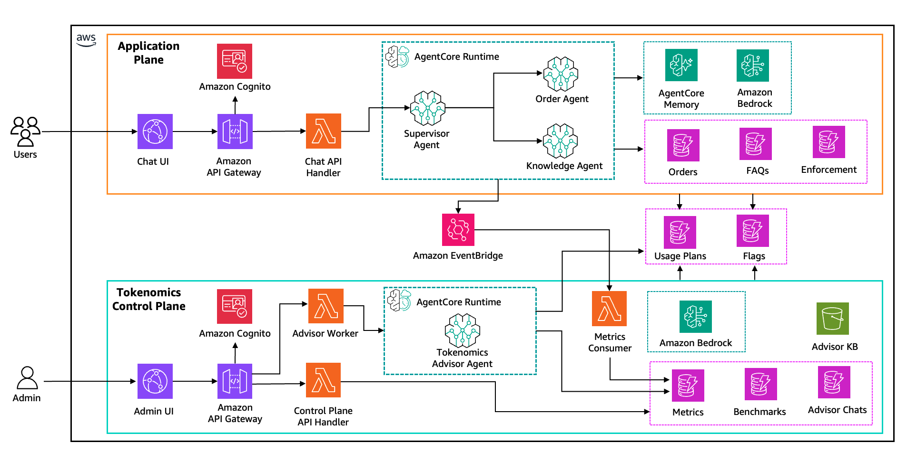

# Agent Tokenomics Framework

**Optimize, govern and explain the token cost of agentic AI workloads on Amazon Bedrock AgentCore.**

**Agent Tokenomics Framework** is a reference implementation for controlling the token cost of
multi-agent applications on [Amazon Bedrock AgentCore](https://aws.amazon.com/bedrock/agentcore/).
It focuses on three pillars:

- **Optimization:** spend fewer tokens on every run, with patterns such as prompt caching,
  context management, model routing and managed conversation memory.
- **Governance:** keep spend within limits by enforcing per-user quotas, throttles and per-agent
  and per-session caps inside the agent loop, before a model call is made.
- **Observability:** see token cost in dollars by agent, user and time window, and prove each
  change saved money with A/B benchmarks on identical conversations.

The framework demonstrates the code and configuration for each pillar on a working multi-agent
application built with the [Strands Agents SDK](https://strandsagents.com), so you can see exactly
how each pattern is implemented and apply it to your own agents.

---

## Overview

AI agents work through multi-step reasoning loops, repeated tool calls and a growing context.
Each step spends tokens, the cost compounds across every session, and small inefficiencies repeat
across thousands of sessions, often staying invisible until the bill arrives. Cutting cost once
isn't the hard part; keeping it down is. Agents behave differently every run, and a change that
cuts cost today can regress after the next deploy.

Tokenomics answers the three questions you end up asking about agent token cost:

| Question | Pillar | What it does |
|----------|--------|--------------|
| What do I fix first? | **Optimization** | Spend fewer tokens on the typical run. Most agent cost is the same tokens paid for over and over. |
| How do I keep it within limits? | **Governance** | Cap the outlier run in-loop, before it blows the budget. Billing data can take hours to update. |
| How do I prove it worked? | **Observability** | See cost in dollars, find where tokens go, and confirm a change really saved money. |

The framework implements tokenomics design patterns across these pillars, using primitives that
AgentCore and the Strands SDK already provide (prompt caching, hooks, execution limits, memory),
and adds the capabilities they leave out: dollarized cost, feature flags, usage plans, A/B
benchmarks and an Advisor.

---

## Architecture

The solution separates a lean **application plane** that answers users and applies the patterns
from a **control plane** that owns token cost operations.



It has four components, each building on the one before:

1. **Sample agentic application (application plane).** A supervisor-based, multi-agent
   customer-support app for an e-commerce store. A Claude Sonnet 5.5 orchestrator routes each
   shopper's question to Claude Haiku 5.5 specialists: an **Order agent** (status, tracking,
   history) and a **Knowledge agent** (policy and how-to questions). It is deliberately complex
   (repeated loops, delegation, a large stable system prompt) so every pattern has something to
   act on. Swap in your own workload and the same patterns apply. This plane also enforces the
   token limits set in the control plane.
2. **Tokenomics control plane.** A single pane of glass where an admin sees cost, sets limits and
   proves savings without touching the agent's code (see [Features](#features)).
3. **Tokenomics Advisor.** A read-only assistant in the admin UI you ask in plain language
   ("what should I fix next?", "why did cost jump this week?"). It grounds every answer in your
   metrics, flags, governance settings and a catalog of tokenomics patterns.
4. **Tokenomics Agent Skill.** A developer tool in the [Agent Skills](skills/agent-tokenomics/)
   format. As you build an agent, it reads your codebase and suggests where prompt caching, model
   routing or output caps belong, so the patterns land in the code the first time.

After every turn, the agent publishes a usage event (input, output and cache tokens, model IDs,
dollar cost, any limit hit) to EventBridge. A Lambda consumer writes it to the DynamoDB Metrics
table, the single source of truth for analytics, governance reports and the Advisor.

See the [Developer Guide](docs/DEVELOPER_GUIDE.md) for the code-level design of each plane.

---

## Features

### Optimization patterns (application plane)

Prompt caching, context management, model routing and memory are toggled from the control plane
and can be benchmarked against a baseline.

| Pattern | What it does |
|---------|--------------|
| **Prompt-cache placement** | Orders the prompt and places cache breakpoints so the model reuses the stable prefix instead of reprocessing it every call. |
| **Context management** | Keeps the context window bounded by masking older tool history and using Strands' native sliding-window and summarizing conversation managers. |
| **Model routing by step complexity** | An LLM-as-a-judge classifies each step; simple steps go to a cheaper model, hard ones to a more capable model. |
| **System-prompt optimization** | Removes repeated instructions and ships the shorter text as a frozen, versioned prompt. |
| **Conversation memory** | Keeps context across turns with AgentCore Memory; a baseline that lets you measure how caching and context management affect cost. |

### Control plane

| Feature | What it does |
|---------|--------------|
| **Token analytics** | Dollarized spend, savings and usage by agent, user and time window. |
| **Token governance** | Usage plans the agent enforces on every turn: per-user daily and monthly quotas, a per-minute throttle, per-agent ceilings and a per-session budget. When a limit trips, the run stops cleanly with a note saying which limit applied. |
| **Feature flags** | Switch each pattern on or off on the live agent, with no code change or redeploy. The agent picks it up on its next turn. |
| **Benchmarking** | Runs the same multi-turn conversations twice (baseline vs candidate pattern set) and compares tokens, cost per session, model calls and the cost gain. |
| **Activity log** | Who changed which flag, usage plan or benchmark, and when (old → new). |

Limits are enforced inside the agent loop: a Strands `BeforeModelCallEvent` hook checks each
user's quota before every model call on the orchestrator and both specialists, Strands limits cap
iterations and tokens per agent call, and Bedrock `maxTokens` caps output. The agent keeps calling
Bedrock directly, so prompt caching stays intact.

---

## Prerequisites

| Requirement | Notes |
|-------------|-------|
| **AWS account** | With permissions to deploy CDK stacks (CloudFormation, IAM, Lambda, DynamoDB, Cognito, AgentCore, S3, CloudFront). |
| **AWS CLI v2** | Installed and authenticated (`aws configure` or `AWS_PROFILE`). [Install](https://aws.amazon.com/cli/) |
| **Amazon Bedrock model access** | Claude Sonnet 5.5, Claude Haiku 5.5 and Amazon Nova Lite, enabled in the Region you deploy to. |
| **Python 3.12+** | Runs the CDK app and the seed step. [Install](https://www.python.org/downloads/) |
| **Node.js 20.19+ or 22.12+** | With npm. Runs the AWS CDK CLI and builds the UIs. [Install](https://nodejs.org/) |
| **Container runtime** | Docker, Finch or Podman, running. Builds the ARM64 agent images. |

Supported Regions: US East (N. Virginia) `us-east-1`, US East (Ohio) `us-east-2` and
US West (Oregon) `us-west-2`.

---

## Deployment

```bash
git clone https://github.com/awslabs/agent-tokenomics-framework
cd agent-tokenomics-framework
bash scripts/deploy-all.sh
```

`deploy-all.sh` checks the prerequisites, prompts for the AWS Region and the two login passwords
(below), bootstraps the AWS CDK if needed, sets up the environment and deploys both planes end to
end. When it finishes it prints the Chat UI and Admin UI URLs with their logins.

**Logins.** Both UIs require sign-in. The deploy creates these users with the passwords you enter
(12+ characters with an uppercase letter, a lowercase letter, a digit and a symbol):

| UI | Users | Password |
|----|-------|----------|
| Chat UI | `bob@example.com` (prime tier), `eva@example.com` (basic tier) | the Chat UI password you enter |
| Admin UI | `admin@example.com` | the Admin UI password you enter |

Forgot a password? Re-run `bash scripts/deploy-all.sh` and enter new ones.

**Redeploy one plane.** The Region from the first run is saved to `infra/.deploy-region` and
reused:

```bash
bash scripts/deploy-app-plane.sh    # agent runtime, chat UI and demo data
bash scripts/deploy-control.sh      # admin API, admin UI and governance data
```

---

## Usage

The framework is built to run as a continuous loop. You can enter at any step:

1. **Fix it.** Enable patterns on the **Feature flags** page (or build them in with the Agent
   Skill), then run a **Benchmark** against a baseline to confirm the cost benefit.
2. **See it.** Chat as bob or eva in the Chat UI, then watch cost by agent, user and window on
   **Analytics**. Ask the **Advisor** what to improve next.
3. **Control it.** Set usage plans on **Governance** and watch limits fire in the enforcement
   event log as traffic grows. Then repeat.

---

## Cost

You pay for the AWS resources the solution uses while it is deployed. Most components are
serverless and pay-per-use (Lambda, API Gateway, DynamoDB on-demand, EventBridge, CloudFront).
The main variable cost is **Amazon Bedrock model usage**: every chat turn, benchmark run and
Advisor question invokes models. AgentCore Runtime, AgentCore Memory and the Bedrock Knowledge
Base on Amazon S3 Vectors are billed by use. Check current rates on the
[Amazon Bedrock](https://aws.amazon.com/bedrock/pricing/) and
[AgentCore](https://aws.amazon.com/bedrock/agentcore/pricing/) pricing pages, and remove the
resources when you are done (below).

---

## Cleanup

Remove all the resources the framework deployed to avoid future charges:

```bash
cd agent-tokenomics-framework
bash scripts/destroy-all.sh
```

---

## Project structure

```
├── src/
│   ├── app-plane/        # Strands support agent on AgentCore Runtime + chat API
│   ├── control-plane/    # admin API, metering consumer, benchmarks, Advisor
│   └── shared/           # flag schema, price map
├── web/                  # React + Cloudscape UIs (admin + chat)
├── infra/                # AWS CDK stacks
├── seed/                 # demo data
├── skills/               # Tokenomics Agent Skill
├── scripts/              # deploy scripts
├── tests/                # unit + live test suites
└── docs/                 # architecture + optimization pattern references
```

---

## Documentation

- [Developer Guide](docs/DEVELOPER_GUIDE.md): code-level design of both planes, the patterns,
  governance, users, extending the framework and testing (§8).
- [Agent Skill](skills/agent-tokenomics/): the developer tool and its pattern references.

---

## Contributing

Contributions and feedback are welcome. See [CONTRIBUTING.md](CONTRIBUTING.md). Areas where
contributions are especially valuable:

- Additional tokenomics techniques and control plane features.
- Support for agent SDKs beyond Strands.
- Bedrock model-specific optimization patterns.
- Agent Skill support for more AI coding tools.

---

## Security

See [CONTRIBUTING](CONTRIBUTING.md#security-issue-notifications) for more information.

---

## License

This project is licensed under the Apache-2.0 License. See the [LICENSE](LICENSE) file.
