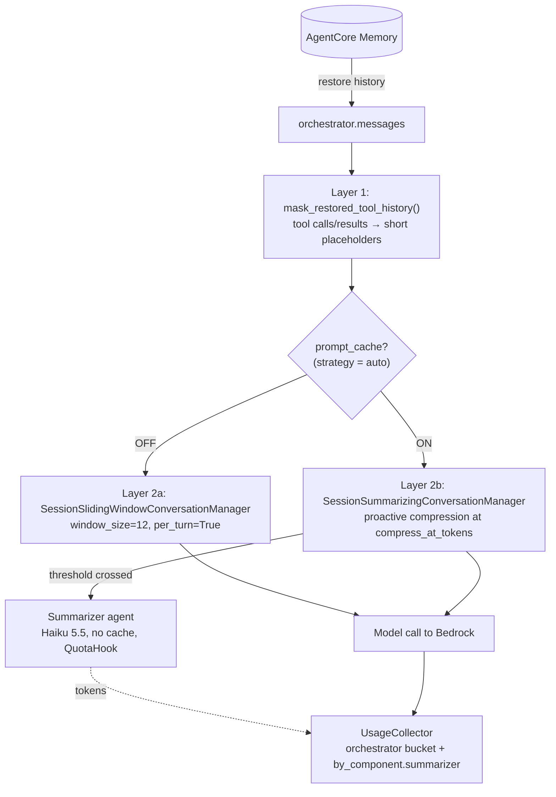

# Context Management

**Pillar:** Optimization · **Flag:** `context_management` · **Default:** OFF

Keep the orchestrator's conversation history from growing without bound. The pattern applies a
cheap masking step to every turn, then one of **two strategies** to bound the rest of the history:

- **Sliding window:** keep only the most recent messages. Used when prompt caching is OFF.
- **Summarizing:** once the prompt gets large, fold the oldest messages into one summary. Used
  when prompt caching is ON.

Both use Strands' native conversation managers; the framework configures them rather than
re-implementing trimming. This document explains both strategies, why the right one depends on
prompt caching, and where each piece lives in the code, so you can apply them to your own agent.

---

## 1. The problem

With [conversation memory](conversation-memory.md) ON, the orchestrator re-sends every earlier
turn on every model call. In a multi-agent app most of that history isn't the conversation itself.
It is **tool traffic**: the orchestrator's `ask_order(...)` and `ask_knowledge(...)` calls, and the
specialists' full answers coming back as tool results.

So each turn costs more than the last, and most of the growth is content the model no longer
needs: a specialist's detailed answer from three turns ago, when the orchestrator's own reply
already summarized it to the customer.

Left alone, two things happen:

1. **Cost grows every turn**, because input tokens grow every turn.
2. **Eventually the history hits a limit.** Strands' default manager trims only at 40 messages or
   on a context overflow, which is late and unplanned.

---

## 2. The pattern

Three layers, applied in order on every turn:

| Layer | When | What it does |
|-------|------|--------------|
| **1. Observation masking** | Always, when the pattern is ON | After memory restores the history, each earlier tool call becomes `[earlier call: ask_order(...)]` and each tool result (a specialist's answer, most of the tokens) becomes a fixed placeholder. The customer's messages and the agent's replies are kept. |
| **2a. Sliding window** | `prompt_cache` OFF | Keep the last N messages (default 12), trimmed before every model call. |
| **2b. Summarizing** | `prompt_cache` ON | Once the **whole prompt** reaches a token threshold (default 20,000), a cheap Haiku summarizer folds the oldest messages into one summary. |

### Strategy A: sliding window

Strands' `SlidingWindowConversationManager` keeps the most recent `window_size` messages and drops
older ones. The framework runs it with `per_turn=True`, so it trims **before every model call**,
not just at the end of the turn. A long tool loop within a single turn stays inside the window too.

- **Good at:** cutting cost on every call. Each removed token saves its full input price.
- **Costs:** nothing extra. No model calls.
- **Trade-off:** older context is simply gone. Masking (layer 1) makes each old turn small, so the
  window holds more turns' worth of conversation.

### Strategy B: summarizing

Strands' `SummarizingConversationManager` with **proactive compression**: when the whole prompt
(system prompt + tools + history) crosses `compress_at_tokens`, it asks a separate summarizer agent
to fold the oldest share of messages (`summary_ratio`, default 60%) into one summary message,
keeping the most recent `preserve_recent` messages (default 4) untouched.

- **Good at:** keeping early facts (the customer's name, the order they mentioned) in compressed
  form, and changing the prompt **rarely**.
- **Costs:** one summarizer call each time it fires, on a cheap model (Haiku 5.5 by default).
- **Trade-off:** it only acts once the prompt is large, so until then the history grows normally,
  and is cached (see below).

### Why prompt caching decides the strategy

Prompt caching matches from the **start** of the prompt. With caching ON, the orchestrator caches
the conversation history up to the latest message, so each turn mostly *reads* cached history.
The rates in the framework's price map (`src/shared/price_map.py`, Claude Sonnet 5.5, Global
cross-Region inference) show what happens when history changes:

| Sonnet 5.5, per 1M input tokens | Rate | vs. normal input |
|---------------------------------|------|------------------|
| Normal input | $2.00 | 1× |
| Cache write | $2.50 | 1.25× |
| Cache read | $0.10 | 0.05× |

- **Removing old messages changes the start of the prompt.** The next call can't read the cache;
  it re-writes it at 1.25× instead of reading at 0.05×.
- **Sliding window with caching ON** would do that on every call, so trimming can cost *more*
  than not trimming at all.
- **Summarizing with caching ON** changes the start only when the threshold is crossed: one cache
  re-write, then cheap reads again until the next summary.
- **With caching OFF** there's no cache to break, and every removed token saves the full $2.00
  rate, so trimming often (sliding window) is the right choice.

The default `strategy: "auto"` applies this rule: sliding window when `prompt_cache` is OFF,
summarizing when it is ON.

### Design rules

1. **Orchestrator only.** The specialists are single-shot per delegation and keep no history, so
   there's nothing to manage.
2. **Masking is count-preserving.** It replaces content in place and never removes messages, so
   the restore offset that Strands stores stays correct and the user/assistant alternation stays
   valid for Bedrock.
3. **A manager is attached on every turn, even with the pattern OFF.** Otherwise a mid-session flag
   change breaks the session (§4.5).
4. **The summarizer is cheap, uncached and governed.** It runs on Haiku, without prompt caching
   (its input is different every time, so a cache write would never be read), and carries the
   per-user quota hook.
5. **The summarizer's cost is counted inside the orchestrator**, because it is an internal
   component, not an agent.

---

## 3. Architecture



Per turn:

1. The factory builds the conversation manager for the turn from the flags (§4.3, §4.4).
2. The orchestrator is built with memory and that manager. Memory restores the earlier messages.
3. Masking rewrites the restored tool traffic in place (§4.2).
4. During the turn, the manager trims (sliding window) or summarizes (summarizing) as needed.
5. After the turn, the summarizer's spend is recorded and a `context_mgmt` telemetry block is
   added to the usage event (§4.7).

---

## 4. Implementation

| Step | File | What it does |
|------|------|--------------|
| 4.1 | `src/shared/flags_schema.py` | the flag, its params and the `auto` rule |
| 4.2 | `src/app-plane/tokenomics/factory.py` | layer 1: observation masking |
| 4.3 | `src/app-plane/tokenomics/factory.py` | strategy A: sliding window |
| 4.4 | `src/app-plane/tokenomics/factory.py` | strategy B: summarizing + the summarizer agent |
| 4.5 | `src/app-plane/tokenomics/factory.py` | restore-safe managers (mid-session flag changes) |
| 4.6 | `src/app-plane/agents/orchestrator/agent.py` | wiring into the orchestrator |
| 4.7 | `src/app-plane/agents/orchestrator/pattern_telemetry.py`, `tokenomics/cost.py` | summarizer metering + telemetry |

### 4.1 The flag, its params and the `auto` rule

`src/shared/flags_schema.py`:

```python
CONTEXT_MANAGEMENT = "context_management"

# context_management strategies. "auto" resolves from the prompt_cache flag.
CTX_AUTO = "auto"
CTX_SLIDING_WINDOW = "sliding_window"
CTX_SUMMARIZING = "summarizing"
CTX_STRATEGIES = (CTX_AUTO, CTX_SLIDING_WINDOW, CTX_SUMMARIZING)
```

```python
@dataclass
class ContextManagementParams:
    """Tunables for the context-management pattern (orchestrator history).

    Attributes:
        mask_tool_history: observation masking (primary compaction) -- on memory
            restore, replace prior turns' tool calls / specialist answers with
            short placeholders. Count-preserving, deterministic, cache-friendly.
        strategy: "auto" | "sliding_window" | "summarizing". "auto" = sliding
            window when prompt cache is OFF, summarizing when it is ON (trimming
            every turn would break the history cache every turn).
        window_size: sliding window -- messages kept.
        compress_at_tokens: summarizing -- summarize once the WHOLE prompt
            (system + tools + history) reaches this many tokens. High by default
            (safety net for long chats); must stay well above the ~1.5k-token
            fixed prefix or it re-summarizes on every call.
        summary_ratio: summarizing -- share of oldest messages folded (0.1-0.8).
        preserve_recent: summarizing -- most-recent messages never summarized.
        summarizer_model: model id for the summary; "" => the knowledge (Haiku) model.
    ...
    """

    mask_tool_history: bool = True
    strategy: str = CTX_AUTO
    window_size: int = 12
    compress_at_tokens: int = 20000
    summary_ratio: float = 0.6
    preserve_recent: int = 4
    summarizer_model: str = ""

    def resolved_strategy(self, prompt_cache_on: bool) -> str:
        """The concrete strategy for this config ("auto" resolved)."""
        if self.strategy == CTX_AUTO:
            return CTX_SUMMARIZING if prompt_cache_on else CTX_SLIDING_WINDOW
        return self.strategy
```

Values read from the Flags table are clamped to safe ranges, so a bad value can't disable the
pattern or make it summarize on every call:

```python
p = self.context_management.params or {}
strategy = str(p.get("strategy", CTX_AUTO))
return ContextManagementParams(
    mask_tool_history=bool(p.get("mask_tool_history", True)),
    strategy=strategy if strategy in CTX_STRATEGIES else CTX_AUTO,
    window_size=max(2, int(p.get("window_size", 12))),
    compress_at_tokens=max(500, int(p.get("compress_at_tokens", 20000))),
    summary_ratio=max(0.1, min(0.8, float(p.get("summary_ratio", 0.6)))),
    preserve_recent=max(0, int(p.get("preserve_recent", 4))),
    summarizer_model=str(p.get("summarizer_model", "") or ""),
)
```

### 4.2 Layer 1: observation masking

`mask_restored_tool_history` in `src/app-plane/tokenomics/factory.py` rewrites the restored
history **in place**, before the turn runs. Stored history in AgentCore Memory is untouched:

```python
_MASKED_RESULT = "[earlier specialist answer omitted -- the reply that followed summarizes it]"


def mask_restored_tool_history(messages: list) -> int:
    """Observation masking: replace restored tool calls/results with short text, in place.

    Applied to the history AgentCore Memory restored, before the turn runs (the
    stored history is untouched). Each toolUse block becomes "[earlier call: ...]"
    and each toolResult block a fixed placeholder, so:
      * the message COUNT is unchanged -> the restore offset Strands persists
        (`removed_message_count`) stays aligned with stored history;
      * user/assistant alternation is unchanged -> valid for Bedrock Converse;
      * output is deterministic -> the masked prefix is byte-stable across turns
        (cache-friendly).

    AgentCore's native `filter_restored_tool_context` is not used: it drops
    tool-only messages, which breaks both of the first two properties.
    Returns the number of blocks masked.
    """
    masked = 0
    for msg in messages:
        content = msg.get("content") or []
        for i, block in enumerate(content):
            if "toolUse" in block:
                use = block["toolUse"]
                arg = " ".join(str(v) for v in (use.get("input") or {}).values())[:200]
                content[i] = {"text": f"[earlier call: {use.get('name', 'tool')}({arg})]"}
                masked += 1
            elif "toolResult" in block:
                content[i] = {"text": _MASKED_RESULT}
                masked += 1
    return masked
```

Why replace in place instead of deleting tool messages:

- **Message count.** On restore, Strands skips the first `removed_message_count` stored messages
  (everything already trimmed or summarized). Deleting messages would shift that offset, and the
  wrong messages would come back on the next turn.
- **Alternation.** Deleting a tool-only message can leave two assistant messages in a row, which
  Bedrock Converse rejects.
- **Determinism.** The same history always masks to the same bytes, so the masked history is a
  stable prefix that prompt caching can still read.

The tests pin these properties:

```python
# tests/context_management/test_context_management.py
def test_masking_preserves_count_and_roles():
    msgs = _history()
    roles = [m["role"] for m in msgs]
    assert mask_restored_tool_history(msgs) == 2
    assert len(msgs) == 4 and [m["role"] for m in msgs] == roles
    flat = json.dumps(msgs)
    assert "toolUse" not in flat and "toolResult" not in flat and "x" * 100 not in flat
    assert msgs[1]["content"][1] == {"text": "[earlier call: ask_order(latest order status)]"}
    assert msgs[3]["content"] == [{"text": "It ships tomorrow."}]  # final reply kept


def test_masking_is_deterministic():
    a, b = _history(), _history()
    mask_restored_tool_history(a)
    mask_restored_tool_history(b)
    assert a == b  # byte-stable masked prefix -> cache-friendly
```

### 4.3 Strategy A: sliding window

`build_conversation_manager` in `src/app-plane/tokenomics/factory.py` picks the strategy. The
sliding-window branch is two lines:

```python
# per_turn=True trims before every model call, so long tool loops within one
# turn also stay inside the window.
manager = SessionSlidingWindowConversationManager(window_size=p.window_size, per_turn=True)
return BuiltContextManager(manager, True, strategy, p.mask_tool_history)
```

```python
# tests/context_management/test_context_management.py
def test_auto_cache_off_picks_sliding_window():
    flags = _flags(cache=False)
    built = build_conversation_manager(flags, _orch_model(flags))
    assert isinstance(built.manager, SlidingWindowConversationManager)
    assert built.strategy == "sliding_window"
    assert built.manager.window_size == 12
    assert built.summarizer is None
```

A tool-using turn adds about 4 messages (the customer's message, the tool call, the tool result
and the reply), so a window of 12 holds about the last 3 tool-using turns. Masking keeps those
messages small, but doesn't reduce their number.

### 4.4 Strategy B: summarizing

The full `build_conversation_manager`, with the summarizing branch:

```python
def build_conversation_manager(
    flags: FlagConfig,
    orchestrator_model: BedrockModel,
    hooks: list[HookProvider] | None = None,
) -> BuiltContextManager:
    if not flags.context_management.enabled:
        return BuiltContextManager(SessionSlidingWindowConversationManager())

    p = flags.context_management_params()
    strategy = p.resolved_strategy(flags.prompt_cache.enabled)

    if strategy == CTX_SUMMARIZING:
        summarizer_model_id = p.summarizer_model or config.KNOWLEDGE_MODEL
        summarizer = Agent(
            model=build_model(summarizer_model_id, FlagConfig.all_off()),
            callback_handler=None,
            hooks=list(hooks or []),
        )
        # Strands' threshold is a ratio of the model's context window (auto-resolved
        # from the model id, e.g. 1M for Sonnet 5.5). The fallback only applies if
        # the SDK can't resolve a window for the id.
        window = orchestrator_model.context_window_limit or 1_000_000
        manager = SessionSummarizingConversationManager(
            summary_ratio=p.summary_ratio,
            preserve_recent_messages=p.preserve_recent,
            summarization_agent=summarizer,
            proactive_compression={"compression_threshold": min(1.0, p.compress_at_tokens / window)},
        )
        return BuiltContextManager(
            manager, True, strategy, p.mask_tool_history, summarizer, summarizer_model_id
        )
    ...
```

Four details in that branch:

- **The summarizer is a separate, cheap agent.** It defaults to `config.KNOWLEDGE_MODEL` (Haiku
  5.5), not the orchestrator's Sonnet 5.5.
- **It is built with `FlagConfig.all_off()`**, so it gets no prompt caching. Its input is
  different on every call, so a cache write would cost 1.25× and never be read.
- **It carries `hooks`**, which is the orchestrator's per-user `QuotaHook` (§4.6), so summarizing
  is governed like any other model call.
- **The threshold is converted to a ratio.** Strands' proactive compression takes a share of the
  model's context window, which Strands resolves from the model id (1,000,000 tokens for Sonnet
  5.5). So 20,000 tokens becomes `0.02`:

```python
# tests/context_management/test_context_management.py
def test_auto_cache_on_picks_summarizing_with_token_threshold():
    flags = _flags(cache=True)
    model = _orch_model(flags)
    built = build_conversation_manager(flags, model)
    assert isinstance(built.manager, SummarizingConversationManager)
    assert built.strategy == "summarizing"
    assert model.context_window_limit == 1_000_000  # auto-resolved for Sonnet 5.5
    assert built.manager._compression_threshold == pytest.approx(20000 / 1_000_000)
    assert built.manager.preserve_recent_messages == 4
    assert built.manager.summary_ratio == 0.6
```

**Keep `compress_at_tokens` well above the fixed prompt.** The threshold counts the *whole*
prompt, and the orchestrator's system prompt plus tool specs are about 1,500 tokens on their own.
If the prompt is still above the threshold right after a summary, Strands summarizes again on the
next call, summarizing its own summary. Early facts fade and the cache breaks on every call. In
testing, a threshold of 2,000 caused this on nearly every turn; that's why the default is 20,000
and the minimum is clamped to 500.

### 4.5 Restore-safe managers

This is the subtle part, and the reason a manager is attached even when the pattern is OFF.

AgentCore Memory stores the conversation manager's state, **including its class name**. On the
next turn, Strands' `restore_from_session` raises `ValueError("Invalid conversation manager
state.")` if a *different* manager class is attached. That happens whenever:

- the `context_management` flag is turned on or off mid-session,
- `auto` switches strategy because `prompt_cache` was toggled, or
- a session started before the pattern was on.

The factory therefore always returns one of two subclasses that **reconcile** state written by
another class:

```python
class _ReconcilingRestore:
    """Mixin: restore a persisted state written by a DIFFERENT manager class.
    ...
    """

    def restore_from_session(self, state):  # type: ignore[no-untyped-def]
        name = type(self).__name__
        if state.get("__name__") != name:
            logger.info(
                "[context] reconciling conversation-manager state %s -> %s", state.get("__name__"), name
            )
            state = {
                **state,
                "__name__": name,
                "removed_message_count": int(state.get("removed_message_count", 0)),
            }
        return super().restore_from_session(state)  # type: ignore[misc]


class SessionSlidingWindowConversationManager(_ReconcilingRestore, SlidingWindowConversationManager):
    """Strands' sliding window, safe to restore across a mid-session pattern change."""


class SessionSummarizingConversationManager(_ReconcilingRestore, SummarizingConversationManager):
    """Strands' summarizing manager, safe to restore across a mid-session pattern change."""
```

`removed_message_count` (the restore offset into stored history) is kept, so the conversation
continues from the right place. A previous summary is kept when the new manager is a summarizing
one.

With the pattern OFF, the factory returns `SessionSlidingWindowConversationManager()` with Strands'
own defaults (40 messages, trimmed at the end of the turn). That behaves exactly like passing no
manager, so it is the honest baseline, but it can still restore a state written while the pattern
was ON.

The test runs two real turns of one session through a Strands session manager for every kind of
change:

```python
# tests/context_management/test_context_management.py
@pytest.mark.parametrize(
    "first,second",
    [
        (dict(cache=True), dict(cache=True)),  # all ON, same mode every turn
        (dict(cache=True), dict(cache=False)),  # cache toggled -> auto flips mode
        (dict(cache=False), dict(cache=True)),
        (dict(cache=True, ctx=False), dict(cache=True)),  # session started with lever OFF
        (dict(cache=True), dict(cache=True, ctx=False)),  # lever turned OFF mid-session
    ],
)
def test_session_restore_survives_lever_changes(tmp_path, first, second):
    """Two turns of one session through a real Strands session manager, no model calls."""
    from strands import Agent
    from strands.session.file_session_manager import FileSessionManager

    def turn(flag_kwargs):
        flags = _flags(**flag_kwargs)
        model = _orch_model(flags)
        built = build_conversation_manager(flags, model)
        return Agent(
            model=model,
            agent_id="orchestrator",
            callback_handler=None,
            conversation_manager=built.manager,
            session_manager=FileSessionManager(session_id="s1", storage_dir=str(tmp_path)),
        )

    turn(first)  # persists this manager's class + state
    turn(second)  # used to raise ValueError("Invalid conversation manager state.")
```

### 4.6 Wiring into the orchestrator

`src/app-plane/agents/orchestrator/agent.py`. The manager is built per turn and attached to the
orchestrator next to the memory session manager. Masking runs right after the agent is built,
which is when memory has restored the history:

```python
orch_model = build_model(config.ORCHESTRATOR_MODEL, flags, orch_limits_cfg, guardrail=True)
...
ctx_mgr = build_conversation_manager(flags, orch_model, hooks=[quota_hook])
orchestrator = Agent(
    model=orch_router.router or orch_model,
    system_prompt=ORCHESTRATOR_PROMPT,
    tools=specialist_tools,
    callback_handler=None,
    session_manager=session_manager,
    hooks=hooks,
    ...
    conversation_manager=ctx_mgr.manager,
)
# Observation masking (primary compaction): mask prior turns' tool traffic in
# the restored history before this turn runs. Count-preserving, so the
# conversation manager's restore offset stays aligned.
blocks_masked = (
    mask_restored_tool_history(orchestrator.messages)
    if session_manager and ctx_mgr.mask_tool_history
    else 0
)
# Snapshot after memory restore so the turn's trim/summarize can be reported.
messages_restored = len(orchestrator.messages)
removed_before = ctx_mgr.manager.removed_message_count
```

Notes:

- `orch_model` is passed in so the summarizing strategy can read the model's context window. It
  is built even when [model routing](model-routing.md) is ON; routing only switches between Claude
  models with large context windows, so the ratio stays valid.
- `hooks=[quota_hook]` is the orchestrator's shared per-user quota hook, which the summarizer
  inherits.
- Masking runs only when memory is active (`session_manager`). Without memory there is no
  restored history to mask, which is why the pattern has no effect with memory OFF.

### 4.7 Metering the summarizer and building the telemetry

Strands discards the summarizer's result, so its tokens never appear in the orchestrator's
usage. `record_context_mgmt` in `src/app-plane/agents/orchestrator/pattern_telemetry.py` records
them after the turn:

```python
def record_context_mgmt(
    ctx_mgr: BuiltContextManager,
    orchestrator: Agent,
    collector: UsageCollector,
    messages_restored: int,
    removed_before: int,
    blocks_masked: int = 0,
) -> dict[str, Any] | None:
    if not ctx_mgr.enabled:
        return None
    summarized = False
    if ctx_mgr.summarizer is not None and (
        collector.record_side_agent(
            ctx_mgr.summarizer,
            ctx_mgr.summarizer_model_id,
            "orchestrator",
            component="summarizer",
        )
        > 0
    ):
        summarized = True
    return {
        "strategy": ctx_mgr.strategy,
        "messages_restored": messages_restored,
        "tool_blocks_masked": blocks_masked,
        "messages_after": len(orchestrator.messages),
        "messages_removed": max(0, ctx_mgr.manager.removed_message_count - removed_before),
        "summarized": summarized,
    }
```

`record_side_agent` in `src/app-plane/tokenomics/cost.py` reads the summarizer's own accumulated
usage and folds it into the **orchestrator's** bucket, broken out as a component:

```python
def record_side_agent(
    self,
    agent_obj: Any,
    model_id: str,
    agent: str,
    component: str = "",
) -> float:
    """Record a side object's OWN `event_loop_metrics.accumulated_usage` under
    its model; return its cost (0.0 if nothing to record).
    ...
    """
    try:
        metrics = getattr(agent_obj, "event_loop_metrics", None)
        acc = getattr(metrics, "accumulated_usage", None)
        if acc and (acc.get("inputTokens") or acc.get("outputTokens")):
            return self.record_usage(model_id, dict(acc), agent=agent, component=component)
    ...
```

The summarizer is built fresh each turn, so its accumulated usage is exactly this turn's spend. It
is priced at the summarizer's own model (Haiku), but counted in the orchestrator's total, so
per-agent costs still add up to the turn total and analytics never list "summarizer" as an agent.
The returned block is added to the usage event as `usage["context_mgmt"]`.

---

## 5. Configuration

**Turn it on** from the Feature flags page in the admin UI. It only has an effect when
**Conversation memory** is also ON. The Flags page in `web/control-plane/src/pages/Flags.tsx`
shows the one tunable that matters for the active strategy:

```tsx
// Strategy is always "auto": sliding window when caching is off, summarize when on.
const ctxResolved = on ? "summarize" : "sliding window";
// The one tunable for the active manager: window_size (cache OFF) or
// compress_at_tokens (cache ON). Stored in the flag's params; defaults load
// when unset.
const ctxKey = on ? "compress_at_tokens" : "window_size";
```

Saving sends the whole flag with the changed param:

```tsx
await updateCtx({ enabled: ctxOn, params: { ...ctxFlag.params, [ctxKey]: ctxNum } });
```

```tsx
async function updateCtx(next: FeatureFlag) {
  if (!flags) return;
  setSaving(true);
  setError(null);
  try {
    const updated = await api.putFlags({ context_management: next });
    setFlags(updated);
  } catch (e) {
    setError((e as Error).message);
  } finally {
    setSaving(false);
  }
}
```

| Param | Strategy | Default | Allowed | In the UI |
|-------|----------|---------|---------|-----------|
| `strategy` | both | `auto` | `auto`, `sliding_window`, `summarizing` | no (always `auto`) |
| `mask_tool_history` | both | `true` | true/false | no |
| `window_size` | sliding window | 12 messages | ≥ 2 | "Window size (messages)" |
| `compress_at_tokens` | summarizing | 20,000 tokens | ≥ 500 | "Max tokens before summarizing" |
| `summary_ratio` | summarizing | 0.6 | 0.1 – 0.8 | no |
| `preserve_recent` | summarizing | 4 messages | ≥ 0 | no |
| `summarizer_model` | summarizing | Haiku 5.5 (`KNOWLEDGE_MODEL`) | any id in the price map | no |

The flag is read when the agents are built, so changes apply on the next turn with no redeploy.
Thanks to §4.5, you can change them in the middle of a conversation.

---

## 6. Applying it to your own agent

Start with the strategy that matches your caching setup:

```python
from strands import Agent
from strands.agent.conversation_manager import (
    SlidingWindowConversationManager,
    SummarizingConversationManager,
)
from strands.models import BedrockModel

PROMPT_CACHE_ON = True
main_model = BedrockModel(model_id="global.anthropic.claude-sonnet-5-5")

if PROMPT_CACHE_ON:
    # Summarize rarely, in one step, so the cached history prefix stays stable.
    summarizer = Agent(
        model=BedrockModel(model_id="us.anthropic.claude-haiku-5-5"),  # cheap, no cache config
        callback_handler=None,
    )
    window = main_model.context_window_limit or 1_000_000
    manager = SummarizingConversationManager(
        summary_ratio=0.6,
        preserve_recent_messages=4,
        summarization_agent=summarizer,
        proactive_compression={"compression_threshold": 20_000 / window},  # whole-prompt tokens
    )
else:
    # No cache to break: trim before every model call.
    manager = SlidingWindowConversationManager(window_size=12, per_turn=True)

agent = Agent(
    model=main_model,
    system_prompt="You are a helpful support agent.",
    conversation_manager=manager,
)
```

Then make it production-safe:

1. **Apply it to the agent that owns the conversation.** Agents that receive a self-contained task
   don't need it.
2. **Choose the strategy by caching.** Caching OFF: sliding window. Caching ON: summarizing.
3. **Mask old tool traffic first** if your agent delegates or calls tools: replace tool calls and
   results in place with short, deterministic placeholders. Never delete messages from restored
   history.
4. **Set the summarizing threshold well above your fixed prompt** (system prompt + tool specs), or
   it will summarize on every call.
5. **Run the summarizer on a cheap model, without caching, with your quota hook,** and record its
   tokens yourself; the SDK discards its result.
6. **If you persist sessions, attach a manager on every turn** and make it able to restore state
   written by the other manager class (§4.5), so a configuration change mid-conversation doesn't
   break the session.
7. **Gate it behind a flag** and benchmark multi-turn conversations (5 or more turns, so the window
   actually fills) with it ON and OFF.

---

## 7. References

**Code**

| File | Purpose |
|------|---------|
| `src/shared/flags_schema.py` | `context_management` flag, `ContextManagementParams`, `resolved_strategy` |
| `src/app-plane/tokenomics/factory.py` | `build_conversation_manager`, `mask_restored_tool_history`, restore-safe managers |
| `src/app-plane/agents/orchestrator/agent.py` | wiring and masking per turn |
| `src/app-plane/agents/orchestrator/pattern_telemetry.py` | `record_context_mgmt` |
| `src/app-plane/tokenomics/cost.py` | `record_side_agent` (summarizer cost) |
| `src/shared/price_map.py` | cache read/write rates |
| `web/control-plane/src/pages/Flags.tsx` | the per-strategy tunable in the admin UI |
| `tests/context_management/test_context_management.py` | unit tests for every step above |

**Further reading**

- [Strands Agents SDK](https://strandsagents.com) — conversation management
- [Prompt caching on Amazon Bedrock](https://docs.aws.amazon.com/bedrock/latest/userguide/prompt-caching.html)
- [Conversation memory](conversation-memory.md) and [prompt caching](prompt-caching.md) — the patterns this one works with
- [Developer Guide §3.6](../DEVELOPER_GUIDE.md#36-tokenomics-design-patterns)
