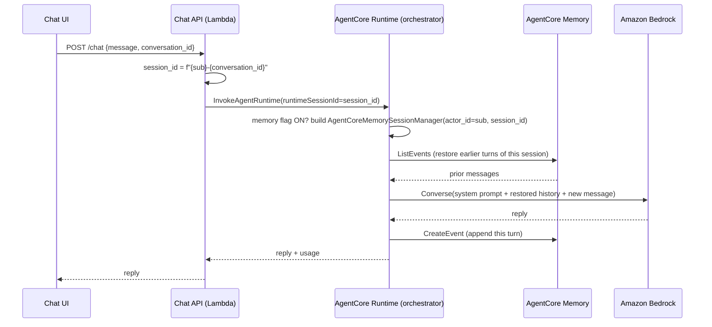

# Conversation Memory

**Pillar:** Optimization · **Flag:** `memory` · **Default:** OFF

Give the agent short-term memory of the current conversation with Amazon Bedrock AgentCore
Memory, and treat it as a **managed cost**: switched on deliberately, scoped tightly, and
measured. Memory is what makes a multi-turn chat feel natural, and it is also the main reason a
conversation's token cost grows with every turn. The other optimization patterns (prompt caching
and context management) exist largely to pay for it.

This document walks through where the pattern lives in the code and how each piece is
implemented, so you can apply it to your own agent.

---

## 1. The problem

Without memory, every turn is independent. The customer says "Where is my order ORD-1001?", then
"When will **it** arrive?", and the agent has no idea what "it" is. It asks again, or delegates
with a vague task, which costs extra calls and frustrates the customer.

With memory, the agent re-sends the earlier turns to the model on every new turn. That fixes the
conversation, but changes the cost shape:

| | Without memory | With memory |
|---|----------------|-------------|
| Input tokens on turn *n* | system prompt + message *n* | system prompt + turns 1 … *n−1* + message *n* |
| Growth per turn | flat | grows with every turn |
| Cost of a whole session | ≈ *n* × one turn | grows faster than the number of turns |

So memory is both a quality feature and a cost multiplier. Turning it on blindly, for every
agent, with no history limit, is how agent bills grow quietly.

---

## 2. The pattern

Short-term memory, applied only where it earns its cost, with clear boundaries:

| Decision | Choice in this framework | Why |
|----------|--------------------------|-----|
| Which agent remembers | **Orchestrator only.** The specialists stay stateless. | The orchestrator owns the conversation. Specialists get a self-contained task string each call, so history would only add tokens. |
| What is stored | **Short-term only:** the raw conversation events of this session. | No long-term extraction, so no extra model calls or background processing. |
| Scope | **(actor_id, session_id):** one user, one conversation. | A new conversation starts clean; users never see each other's history; benchmark runs never bleed into each other. |
| Retention | Events expire after **30 days** (configurable). | Bounded storage cost and data retention. |
| On failure | **Run stateless.** | Memory never fails a turn. |
| Control | Behind the `memory` flag, OFF by default. | You can measure the cost of memory itself, then measure how much caching and context management claw back. |

Memory is the **baseline** pattern the others build on. Benchmarks in the control plane typically
compare `memory` alone (run A) against `memory` + `prompt_cache` + `context_management`
(run B), because caching and context management only have something to act on once history is
being re-sent.

---

## 3. Architecture



Per turn:

1. The Chat API derives a stable session id from the signed-in user and the conversation.
2. The orchestrator is rebuilt for the turn. If `memory` is ON, it gets a session manager scoped to
   `(user, session)` and a **stable agent id**.
3. Strands restores the earlier messages of this session from AgentCore Memory into
   `agent.messages` before the model call.
4. After the turn, the new messages are written back as events.

---

## 4. Implementation

The pattern touches seven places. Each step below shows the real code.

| Step | File | What it does |
|------|------|--------------|
| 4.1 | `infra/stacks/app_plane_stack.py` | provisions the AgentCore Memory resource |
| 4.2 | `infra/stacks/app_plane_stack.py` | scopes IAM to that resource |
| 4.3 | `infra/stacks/app_plane_stack.py`, `src/app-plane/config.py` | injects the memory id |
| 4.4 | `src/shared/flags_schema.py` | the flag and its params |
| 4.5 | `src/app-plane/chat_api/handler.py`, `web/app-plane/src/App.tsx` | the session identity |
| 4.6 | `src/app-plane/agents/orchestrator/agent.py` | builds the session manager and attaches it |
| 4.7 | `src/app-plane/agents/orchestrator/prompts.py` | tells the model how to use memory |

### 4.1 Provision the memory resource

`infra/stacks/app_plane_stack.py` — one short-term memory resource for the support agent. No
memory strategies are configured, so AgentCore stores raw events only and runs no extraction:

```python
# ---- AgentCore Memory (short-term) ---------------------------------
# Event retention is context-driven (no hardcoded magic number).
#   cdk deploy ... -c memoryEventExpiryDays=30
memory_expiry_days = int(self.node.try_get_context("memoryEventExpiryDays") or 30)
self.memory = agentcore.CfnMemory(
    self,
    "SupportAgentMemory",
    name="TokenomicsSupportAgentMemory",
    event_expiry_duration=memory_expiry_days,
    description="Short-term conversation memory for the support agent (flag-gated lever).",
)
self.memory.apply_removal_policy(RemovalPolicy.DESTROY)  # demo resource
```

`event_expiry_duration` is the retention bound. Every stored event is billed for storage over its
lifetime, so a shorter expiry means lower storage cost and less retained customer data.

### 4.2 Scope IAM to that resource

The agent's runtime role can read and write events **only on this memory resource**, with no
wildcard:

```python
# AgentCore Memory data-plane: the agent writes conversation events and
# reads prior turns back. Scoped to this memory resource (no wildcard).
self.runtime.add_to_role_policy(
    iam.PolicyStatement(
        actions=[
            "bedrock-agentcore:CreateEvent",
            # When the guardrail blocks a message, Strands rewrites it in
            # history (redaction): create the replacement, delete the
            # original. Without this the blocked text would stay in Memory
            # and be replayed to the model on later turns.
            "bedrock-agentcore:DeleteEvent",
            "bedrock-agentcore:ListEvents",
            "bedrock-agentcore:GetEvent",
            "bedrock-agentcore:ListSessions",
            "bedrock-agentcore:RetrieveMemoryRecords",
        ],
        resources=[self.memory.attr_memory_arn],
    )
)
```

`DeleteEvent` is easy to miss. When the Bedrock Guardrail blocks a message, Strands replaces it in
history. Without `DeleteEvent` the blocked text stays in memory and is re-sent to the model on
every later turn, which is a safety issue and wasted tokens.

### 4.3 Inject the memory id

The stack passes the resource id to the agent runtime as an environment variable:

```python
"AGENTCORE_MEMORY_ID": self.memory.attr_memory_id,
```

`src/app-plane/config.py` reads it and treats it as **optional**:

```python
# Resource id injected by CDK. Optional (unlike tables): if empty, the agent
# runs stateless regardless of the `memory` flag -- graceful degradation so the
# container still boots when memory isn't provisioned.
AGENTCORE_MEMORY_ID = os.environ.get("AGENTCORE_MEMORY_ID", "")
```

### 4.4 The flag and its params

`src/shared/flags_schema.py`:

```python
MEMORY = "memory"

ALL_FEATURES = (PROMPT_CACHE, MEMORY, CONTEXT_MANAGEMENT, MODEL_ROUTING)


@dataclass
class MemoryParams:
    """Tunables for the short-term memory pattern.

    Attributes:
        batch_size: event-write batching. 1 = write each turn immediately.
    ...
    """

    batch_size: int = 1
```

```python
def memory_params(self) -> MemoryParams:
    p = self.memory.params or {}
    return MemoryParams(
        batch_size=int(p.get("batch_size", 1)),
    )
```

There is deliberately no "how many turns to replay" knob here. Short-term memory replays the
session's stored turns; bounding that history is the job of the
[context management](context-management.md) pattern.

### 4.5 The session identity

Memory is only as good as its key. The same user in the same conversation must get the same
session, and a new conversation must get a new one.

`src/app-plane/chat_api/handler.py` derives the session id on the server, from the **verified**
user id in the JWT (never from the request body) and the conversation id from the UI:

```python
def _session_id(user_id: str, conversation_id: str) -> str:
    """Stable AgentCore runtimeSessionId for this user's conversation.

    Same user + same conversation -> same session (turns grouped, prompt-cache
    reuse). AgentCore requires 33-128 chars; we sanitize and pad.
    """
    raw = f"{user_id}-{conversation_id}"
    safe = re.sub(r"[^A-Za-z0-9_-]", "-", raw)
    if len(safe) < 33:
        safe = f"{safe}-{uuid.uuid4().hex}"
    return safe[:128]
```

```python
conversation_id = (body.get("conversation_id") or "default").strip() or "default"
...
"session_id": _session_id(user_id, conversation_id),
...
runtimeSessionId=payload["session_id"],
```

`web/app-plane/src/App.tsx` rotates the conversation id when the customer starts a new chat. It
uses a ref so the very next message is guaranteed to use the new id; reusing the old id would
leak the previous conversation's memory into the new chat:

```tsx
const newConversationId = () =>
  crypto.randomUUID?.() ?? `conv-${Date.now()}-${Math.random().toString(16).slice(2)}`;

function newConversation() {
  const id = newConversationId();
  conversationIdRef.current = id; // rotate synchronously so the next send uses it
  setMessages([]);
  setError(null);
  setInfo(null);
  setConversationId(id);
  ...
}
```

Benchmarks use the same mechanism with synthetic ids. In
`src/control-plane/handlers/load_generator.py`, every turn of one scripted conversation shares a
session id, and every run gets fresh ones, so memory builds up within a conversation but never
leaks between runs:

```python
session_id = f"{run_id}-{s_index}"  # ONE id for the whole conversation
```

### 4.6 Build the session manager and attach it

`src/app-plane/agents/orchestrator/agent.py`. The session manager comes from the AgentCore
Memory integration for Strands (`bedrock-agentcore[strands-agents]`). It returns `None`, which
means a stateless orchestrator, whenever memory can't or shouldn't be used:

```python
def _memory_session_manager(ctx: RunContext, flags):
    """Build an AgentCore short-term memory session manager for this turn.

    Returns None (⇒ stateless orchestrator, today's behavior) when:
      - the `memory` flag is OFF, or
      - no memory resource is configured (AGENTCORE_MEMORY_ID empty), or
      - the memory integration can't be imported / constructed.

    Memory is scoped by (actor_id, session_id):
      - actor_id  = ctx.user_id  (Cognito sub for live chat; synthetic in benchmarks)
      - session_id = ctx.session_id ({sub}-{conv} live; {run_id}-{index} in benchmarks)
    """
    if not flags.memory.enabled or not config.AGENTCORE_MEMORY_ID:
        return None
    try:
        from bedrock_agentcore.memory.integrations.strands.config import (
            AgentCoreMemoryConfig,
        )
        from bedrock_agentcore.memory.integrations.strands.session_manager import (
            AgentCoreMemorySessionManager,
        )

        params = flags.memory_params()
        cfg = AgentCoreMemoryConfig(
            memory_id=config.AGENTCORE_MEMORY_ID,
            actor_id=ctx.user_id,
            session_id=ctx.session_id,
            batch_size=params.batch_size,
        )
        return AgentCoreMemorySessionManager(cfg, region_name=config.AWS_REGION)
    except Exception as exc:  # noqa: BLE001 -- never let memory break a turn
        logger.warning("[memory] disabled for this turn (%s: %s)", type(exc).__name__, exc)
        return None
```

The import is inside the `try`, so a missing or broken integration package degrades to stateless
instead of crashing the container.

Attaching it to the orchestrator has one subtle requirement, the **stable `agent_id`**:

```python
session_manager = _memory_session_manager(ctx, flags)
...
orchestrator = Agent(
    model=orch_router.router or orch_model,
    system_prompt=ORCHESTRATOR_PROMPT,
    tools=specialist_tools,
    callback_handler=None,
    session_manager=session_manager,
    hooks=hooks,
    # Stable agent id so AgentCore Memory restores prior turns on the NEXT
    # invoke: the runtime rebuilds the agent per turn, and the session
    # manager keys restored history by (session_id, agent_id). A random id
    # (Strands default) would look like a brand-new agent each turn and skip
    # restore. Only set it when memory is active so nothing else changes.
    **({"agent_id": "orchestrator"} if session_manager else {}),
    conversation_manager=ctx_mgr.manager,
)
```

This is the most common way to get memory silently wrong. The agent is rebuilt on every turn,
and Strands generates a random `agent_id` by default. Restored history is keyed by
`(session_id, agent_id)`, so with a random id every turn looks like a new agent: the history is
written but never read back, and you pay for storage with no benefit.

The specialists are built without a session manager (`build_specialists` in
`src/app-plane/tokenomics/factory.py`), so they stay stateless. Each delegated call is a
self-contained task string, and history would only add input tokens.

### 4.7 Tell the model how to use memory

Restored history only helps if the model is told it may rely on it, and what it may *not* use it
for. `src/app-plane/agents/orchestrator/prompts.py`:

```text
You retain the context of the current, ongoing conversation. Earlier turns in
this session are available to you, so use them: remember what the customer has
already told you (their name, preferences, the order they mentioned, what you
already answered) and do not ask them to repeat it. If the customer refers back
to something said earlier ("that order", "the color I mentioned"), resolve it
from the conversation so far. This "memory" is the running conversation only --
it does not let you invent order facts or policy (see the rule below); for those
you still delegate to the specialists.
```

The text is static, so it stays part of the cached system prompt (see
[prompt caching](prompt-caching.md)) and adds no per-turn cost once cached.

---

## 5. Configuration

**Turn it on** from the Feature flags page in the admin UI. The toggle in
`web/control-plane/src/pages/Flags.tsx` sends only the changed flag, keeping its current params:

```typescript
async function toggleMemory(enabled: boolean) {
  if (!flags) return;
  setSaving(true);
  setError(null);
  try {
    const updated = await api.putFlags({
      memory: { enabled, params: flags.memory.params },
    });
    setFlags(updated);
  } catch (e) {
    setError((e as Error).message);
  } finally {
    setSaving(false);
  }
}
```

`web/control-plane/src/api.ts` sends it to the control-plane API:

```typescript
putFlags: (flags: Partial<FlagConfig>) =>
  req<FlagConfig>("/flags", { method: "PUT", body: JSON.stringify(flags) }),
```

`src/control-plane/handlers/flags.py` merges the change over the current flags and writes them to
the shared Flags table, which the agent reads on its next turn:

```python
def put_flags(body: dict[str, Any]) -> dict[str, Any]:
    """PUT /flags -> replace the flag config, return the normalized result.

    Accepts either a full config ({"prompt_cache": {"enabled": true, ...}}) or a
    partial merge over the current config so the UI can send just what changed.
    """
    current = store.read_flags()
    merged = {**current, **(body or {})}
    return store.write_flags(merged)
```

| Setting | Where | Default |
|---------|-------|---------|
| On/off | `memory.enabled` (Flags table) | OFF |
| Event-write batching | `memory.params.batch_size` | 1 (write each turn immediately) |
| Event retention | CDK context `memoryEventExpiryDays` (`cdk deploy -c memoryEventExpiryDays=7`) | 30 days |
| Memory resource | `AGENTCORE_MEMORY_ID` env var, set by CDK | the stack's `CfnMemory` |
| Which agents | orchestrator only (code) | — |
| Applies | at agent build | next turn, no redeploy |

Turning the flag OFF doesn't delete stored events. They stay until they expire, and the
orchestrator simply stops reading them.

---

## 6. Applying it to your own agent

The minimum version, for a single Strands agent on AgentCore Runtime:

```python
import os

from bedrock_agentcore.memory.integrations.strands.config import AgentCoreMemoryConfig
from bedrock_agentcore.memory.integrations.strands.session_manager import (
    AgentCoreMemorySessionManager,
)
from strands import Agent


def build_agent(user_id: str, session_id: str) -> Agent:
    session_manager = None
    memory_id = os.environ.get("AGENTCORE_MEMORY_ID", "")
    if memory_id:
        try:
            cfg = AgentCoreMemoryConfig(
                memory_id=memory_id,
                actor_id=user_id,       # who: the verified user, never from the request body
                session_id=session_id,  # which conversation
                batch_size=1,
            )
            session_manager = AgentCoreMemorySessionManager(cfg, region_name=os.environ["AWS_REGION"])
        except Exception:
            session_manager = None      # degrade to stateless, never fail the turn

    return Agent(
        system_prompt="You are a helpful support agent. Use earlier turns of this conversation.",
        session_manager=session_manager,
        # Required when the agent is rebuilt per request: a stable id lets the
        # session manager find and restore this agent's history.
        **({"agent_id": "support-agent"} if session_manager else {}),
    )
```

Then make it production-safe:

1. **Give memory only to the agent that owns the conversation.** Sub-agents that receive a
   self-contained task should stay stateless.
2. **Derive `actor_id` and `session_id` on the server** from verified identity, and rotate the
   session id when the user starts a new conversation.
3. **Set a stable `agent_id`** whenever the agent is rebuilt per request.
4. **Scope IAM to the memory resource ARN**, and include `DeleteEvent` if you use a guardrail.
5. **Set an event expiry** that matches how long a conversation realistically lasts.
6. **Keep the memory instructions static** in the system prompt so they are cached.
7. **Bound the history** with [context management](context-management.md), and offset the
   re-sent history with [prompt caching](prompt-caching.md).
8. **Gate it behind a flag** and benchmark multi-turn conversations with it ON and OFF, so you
   know what memory costs before you optimize it.

---

## 7. References

**Code**

| File | Purpose |
|------|---------|
| `infra/stacks/app_plane_stack.py` | `CfnMemory` resource, IAM, `AGENTCORE_MEMORY_ID` |
| `src/app-plane/config.py` | optional memory id |
| `src/shared/flags_schema.py` | `memory` flag and `MemoryParams` |
| `src/app-plane/chat_api/handler.py` | server-side session id |
| `web/app-plane/src/App.tsx` | new-conversation id rotation |
| `src/app-plane/agents/orchestrator/agent.py` | `_memory_session_manager`, stable `agent_id` |
| `src/app-plane/agents/orchestrator/prompts.py` | memory instructions in the system prompt |
| `src/control-plane/handlers/load_generator.py` | per-run benchmark session ids |
| `tests/context_management/test_context_management.py` | session restore across flag changes |

**Further reading**

- [Amazon Bedrock AgentCore Memory](https://docs.aws.amazon.com/bedrock-agentcore/latest/devguide/memory.html)
- [Amazon Bedrock AgentCore pricing](https://aws.amazon.com/bedrock/agentcore/pricing/) — short-term memory is billed on event ingestion, storage and retrieval
- [Strands Agents SDK](https://strandsagents.com) — session management
- [Developer Guide §3.5](../DEVELOPER_GUIDE.md#35-features-agentcore-memory-strands-agents)
