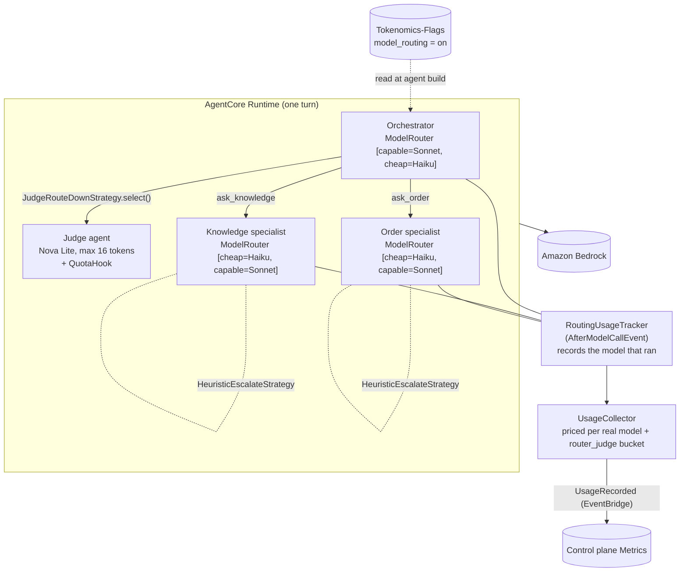

# Model Routing by Step Complexity

**Pillar:** Optimization · **Flag:** `model_routing` · **Default:** OFF

Send each agent step to the cheapest model that can handle it: simple steps run on a small,
cheap model, and only genuinely hard steps pay for a frontier model. This document walks through
where the pattern lives in the code and how each piece is implemented, so you can apply it to
your own agent.

---

## 1. The problem

A multi-agent assistant pays **frontier-model rates for every step, even trivial ones**. In the
sample app:

- The **orchestrator** runs Claude Sonnet 5.5 for every model call, whether it is planning a
  multi-step resolution or just saying "You're welcome!".
- The **specialists** run Claude Haiku 5.5 for every call, even on the occasional task that
  needs real reasoning ("compare these two orders and explain which ships first").

Step complexity changes from turn to turn, and a fixed model per agent can't follow it. You
either overpay on easy steps or under-serve hard ones.

This is the AWS Well-Architected Agentic AI Lens best practice **AGENTCOST02-BP01, tiered model
selection**: match each task to the cheapest model with acceptable quality, escalate only when
needed, and keep any pre-classifier cheaper than the price difference it arbitrates.

---

## 2. The pattern

Each agent runs behind a Strands **`ModelRouter`** with two candidates (a capable model and a
cheap model) and a **routing strategy** that picks one per model call. The framework supplies only
the routing *decision* and the cost attribution; the SDK does candidate resolution,
per-invocation state and failover.

| Agent | Candidate 0 (default) | Classifier | Routes | On a miss or error |
|-------|-----------------------|-----------|--------|--------------------|
| Orchestrator | Sonnet 5.5 (capable) | **LLM-as-a-judge** (Amazon Nova Lite) | *down* to Haiku on a SIMPLE step | stays on Sonnet (**fail safe**) |
| Knowledge | Haiku 5.5 (cheap) | **keyword heuristic** (no model call) | *up* to Sonnet on a reasoning keyword | stays on Haiku (**fail cheap**) |
| Order | Haiku 5.5 (cheap) | **keyword heuristic** | *up* to Sonnet on a reasoning keyword | stays on Haiku (**fail cheap**) |

Three design rules make it work:

1. **Candidate 0 is the agent's normal model.** With the flag OFF, or ON with the strategy
   declining, the agent runs the same model as before. Routing only ever moves *off* the baseline,
   so a before/after benchmark is honest, and the order of the candidates sets the fail direction.
2. **The classifier must cost less than it saves.** The orchestrator defaults to the expensive
   model, so a one-word Nova Lite judge (16 output tokens max) is far cheaper than the
   Sonnet→Haiku saving it unlocks. The specialists default to the cheap model and run single-shot,
   so an LLM judge per step would cost more than the step itself; a deterministic keyword check is
   the right fit there.
3. **Every model call is governed and metered, including the judge.** The judge carries the
   per-user quota hook and its tokens are recorded as their own cost bucket (`router_judge`), so
   the routing decision is never free, hidden spend.

---

## 3. Architecture



Per turn:

1. The agent factory reads the flag. If `model_routing` is ON, it builds a `ModelRouter` per agent
   instead of a single `BedrockModel`.
2. Before each model call, Strands asks the router's strategy which candidate to use.
3. A `RoutingUsageTracker` hook records which model actually ran.
4. At the end of the turn, each agent's tokens are priced at that model, the judge's tokens are
   recorded as `router_judge`, and a `model_routing` telemetry block rides on the usage event.

---

## 4. Implementation

The pattern touches six places. Each step below shows the real code.

| Step | File | What it does |
|------|------|--------------|
| 4.1 | `src/shared/flags_schema.py` | the flag and its params |
| 4.2 | `src/app-plane/tokenomics/routing.py` | the two routing strategies |
| 4.3 | `src/app-plane/tokenomics/factory.py` | builds the judge and the per-role router |
| 4.4 | `src/app-plane/agents/orchestrator/agent.py`, `factory.py` | wires routers into the agents |
| 4.5 | `routing.py`, `delegation.py` | prices each agent at the model that really ran |
| 4.6 | `src/app-plane/agents/orchestrator/pattern_telemetry.py` | meters the judge and builds telemetry |

### 4.1 The flag and its params

`src/shared/flags_schema.py` — the flag id is part of `ALL_FEATURES`, so the control plane and the
agent both know it. An unknown or missing flag reads as OFF.

```python
MODEL_ROUTING = "model_routing"

ALL_FEATURES = (PROMPT_CACHE, MEMORY, CONTEXT_MANAGEMENT, MODEL_ROUTING)
```

The params are optional overrides. Blank means "use the model ids from `config.py`", so model ids
live in one place:

```python
@dataclass
class ModelRoutingParams:
    """Tunables for the model-routing pattern (on/off only in the UI).
    ...
    """

    capable_model: str = ""   # "" => config.ORCHESTRATOR_MODEL (Claude Sonnet 5.5)
    cheap_model: str = ""     # "" => config.KNOWLEDGE_MODEL   (Claude Haiku 5.5)
    judge_model: str = ""     # "" => config.ROUTER_JUDGE_MODEL (Amazon Nova Lite)
```

`src/app-plane/config.py` — the defaults, all taken from the single model-id source
(`shared/price_map.py`):

```python
ORCHESTRATOR_MODEL = os.environ.get("ORCHESTRATOR_MODEL", price_map.SONNET_5_5)
KNOWLEDGE_MODEL = os.environ.get("KNOWLEDGE_MODEL", price_map.HAIKU_5_5)
ORDER_MODEL = os.environ.get("ORDER_MODEL", price_map.HAIKU_5_5)

# Judge ONLY -- never an agent's runtime model. Cheapest model in price_map, so the
# per-step judge call stays well below the Sonnet->Haiku saving it unlocks.
ROUTER_JUDGE_MODEL = os.environ.get("ROUTER_JUDGE_MODEL", price_map.NOVA_LITE)
```

### 4.2 The routing strategies

`src/app-plane/tokenomics/routing.py` holds both strategies. A Strands routing strategy has one
method, `async select(context)`, which returns a candidate from `context.candidates` or `None` to
decline (the router then serves candidate 0).

**What the strategy looks at.** Only the latest user turn, not the whole history. The cached
system prompt and earlier turns don't decide how hard *this* step is:

```python
def _latest_user_text(context: RoutingContext) -> str:
    messages = getattr(context, "messages", None) or []
    for msg in reversed(messages):
        if not isinstance(msg, dict) or msg.get("role") != "user":
            continue
        parts = [
            b.get("text", "") for b in (msg.get("content") or []) if isinstance(b, dict) and b.get("text")
        ]
        text = " ".join(p for p in parts if p).strip()
        if text:
            return text
    return ""


def _candidate_by_name(context: RoutingContext, name: str) -> RoutingCandidate | None:
    """The candidate instance with this name (router matches by identity)."""
    for c in getattr(context, "candidates", None) or []:
        if c.name == name:
            return c
    return None
```

**Specialists: escalate up on a reasoning keyword.** No model call, fully deterministic:

```python
REASONING_KEYWORDS = (
    "why", "compare", "comparison", "versus", " vs ", "explain", "reconcile",
    "difference", "differ", "trade-off", "tradeoff", "step by step", "step-by-step",
    "analyze", "analyse", "evaluate", "pros and cons",
)


class HeuristicEscalateStrategy:
    def __init__(self, capable_name: str) -> None:
        self._capable_name = capable_name

    async def select(self, context: RoutingContext, **_: Any) -> RoutingCandidate | None:
        try:
            if self._is_complex(context):
                return _candidate_by_name(context, self._capable_name)  # -> Sonnet
            return None  # simple / uncertain -> decline -> Haiku default
        except Exception as exc:  # noqa: BLE001 -- fail cheap (Haiku) on any hiccup
            logger.warning("[routing] heuristic classify failed, staying on cheap default: %r", exc)
            return None

    def _is_complex(self, context: RoutingContext) -> bool:
        text = _latest_user_text(context)
        if not text:
            return False
        return any(kw in text.lower() for kw in REASONING_KEYWORDS)
```

Why keywords only, and not order ids, numbers or length: a specialist classifies the
orchestrator's *composed task string*, which carries ids, dates and amounts even for trivial
lookups. The tests pin this behavior:

```python
# tests/model_routing/test_model_routing.py
def test_heuristic_does_not_escalate_routine_task_with_ids_and_numbers():
    s = HeuristicEscalateStrategy("capable")
    task = "Look up the status of ORD-1001 placed 2026-10-02 for $129.99"
    assert _pick(s, _ctx(task)) is None


def test_heuristic_escalates_multi_order_compare():
    s = HeuristicEscalateStrategy("capable")
    assert _pick(s, _ctx("Compare ORD-1001 and ORD-1002 and say which ships first")).name == "capable"
```

**Orchestrator: route down when the judge says SIMPLE.** One small model call per orchestrator
step:

```python
_JUDGE_INSTRUCTIONS = (
    "You are a routing classifier. Decide if the following assistant step is "
    "SIMPLE (a trivial lookup, acknowledgement, formatting, or single-fact reply "
    "a small model handles well) or COMPLEX (multi-step reasoning, planning, "
    "weighing trade-offs, or synthesizing several facts). "
    "Answer with exactly one word: SIMPLE or COMPLEX."
)


class JudgeRouteDownStrategy:
    def __init__(self, cheap_name: str, judge_agent: Any) -> None:
        self._cheap_name = cheap_name
        self._judge = judge_agent
        self.calls = 0                                          # telemetry
        self.usage: dict[str, int] = dict.fromkeys(_USAGE_KEYS, 0)  # per-turn judge tokens

    async def select(self, context: RoutingContext, **_: Any) -> RoutingCandidate | None:
        try:
            if self._classify(context) == "simple":
                return _candidate_by_name(context, self._cheap_name)  # -> Haiku
            return None  # complex / uncertain -> decline -> Sonnet default
        except Exception as exc:  # noqa: BLE001 -- fail safe (Sonnet) on any judge error
            logger.warning("[routing] judge classify failed, staying on capable default: %r", exc)
            return None

    def _classify(self, context: RoutingContext) -> str:
        task = _latest_user_text(context)
        if not task:
            return "complex"  # nothing to judge -> keep the capable default
        prompt = f"{_JUDGE_INSTRUCTIONS}\n\nStep:\n{task}\n\nAnswer:"
        # Stateless per classify: clear any prior exchange so this call sees only the step.
        try:
            self._judge.messages = []
        except Exception:  # noqa: BLE001
            pass
        before = self._accumulated()
        self.calls += 1
        result = self._judge(prompt)
        after = self._accumulated()
        for k in _USAGE_KEYS:
            self.usage[k] += max(0, after[k] - before[k])  # THIS call's tokens only
        text = str(result).strip().lower()
        # Robust parse: explicit "simple" wins; anything else is complex (fail safe).
        return "simple" if "simple" in text and "complex" not in text else "complex"
```

Three details matter here:

- **Fail safe.** Any parse failure, empty step or judge error returns `None`, so the
  orchestrator stays on Sonnet. A classifier wobble never degrades a supervisory step.
- **Stateless judge.** Clearing `self._judge.messages` before each call stops earlier classifies
  from being re-sent, which would grow the judge's input cost with every call in a turn.
- **Per-call token delta.** The judge may run several times per turn. Recording
  `after - before` per call gives an exact per-turn tally for metering (§4.6).

### 4.3 Building the judge and the router

`src/app-plane/tokenomics/factory.py`. The judge is a small Strands `Agent` with a one-word output
cap and **no prompt caching** (its input changes on every call, so a cache write would never be
read back):

```python
_JUDGE_MAX_OUTPUT_TOKENS = 16
_JUDGE_SYSTEM_PROMPT = (
    "You classify one agent step as SIMPLE or COMPLEX for model routing. "
    "Reply with exactly one word: SIMPLE or COMPLEX."
)


def _build_judge_agent(judge_model_id: str, quota_hook: HookProvider | None = None) -> Agent:
    hooks = [quota_hook] if quota_hook is not None else []
    judge_model = BedrockModel(
        model_id=judge_model_id,
        region_name=config.AWS_REGION,
        max_tokens=_JUDGE_MAX_OUTPUT_TOKENS,
    )
    return Agent(
        model=judge_model,
        system_prompt=_JUDGE_SYSTEM_PROMPT,
        callback_handler=None,
        hooks=hooks,   # per-user quota: the routing decision is governed too
    )
```

`build_router` returns a router per role, or an empty result when the flag is OFF. **The order of
the candidate list is the whole fail-direction design:**

```python
def build_router(
    role: str,
    flags: FlagConfig,
    limits: AgentLimits | None = None,
    *,
    quota_hook: HookProvider | None = None,
) -> BuiltRouter:
    if not flags.model_routing.enabled:
        return BuiltRouter()                        # router=None -> caller builds the static model

    p = flags.model_routing_params()
    capable_id = p.capable_model or config.ORCHESTRATOR_MODEL
    cheap_id = p.cheap_model or config.KNOWLEDGE_MODEL

    # The orchestrator's candidates carry the customer-facing guardrail too, so
    # routing never moves a turn onto an unguarded model.
    guard = role == "orchestrator"
    capable = RoutingCandidate(build_model(capable_id, flags, limits, guardrail=guard), name="capable")
    cheap = RoutingCandidate(build_model(cheap_id, flags, limits, guardrail=guard), name="cheap")

    if role == "orchestrator":
        judge_id = p.judge_model or config.ROUTER_JUDGE_MODEL
        judge = _build_judge_agent(judge_id, quota_hook)
        strategy = JudgeRouteDownStrategy("cheap", judge)
        router = ModelRouter([capable, cheap], strategy=strategy)      # Sonnet first: fail safe
        return BuiltRouter(router=router, judge=judge, judge_model_id=judge_id, judge_strategy=strategy)

    # Specialists: Haiku default, heuristic escalates up to Sonnet (no judge call).
    router = ModelRouter([cheap, capable], strategy=HeuristicEscalateStrategy("capable"))  # Haiku first: fail cheap
    return BuiltRouter(router=router)
```

Each candidate is built through the same `build_model()` as the non-routed path, so prompt
caching, the per-call output cap (`max_tokens`) and the guardrail apply to *both* candidates.
Routing never silently drops another pattern or a governance limit.

### 4.4 Wiring the routers into the agents

The trick is that `Agent(model=...)` accepts either a `BedrockModel` or a `ModelRouter`. With the
flag OFF the router is `None` and the agent gets its static model, so the baseline path is
unchanged.

**Orchestrator** (`src/app-plane/agents/orchestrator/agent.py`):

```python
# Cost attribution: record which model each call really ran on. None when OFF.
orch_tracker = RoutingUsageTracker() if flags.model_routing.enabled else None
if orch_tracker is not None:
    hooks.append(orch_tracker)

orch_model = build_model(config.ORCHESTRATOR_MODEL, flags, orch_limits_cfg, guardrail=True)

# The judge gets its OWN QuotaHook instance (same user, quota and shared outcome), so it is
# gated and recorded, but its tiny projection doesn't skew the orchestrator's throttle check.
judge_quota_hook = QuotaHook(ctx.user_id, gov_config.quota_for(ctx.user_id), outcome)
orch_router = build_router("orchestrator", flags, orch_limits_cfg, quota_hook=judge_quota_hook)

orchestrator = Agent(
    model=orch_router.router or orch_model,     # router when ON, static Sonnet when OFF
    system_prompt=ORCHESTRATOR_PROMPT,
    tools=specialist_tools,
    hooks=hooks,
    ...
)
```

**Specialists** (`build_specialists` in `src/app-plane/tokenomics/factory.py`):

```python
know_router = build_router("knowledge", flags, know_limits).router
order_router = build_router("order", flags, order_limits).router

routing_on = flags.model_routing.enabled
know_tracker = RoutingUsageTracker() if routing_on else None
order_tracker = RoutingUsageTracker() if routing_on else None

knowledge = Agent(
    model=know_router or build_model(config.KNOWLEDGE_MODEL, flags, know_limits),
    system_prompt=KNOWLEDGE_PROMPT,
    tools=[search_kb],
    hooks=hooks + tool_cap("knowledge", know_limits) + ([know_tracker] if know_tracker else []),
)
order = Agent(
    model=order_router or build_model(config.ORDER_MODEL, flags, order_limits),
    system_prompt=ORDER_PROMPT,
    tools=[lookup_customer, get_orders],
    hooks=hooks + tool_cap("order", order_limits) + ([order_tracker] if order_tracker else []),
)
```

The flag is read when the agents are built, at the start of each turn, so turning it on or off
in the control plane applies on the next turn with no redeploy.

### 4.5 Cost attribution: price each agent at the model that really ran

This is the one non-obvious code change. Strands applies routing inside the model call, so
`agent.model` still points at the router (candidate 0) even when the other candidate ran. Pricing
an agent's usage at its configured model would mis-price every routed call.

`src/app-plane/tokenomics/routing.py` — Strands keeps the router's per-invocation selection in
`invocation_state` under a key starting with `strands:model_routing`. A hook reads it after every
model call:

```python
_ROUTING_STATE_PREFIX = "strands:model_routing"


def selected_model_id(invocation_state: dict | None) -> str | None:
    for key, state in (invocation_state or {}).items():
        if not isinstance(key, str) or not key.startswith(_ROUTING_STATE_PREFIX):
            continue
        model = getattr(state, "model", None)
        if model is None:
            continue
        try:
            cfg = model.get_config() if hasattr(model, "get_config") else getattr(model, "config", {})
            mid = cfg.get("model_id") if isinstance(cfg, dict) else None
        except Exception:  # noqa: BLE001 -- never break a turn over attribution
            mid = None
        if mid:
            return str(mid)
    return None


class RoutingUsageTracker(HookProvider):
    def __init__(self) -> None:
        self.last_model: str = ""
        self.model_calls: dict[str, int] = {}

    def register_hooks(self, registry: HookRegistry, **_: Any) -> None:
        registry.add_callback(AfterModelCallEvent, self._after)

    def _after(self, event: AfterModelCallEvent) -> None:
        mid = selected_model_id(getattr(event, "invocation_state", None))
        if mid:
            self.last_model = mid
            self.model_calls[mid] = self.model_calls.get(mid, 0) + 1
```

`src/app-plane/delegation.py` — when a specialist finishes, its usage is priced at the tracked
model, falling back to the static model when routing is OFF:

```python
def _priced_model(tracker, default_id: str) -> str:
    if tracker is not None and getattr(tracker, "last_model", ""):
        return tracker.last_model
    return default_id


@tool
def ask_knowledge(question: str) -> str:
    result = knowledge(question, **({"limits": know_limits} if know_limits else {}))
    collector.record_result(
        _priced_model(knowledge_tracker, knowledge_model_id), result, agent="knowledge"
    )
    ...
```

**Why pricing at `last_model` is exact.** The router selects once per invocation and asks the
strategy again only after a *failed* call. These strategies re-classify to the same tier, which
the router treats as "already used" and stops, so one invocation never splits across two
models. If a future, failure-aware strategy ever did split one, the telemetry logs a warning
instead of hiding it (§4.6).

> The `invocation_state` key was verified against strands-agents 1.61.0. The tracker reads it
> defensively and falls back to the static model id, so an SDK change degrades attribution, not
> the turn. `test_selected_model_id_prefix_matches_real_sdk_constant` fails if the SDK constant
> moves.

### 4.6 Metering the judge and building the telemetry

`src/app-plane/agents/orchestrator/pattern_telemetry.py` runs at the end of each turn. Strands
discards the judge's result, so its spend would be invisible unless it is recorded explicitly:

```python
def record_model_routing(flags, orch_router, orch_tracker, built, collector) -> dict[str, Any] | None:
    if not flags.model_routing.enabled:
        return None
    p = flags.model_routing_params()
    cheap_id = p.cheap_model or config.KNOWLEDGE_MODEL
    capable_id = p.capable_model or config.ORCHESTRATOR_MODEL

    # Meter the judge as its own cost bucket -- governed + metered, no free spend.
    judge_cost = 0.0
    strat = getattr(orch_router, "judge_strategy", None) if orch_router else None
    tally = getattr(strat, "usage", None) if strat else None
    if tally and (tally.get("inputTokens") or tally.get("outputTokens")):
        judge_cost = collector.record_usage(orch_router.judge_model_id, dict(tally), agent="router_judge")

    # Route distribution across every agent that carried a router this turn.
    routed_calls: dict[str, int] = {}
    for tracker in (orch_tracker, built.knowledge_tracker, built.order_tracker):
        if tracker is not None:
            for mid, n in tracker.model_calls.items():
                routed_calls[mid] = routed_calls.get(mid, 0) + n
    ...
    return {
        "enabled": True,
        "routed_calls": routed_calls,
        "model_calls": sum(routed_calls.values()),
        "capable_calls": routed_calls.get(capable_id, 0),
        "cheap_calls": routed_calls.get(cheap_id, 0),
        "orchestrator_cheap_calls": orch_cheap,
        "specialist_escalated_calls": spec_escalated,
        "judge_calls": judge_calls,
        "judge_cost_usd": round(judge_cost, 6),
    }
```

The block is added to the turn's usage as `usage["model_routing"]` and travels inside the
existing `UsageRecorded` EventBridge event, so the control plane's analytics and benchmarks can
show the route distribution and the judge cost next to the savings. No new event type or table
is needed.

---

## 5. Configuration

**Turn it on** from the Feature flags page in the admin UI. The toggle in
`web/control-plane/src/pages/Flags.tsx` sends only the changed flag, keeping its current params:

```typescript
async function toggleRouting(enabled: boolean) {
  if (!flags) return;
  setSaving(true);
  setError(null);
  try {
    const updated = await api.putFlags({
      model_routing: { enabled, params: flags.model_routing?.params ?? {} },
    });
    setFlags(updated);
  } catch (e) {
    setError((e as Error).message);
  } finally {
    setSaving(false);
  }
}
```

`web/control-plane/src/api.ts` sends it to the control-plane API:

```typescript
putFlags: (flags: Partial<FlagConfig>) =>
  req<FlagConfig>("/flags", { method: "PUT", body: JSON.stringify(flags) }),
```

`src/control-plane/handlers/flags.py` merges the change over the current flags and writes them to
the shared Flags table, which the agent reads on its next turn:

```python
def put_flags(body: dict[str, Any]) -> dict[str, Any]:
    """PUT /flags -> replace the flag config, return the normalized result.

    Accepts either a full config ({"prompt_cache": {"enabled": true, ...}}) or a
    partial merge over the current config so the UI can send just what changed.
    """
    current = store.read_flags()
    merged = {**current, **(body or {})}
    return store.write_flags(merged)
```

**Override the models** (optional) by setting the `ModelRoutingParams` fields (§4.1) in the
`model_routing` item's `params`. The UI exposes on/off only; blank params use `config.py`.

| Setting | Where | Default |
|---------|-------|---------|
| On/off | `model_routing.enabled` (Flags table) | OFF |
| Capable model | `capable_model` param, else `ORCHESTRATOR_MODEL` env | Claude Sonnet 5.5 |
| Cheap model | `cheap_model` param, else `KNOWLEDGE_MODEL` env | Claude Haiku 5.5 |
| Judge model | `judge_model` param, else `ROUTER_JUDGE_MODEL` env | Amazon Nova Lite |
| Judge output cap | `_JUDGE_MAX_OUTPUT_TOKENS` in `factory.py` | 16 tokens |
| Escalation keywords | `REASONING_KEYWORDS` in `routing.py` | 17 keywords |
| Applies | at agent build | next turn, no redeploy |

**IAM.** The agent's Bedrock permission is generated from `known_model_ids()` in
`shared/price_map.py` (`infra/stacks/app_plane_stack.py`), so the judge model is already granted.
If you override a model with an id that isn't in the price map, add it there too, or the call
fails with an access error and the strategy falls back to the default model.

**Both candidates must have similar context windows.** The pattern routes only between Claude
models, which is why it is safe with the summarizing context-management mode. Nova Lite is used
only as the judge, never as a routing candidate.

---

## 6. Applying it to your own agent

The minimum version of the pattern is about 30 lines. Start with a single agent:

```python
from strands import Agent
from strands.models import BedrockModel
from strands.models.routing import ModelRouter, RoutingCandidate

CAPABLE = "global.anthropic.claude-sonnet-5-5"
CHEAP = "us.anthropic.claude-haiku-5-5"
REASONING = ("why", "compare", "explain", "reconcile", "step by step", "analyze")


class EscalateOnReasoning:
    """Cheap by default; escalate to the capable model on a reasoning keyword."""

    async def select(self, context, **_):
        try:
            last_user = next(
                (m for m in reversed(context.messages or []) if m.get("role") == "user"), {}
            )
            text = " ".join(b.get("text", "") for b in last_user.get("content", [])).lower()
            if any(k in text for k in REASONING):
                return next(c for c in context.candidates if c.name == "capable")
        except Exception:
            pass
        return None  # decline -> candidate 0 (cheap)


router = ModelRouter(
    [
        RoutingCandidate(BedrockModel(model_id=CHEAP), name="cheap"),      # candidate 0 = default
        RoutingCandidate(BedrockModel(model_id=CAPABLE), name="capable"),
    ],
    strategy=EscalateOnReasoning(),
)

agent = Agent(model=router, system_prompt="You are a helpful support agent.")
```

Then add the parts that make it production-safe, in this order:

1. **Pick the default per agent.** Put the model the agent uses today first. An expensive agent
   with varied steps routes *down*; a cheap, single-shot agent escalates *up*.
2. **Choose the classifier by cost.** Use an LLM judge only where it is much cheaper than the
   price gap it closes (expensive default, many steps). Use a heuristic everywhere else.
3. **Fail toward the default.** Wrap `select()` in `try/except` and return `None` on any error.
4. **Build every candidate the same way** as your normal model: same caching, output cap and
   guardrail, so routing never removes another protection.
5. **Track the model that ran** with an `AfterModelCallEvent` hook (§4.5) and price usage at it.
   Without this, your cost reports will credit savings to the wrong model.
6. **Meter and govern the judge** like any other model call (§4.3, §4.6).
7. **Gate it behind a flag** and benchmark it against the same conversations with the flag OFF.

---

## 7. References

**Code**

| File | Purpose |
|------|---------|
| `src/app-plane/tokenomics/routing.py` | strategies, routing-state reader, usage tracker |
| `src/app-plane/tokenomics/factory.py` | `build_router`, `_build_judge_agent`, `build_specialists` |
| `src/app-plane/agents/orchestrator/agent.py` | orchestrator wiring |
| `src/app-plane/delegation.py` | specialist pricing at the routed model |
| `src/app-plane/agents/orchestrator/pattern_telemetry.py` | judge metering, telemetry block |
| `src/shared/flags_schema.py` | `model_routing` flag and `ModelRoutingParams` |
| `src/app-plane/config.py`, `src/shared/price_map.py` | model ids |
| `tests/model_routing/test_model_routing.py` | unit tests for every step above |

**Further reading**

- [AWS Well-Architected Agentic AI Lens — Cost optimization](https://docs.aws.amazon.com/wellarchitected/latest/agentic-ai-lens/cost-optimization.html) (AGENTCOST02-BP01)
- [Strands Agents SDK](https://strandsagents.com) — model providers and routing
- [Developer Guide §3.6](../DEVELOPER_GUIDE.md#36-tokenomics-design-patterns) — how this pattern fits with the others
