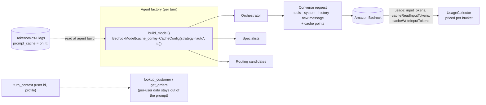

# Prompt-Cache Placement

**Pillar:** Optimization · **Flag:** `prompt_cache` · **Default:** OFF

Stop paying full price for the same tokens on every model call. An agent re-sends its system
prompt and tool definitions on every call, and with [conversation memory](conversation-memory.md)
it re-sends the whole conversation too. Prompt caching lets Amazon Bedrock read that repeated
prefix from cache at a fraction of the input price. The pattern is about **placing** the cache
correctly and **keeping the cached prefix stable**, so the cache is actually read.

This document walks through where the pattern lives in the code and how each piece is
implemented, so you can apply it to your own agent.

---

## 1. The problem

Most of an agent's input tokens are the same on every call:

- **The system prompt.** The orchestrator's prompt is the largest, most stable text in the system.
  It is identical for every customer and every turn.
- **Tool definitions.** The tool names, descriptions and JSON schemas are sent with every call.
- **Conversation history.** With memory on, every earlier turn is sent again on every new turn.

Without caching, Bedrock processes and bills all of it at the full input rate on every call. In a
multi-step agent, one customer turn makes several model calls, so the same prefix is paid for many
times per turn, then again on every turn after that.

The rates in the framework's price map (`src/shared/price_map.py`) show the size of the gap:

| Claude Sonnet 5.5 (Global cross-Region inference), per 1M input tokens | Rate | vs. normal input |
|------------------------------------------------------------------------|------|------------------|
| Normal input | $2.00 | 1× |
| Cache write (first time a prefix is seen) | $2.50 | 1.25× |
| Cache read (every later call with the same prefix) | $0.10 | 0.05× |

A prefix that is written once and read many times costs a fraction of sending it uncached. A prefix
that changes on every call is written every time and never read, which costs **more** than not
caching at all.

---

## 2. The pattern

Two parts. Both are required.

**1. Cache the stable prefix.** Build every Claude agent's model with Strands' `CacheConfig`.
Strands then adds Bedrock cache points after the stable parts of the request (tools, system prompt)
and on the conversation history. There's no hand-written cache-point code; the framework configures
what the SDK provides.

**2. Keep the prefix byte-stable.** Caching matches from the start of the prompt, byte for byte. Any
per-request value placed early in the prompt (a user name, a timestamp, a tier) breaks the match for
everything after it. So the framework:

- keeps the system prompt fully static, with no per-request data in it;
- gives per-user data (identity, profile) to the **tools** instead of the prompt;
- runs the guardrail on the **latest message only**, so it doesn't change the cached history;
- masks old tool history **deterministically** ([context management](context-management.md)), so
  the masked history is identical from one turn to the next.

### Where caching is applied, and where it is not

| Model | Cached? | Why |
|-------|---------|-----|
| Orchestrator (Sonnet 5.5) | Yes | Large static prompt + tools + growing history |
| Knowledge and Order specialists (Haiku 5.5) | Yes | Static prompt + tools, called often |
| [Model routing](model-routing.md) candidates | Yes | Built the same way as the normal model |
| Context-management summarizer | **No** | Its input is different every time, so a cache write (1.25×) would never be read |
| Model-routing judge (Nova Lite) | **No** | Same: a new step to classify on every call |

### Design rules

1. **Configure, don't hand-roll.** Caching is set when the model is built, via `CacheConfig`, not by
   a hook that edits requests.
2. **Same request, cached or not.** With the flag OFF the request is identical, just uncached. With
   it ON, only the cache points are added. Model output doesn't change, so the before/after
   benchmark compares cost only.
3. **Don't cache what is never re-read.** One-off helper calls (summarizer, judge) are built
   without caching.
4. **Price cache tokens separately.** Cache reads and writes are billed at different rates, and a
   spike in cache writes means the prefix broke. Both are tracked on their own.

---

## 3. Architecture



Per turn:

1. The factory reads the `prompt_cache` flag and builds each Claude model with or without
   `CacheConfig`.
2. Strands adds the cache points to each Bedrock request.
3. Bedrock returns cache-read and cache-write token counts with every response.
4. The cost collector prices normal input, cache reads and cache writes at their own rates.

---

## 4. Implementation

| Step | File | What it does |
|------|------|--------------|
| 4.1 | `src/shared/flags_schema.py` | the flag and its params |
| 4.2 | `src/app-plane/tokenomics/factory.py` | builds every model with `CacheConfig` |
| 4.3 | `src/app-plane/agents/orchestrator/prompts.py`, `tokenomics/turn_context.py`, `tools/` | keeps the prefix stable |
| 4.4 | `src/app-plane/tokenomics/factory.py` | leaves one-off helpers uncached |
| 4.5 | `src/app-plane/tokenomics/cost.py`, `src/shared/price_map.py` | prices cache reads and writes |
| 4.6 | `src/control-plane/lib/metrics.py` | splits cache-read and cache-write cost |

### 4.1 The flag and its params

`src/shared/flags_schema.py`:

```python
PROMPT_CACHE = "prompt_cache"

ALL_FEATURES = (PROMPT_CACHE, MEMORY, CONTEXT_MANAGEMENT, MODEL_ROUTING)


@dataclass
class PromptCacheParams:
    """Tunables for the prompt-cache placement hook.

    Attributes:
        cache_system: place a cachePoint after the (stable) system prompt.
        cache_tools: place a cachePoint after the (stable) tool schemas.
        ttl: Bedrock cache TTL. "5m" (default) or "1h".
    """

    cache_system: bool = True
    cache_tools: bool = True
    ttl: str = "5m"
```

```python
def prompt_cache_params(self) -> PromptCacheParams:
    p = self.prompt_cache.params or {}
    return PromptCacheParams(
        cache_system=bool(p.get("cache_system", True)),
        cache_tools=bool(p.get("cache_tools", True)),
        ttl=str(p.get("ttl", "5m")),
    )
```

Only `ttl` is used today. With `strategy="auto"`, Strands decides where the cache points go, so
`cache_system` and `cache_tools` are kept in the schema for future, finer control but are not read
by the model builder.

### 4.2 Build every model with `CacheConfig`

`build_model` in `src/app-plane/tokenomics/factory.py` is the **single place** Bedrock models are
built for the agents. Caching is one `if`:

```python
def build_model(
    model_id: str,
    flags: FlagConfig,
    limits: AgentLimits | None = None,
    *,
    guardrail: bool = False,
) -> BedrockModel:
    """Construct a BedrockModel with prompt caching + governance output cap applied.

    Flag ON  -> CacheConfig(strategy="auto"): SDK places cachePoints after the
                stable prefix; Bedrock reuses the cached prefix on repeat calls.
    Flag OFF -> no cache_config: baseline, uncached.
    ...
    """
    kwargs: dict = {"model_id": model_id, "region_name": config.AWS_REGION}
    if guardrail and config.SUPPORT_GUARDRAIL_ID and config.SUPPORT_GUARDRAIL_VERSION:
        kwargs.update(
            guardrail_id=config.SUPPORT_GUARDRAIL_ID,
            guardrail_version=config.SUPPORT_GUARDRAIL_VERSION,
            guardrail_latest_message=True,
            guardrail_trace="disabled",
        )
    if flags.prompt_cache.enabled:
        params = flags.prompt_cache_params()
        kwargs["cache_config"] = CacheConfig(strategy="auto", ttl=params.ttl)
    if limits and limits.output_tokens_cap():
        kwargs["max_tokens"] = limits.output_tokens_cap()
    return BedrockModel(**kwargs)
```

The module docstring records why it is done this way:

```python
"""
Design note (verified against Strands 1.54.0):
  Strands applies Bedrock prompt caching natively via BedrockModel's
  `cache_config` (modern, non-deprecated) -- it places the cachePoint blocks
  after the stable prefix (tools -> system) for us. So "prompt-cache placement"
  in V1 is implemented by BUILDING the model with `CacheConfig(strategy="auto")`
  when the flag is ON, and WITHOUT it when OFF. This honors the project's
  guiding rule ("reuse, never duplicate" -- don't hand-roll what the SDK ships).

  Consequence for the toggle tier: because caching is set at model construction,
  the flag applies when the factory next builds agents (i.e. next session/turn),
  not mid-stream within an in-flight model call. For the benchmark this is exactly
  right -- each conversation is built fresh under one pinned flag config.

  Baseline (flag OFF): no cache_config -> byte-identical requests, just uncached
  -> cacheRead/Write tokens are 0. Optimized (flag ON): cache_config -> the stable
  prefix is cached -> cacheReadInputTokens climbs on repeat calls. That is the
  clean, honest before/after signal, with no change to model output.
"""
```

Every agent model goes through `build_model`, so they all pick up caching from the one flag:

```python
# src/app-plane/agents/orchestrator/agent.py
orch_model = build_model(config.ORCHESTRATOR_MODEL, flags, orch_limits_cfg, guardrail=True)
```

```python
# src/app-plane/tokenomics/factory.py -- build_specialists
knowledge = Agent(
    model=know_router or build_model(config.KNOWLEDGE_MODEL, flags, know_limits),
    ...
)
order = Agent(
    model=order_router or build_model(config.ORDER_MODEL, flags, order_limits),
    ...
)
```

```python
# src/app-plane/tokenomics/factory.py -- build_router
capable = RoutingCandidate(build_model(capable_id, flags, limits, guardrail=guard), name="capable")
cheap = RoutingCandidate(build_model(cheap_id, flags, limits, guardrail=guard), name="cheap")
```

Note `guardrail_latest_message=True` above. The orchestrator's guardrail screens only the
newest customer message, so it doesn't re-process, or change, the cached history.

### 4.3 Keep the prefix stable

Caching only pays when the prefix is the same on the next call. Three choices in the code keep it
that way.

**A static system prompt.** `src/app-plane/agents/orchestrator/prompts.py` is a module-level
constant with no placeholders, and its docstring states the rule:

```python
"""System prompt for the Orchestrator (supervisor) agent.

This is deliberately the largest, most stable prompt in the system. It is the
shared prefix that prompt caching targets: it does not change between turns or
customers, so once cached it is reused across every request. Keep static content
here (role, routing rules, tools, style) and never interpolate per-request data
into it.
"""

ORCHESTRATOR_PROMPT = """You are the lead customer-support agent for an e-commerce store. You own the
conversation with the customer and coordinate two specialist assistants to
resolve their request. Your goal is to fully resolve the customer's issue in a
warm, concise, and accurate way.
...
```

**Per-user data goes to the tools, not the prompt.** The signed-in user's id and profile are
needed to answer questions, but putting "The customer is Bob, prime tier" in the system prompt
would make the prompt different for every user, and the cache would never be shared. Instead, the
turn stores them in a context variable at the start of the turn:

```python
# src/app-plane/agents/orchestrator/agent.py -- handle_turn
# Make the signed-in user's identity + profile available to the tools
# (lookup_customer reads the profile; get_orders reads user_id).
turn_context.set_current(ctx.user_id, ctx.profile)
```

```python
# src/app-plane/tokenomics/turn_context.py
_current: contextvars.ContextVar[dict[str, Any] | None] = contextvars.ContextVar("turn_context", default=None)


def set_current(user_id: str, profile: dict[str, Any]) -> None:
    _current.set({"user_id": user_id, "profile": profile or {}})


def user_id() -> str:
    return (_current.get() or {}).get("user_id", "")


def profile() -> dict[str, Any]:
    return (_current.get() or {}).get("profile", {})
```

The tool reads it only when the model asks for it, so the profile enters the conversation as a
tool result, *after* the cached prefix:

```python
# src/app-plane/tools/lookup_customer.py
@tool
def lookup_customer() -> str:
    """Look up the current signed-in customer's account profile.

    Use this to get the customer's name and membership tier before answering
    account or billing questions. Always refers to the authenticated user.

    Returns:
        A JSON object with the customer profile (name, email, tier).
    """
    profile = turn_context.profile()
    if not profile:
        return "No profile available for the current user."
    return json.dumps(profile, ensure_ascii=False)
```

**Deterministic history.** With memory and context management on, old tool traffic is replaced
with placeholders on every turn. The replacement is deterministic, so the masked history is
byte-identical from turn to turn and stays readable from cache. See
[context management §4.2](context-management.md#42-layer-1-observation-masking).

### 4.4 Leave one-off helpers uncached

Two helper agents are built **without** caching on purpose, because their input is new on every
call and a cache write would never be read back.

The context-management summarizer is built with all flags off:

```python
# src/app-plane/tokenomics/factory.py -- build_conversation_manager
summarizer = Agent(
    model=build_model(summarizer_model_id, FlagConfig.all_off()),
    callback_handler=None,
    hooks=list(hooks or []),
)
```

The model-routing judge builds its `BedrockModel` directly, with no `cache_config`:

```python
# src/app-plane/tokenomics/factory.py -- _build_judge_agent
judge_model = BedrockModel(
    model_id=judge_model_id,
    region_name=config.AWS_REGION,
    max_tokens=_JUDGE_MAX_OUTPUT_TOKENS,
)
```

### 4.5 Price cache reads and writes

Bedrock reports three input buckets per call: `inputTokens` (uncached input),
`cacheReadInputTokens` and `cacheWriteInputTokens`. `record_usage` in
`src/app-plane/tokenomics/cost.py` reads all three:

```python
it = int(usage.get("inputTokens", 0) or 0)
ot = int(usage.get("outputTokens", 0) or 0)
cr = int(usage.get("cacheReadInputTokens", 0) or 0)
cw = int(usage.get("cacheWriteInputTokens", 0) or 0)
self.totals.add(model_id, it, ot, cr, cw)
```

`cost_usd` in `src/shared/price_map.py` prices each bucket at its own rate:

```python
def cost_usd(
    model_id: str,
    *,
    input_tokens: int = 0,
    output_tokens: int = 0,
    cache_read_tokens: int = 0,
    cache_write_tokens: int = 0,
) -> float:
    """Dollarize a single model call from its token buckets.

    Args map 1:1 to Bedrock Converse `usage` fields:
      input_tokens        -> usage.inputTokens (non-cached input when caching on)
      output_tokens       -> usage.outputTokens
      cache_read_tokens   -> usage.cacheReadInputTokens
      cache_write_tokens  -> usage.cacheWriteInputTokens
    """
    p = price_for(model_id)
    return (
        input_tokens * p.input
        + output_tokens * p.output
        + cache_read_tokens * p.cache_read
        + cache_write_tokens * p.cache_write
    ) / 1000.0
```

The rates per model live in one table:

```python
PRICE_PER_1K: dict[str, ModelPrice] = {
    # Sonnet 5.5, Global CRIS: $2.00 / $10.00 per 1M in/out (regional is
    # $2.20 / $11.00). Cache write $2.50, cache read $0.10 per 1M (cache reads
    # were cut 50% on 2026-10-07, so they are now 0.05x input, not 0.1x).
    SONNET_5_5: ModelPrice(input=0.002, output=0.010, cache_write=0.0025, cache_read=0.0001),
    # Haiku 5.5, regional (`us.` profile): $0.11 / $0.55 per 1M in/out for prompts
    # <=100K tokens (the tier the specialists + summarizer run in); it steps up
    # to $0.55 / $2.75 above 100K. Cache write $0.1375, cache read $0.011 per 1M.
    HAIKU_5_5: ModelPrice(input=0.00011, output=0.00055, cache_write=0.0001375, cache_read=0.000011),
    # Nova Lite: $0.06 / $0.24 per 1M in/out; cache writes are free, cache read $0.015.
    NOVA_LITE: ModelPrice(input=0.00006, output=0.00024, cache_write=0.0, cache_read=0.000015),
}
```

`UsageTotals` derives the cache hit ratio from the same buckets. When caching is on, Bedrock's
`inputTokens` excludes cached tokens, so total input is the sum of all three:

```python
@property
def total_input_tokens(self) -> int:
    """Total input incl. cache (Bedrock's inputTokens excludes cached when caching is on)."""
    return self.input_tokens + self.cache_read_tokens + self.cache_write_tokens

@property
def cache_hit_ratio(self) -> float:
    """Fraction of input tokens served from cache. 0.0 when caching is off."""
    denom = self.total_input_tokens
    return (self.cache_read_tokens / denom) if denom else 0.0
```

### 4.6 Split cache-read and cache-write cost

A drop in cache reads with a jump in cache writes means the prefix broke, for example because
something per-request slipped into the prompt. `_cache_costs` in
`src/control-plane/lib/metrics.py` keeps the two apart, priced at each agent's own model, so a break
is visible instead of hidden in the total:

```python
def _cache_costs(usage: dict[str, Any]) -> tuple[float, float]:
    """(cache-read $, cache-write $) for one turn, priced per agent's model.

    Shown separately so a cache break (a cache-write spike) is visible, not
    hidden inside the total.
    """
    read = write = 0.0
    for a in (usage.get("by_agent") or {}).values():
        a = a or {}
        price = price_for(a.get("model_id", ""))
        read += int(a.get("cache_read_tokens", 0)) / 1000 * price.cache_read
        write += int(a.get("cache_write_tokens", 0)) / 1000 * price.cache_write
    return read, write
```

---

## 5. Configuration

**Turn it on** from the Feature flags page in the admin UI. The toggle in
`web/control-plane/src/pages/Flags.tsx` sends only the changed flag, keeping its current params:

```tsx
async function toggleCache(enabled: boolean) {
  if (!flags) return;
  setCtxDraft(""); // the tunable shown depends on the cache flag
  setSaving(true);
  setError(null);
  try {
    const updated = await api.putFlags({
      prompt_cache: { enabled, params: flags.prompt_cache.params },
    });
    setFlags(updated);
  } catch (e) {
    setError((e as Error).message);
  } finally {
    setSaving(false);
  }
}
```

The `setCtxDraft("")` line is there because turning caching on or off also switches the
[context management](context-management.md) strategy, so the tunable shown on that page changes.

| Setting | Where | Default | Notes |
|---------|-------|---------|-------|
| On/off | `prompt_cache.enabled` (Flags table) | OFF | applies on the next turn, no redeploy |
| Cache TTL | `prompt_cache.params.ttl` | `5m` | `5m` or `1h`; not shown in the UI |
| `cache_system`, `cache_tools` | `prompt_cache.params` | `true` | in the schema, not used with `strategy="auto"` |

**Choosing the TTL.** The cache expires if it isn't read within the TTL, and every read resets
the timer. Amazon Bedrock recommends the 5-minute cache for prompts used more often than every
5 minutes; the 1-hour cache suits conversations where the user may not reply within 5 minutes.
Check the model's supported TTLs in the Bedrock prompt caching documentation before using `1h`.

**Minimum prefix size.** Bedrock only caches a prefix above a model-specific minimum token count.
A cache point placed before the minimum is ignored and the call still succeeds, uncached. The
orchestrator's static system prompt and tool definitions are well above it.

---

## 6. Applying it to your own agent

The minimum version is one constructor argument:

```python
from strands import Agent
from strands.models import BedrockModel
from strands.models.bedrock import CacheConfig

model = BedrockModel(
    model_id="global.anthropic.claude-sonnet-5-5",
    cache_config=CacheConfig(strategy="auto", ttl="5m"),
)

SYSTEM_PROMPT = """You are a support agent for an e-commerce store.
... (static rules, style and routing guidance; no per-request data) ..."""

agent = Agent(model=model, system_prompt=SYSTEM_PROMPT, tools=[lookup_customer, get_orders])
```

Then make sure the cache is actually read:

1. **Build every model in one function** and add `CacheConfig` there, so caching can't be
   forgotten on one agent.
2. **Keep the system prompt static.** No names, dates, tiers, ids or timestamps. Put rarely-changing
   content first and anything variable last.
3. **Pass per-user data through tools** (or after the cached prefix), never in the system prompt.
4. **Don't cache one-off calls** (summarizers, classifiers). Their cache writes are never read.
5. **Keep history edits deterministic.** If you trim or mask history, produce the same bytes every
   time, and prefer rare, large edits over frequent small ones (see
   [context management](context-management.md)).
6. **Track cache reads and writes separately.** A cache-write spike is the signal that something
   broke the prefix.
7. **Check model support.** `strategy="auto"` detects Claude models from the model id; an opaque
   application inference profile ARN needs `CacheConfig(strategy="anthropic")`.
8. **Gate it behind a flag** and benchmark the same conversations with it ON and OFF.

---

## 7. References

**Code**

| File | Purpose |
|------|---------|
| `src/shared/flags_schema.py` | `prompt_cache` flag and `PromptCacheParams` |
| `src/app-plane/tokenomics/factory.py` | `build_model` (`CacheConfig`), uncached summarizer and judge |
| `src/app-plane/agents/orchestrator/prompts.py` | the static, cacheable system prompt |
| `src/app-plane/tokenomics/turn_context.py`, `src/app-plane/tools/lookup_customer.py` | per-user data via tools |
| `src/app-plane/tokenomics/cost.py` | cache token buckets and hit ratio |
| `src/shared/price_map.py` | cache read and write rates |
| `src/control-plane/lib/metrics.py` | cache read vs write cost split |
| `web/control-plane/src/pages/Flags.tsx` | the toggle |

**Further reading**

- [Prompt caching for faster model inference — Amazon Bedrock](https://docs.aws.amazon.com/bedrock/latest/userguide/prompt-caching.html)
- [Amazon Bedrock model provider — Strands Agents](https://strandsagents.com/latest/documentation/docs/user-guide/concepts/model-providers/amazon-bedrock/) (`cache_config`, `CacheConfig`)
- [Amazon Bedrock pricing](https://aws.amazon.com/bedrock/pricing/)
- [Developer Guide §3.6](../DEVELOPER_GUIDE.md#36-tokenomics-design-patterns)
